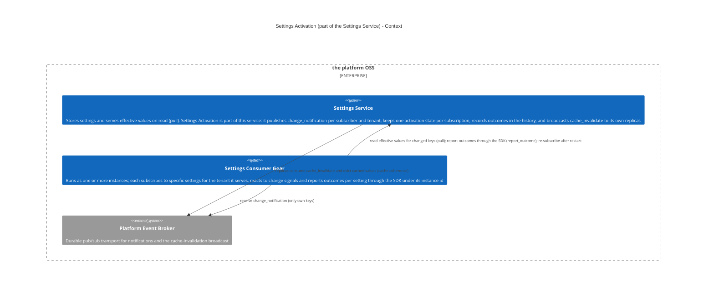
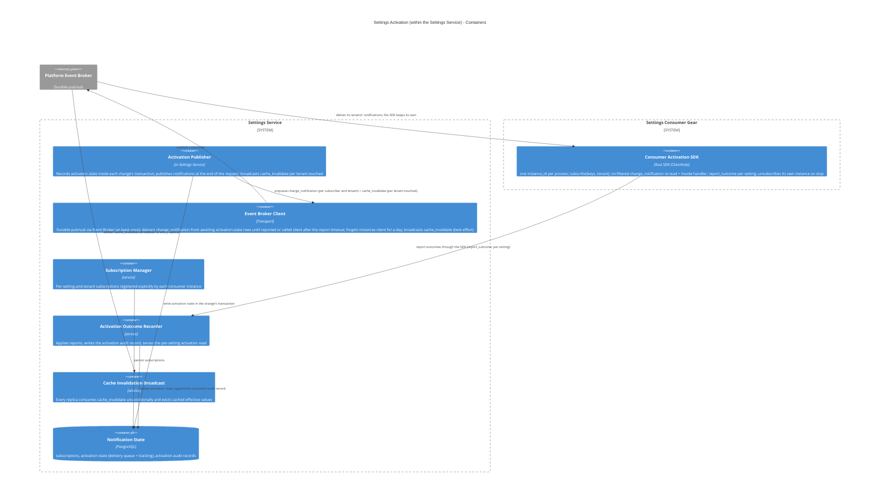
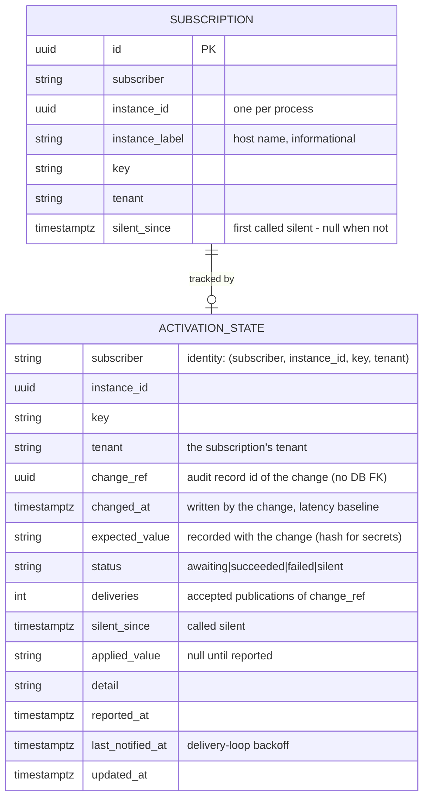
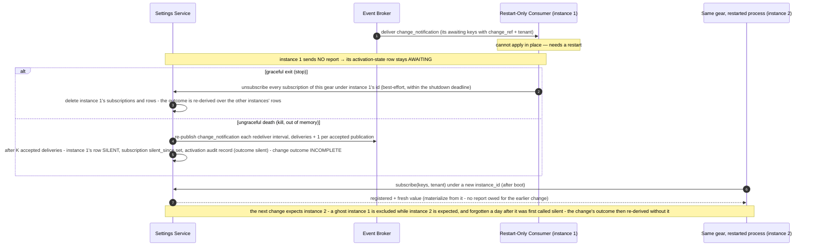
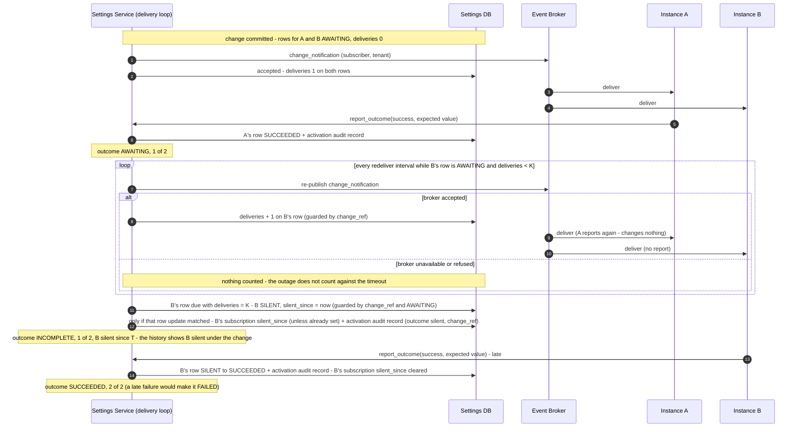

Created:  2026-07-28 by Virtuozzo International GmbH
Updated:  2026-11-09 by Virtuozzo International GmbH

# Technical Design — Settings Activation

<!-- toc -->

- [1. Architecture Overview](#1-architecture-overview)
  - [1.1 Architectural Vision](#11-architectural-vision)
  - [1.2 Architecture Drivers](#12-architecture-drivers)
  - [1.3 Architecture Layers](#13-architecture-layers)
- [2. Goals / Non-Goals](#2-goals--non-goals)
  - [2.1 Goals](#21-goals)
  - [2.2 Non-Goals](#22-non-goals)
- [3. Principles & Constraints](#3-principles--constraints)
  - [3.1 Design Principles](#31-design-principles)
  - [3.2 Constraints](#32-constraints)
- [4. Technical Architecture](#4-technical-architecture)
  - [4.1 Domain Model](#41-domain-model)
  - [4.2 Component Model](#42-component-model)
  - [4.3 API Contracts](#43-api-contracts)
  - [4.4 External Interfaces & Protocols](#44-external-interfaces--protocols)
  - [4.5 Service-to-Service Pattern](#45-service-to-service-pattern)
  - [4.6 Interactions & Sequences](#46-interactions--sequences)
  - [4.7 Database schemas & tables](#47-database-schemas--tables)
  - [4.8 Security & Authorization](#48-security--authorization)
  - [4.9 Technology Stack](#49-technology-stack)
- [5. Risks / Trade-offs](#5-risks--trade-offs)
  - [5.1 Architectural Trade-offs](#51-architectural-trade-offs)
  - [5.2 Security and Performance Risks](#52-security-and-performance-risks)
- [6. Open Questions](#6-open-questions)
  - [6.1 From PRD (Cross-Reference)](#61-from-prd-cross-reference)
  - [6.2 Design-Specific Questions](#62-design-specific-questions)
- [7. Additional context](#7-additional-context)
  - [Feature Metrics](#feature-metrics)
  - [NFR Mapping](#nfr-mapping)
  - [Testing Architecture](#testing-architecture)
- [8. Traceability](#8-traceability)

<!-- /toc -->

<!--
=============================================================================
TECHNICAL DESIGN DOCUMENT
=============================================================================
PURPOSE: Define HOW the system is built — architecture, components, APIs,
data models, and technical decisions that realize the requirements.

DESIGN IS PRIMARY: DESIGN defines the "what" (architecture and behavior).
ADRs record the "why" (rationale and trade-offs) for selected design
decisions; ADRs are not a parallel spec, it's a traceability artifact.

SCOPE:
  ✓ Architecture overview and vision
  ✓ Design principles and constraints
  ✓ Component model and interactions
  ✓ API contracts and interfaces
  ✓ Data models and database schemas
  ✓ Technology stack choices

NOT IN THIS DOCUMENT (see other templates):
  ✗ Requirements → PRD.md
  ✗ Storage, resolution and the value commit → DESIGN.md
  ✗ Detailed rationale for decisions → ADR/

STANDARDS ALIGNMENT:
  - IEEE 1016-2009 (Software Design Description)
  - IEEE 42010 (Architecture Description — viewpoints, views, concerns)
  - ISO/IEC 15288 / 12207 (Architecture & Design Definition processes)

DESIGN LANGUAGE:
  - Be specific and clear; no fluff, bloat, or emoji
  - Reference PRD requirements using `cpt-cf-settings-service-fr-{slug}`,
    `cpt-cf-settings-service-nfr-{slug}` IDs
  - Cross-document references name the target file, e.g. "DESIGN.md §4.2"
=============================================================================
-->

- [ ] `p1` - **ID**: `cpt-cf-settings-service-design-settings-activation`

## 1. Architecture Overview

### 1.1 Architectural Vision

Design **Settings Activation** — the part of the **Settings Service** that provides **guaranteed, acknowledged delivery** of settings-change notifications. It tells a settings consumer **which settings changed**, so the consumer can re-read the new values and apply them its own way, and it **keeps each consumer instance's activation state per subscription (one row per subscriber, instance, key and tenant)** until every expected instance has confirmed the current value or the report timeout has closed the change as `incomplete`, naming the instances that stayed silent ([ADR-004](./ADR/ADR-004-per-instance-acknowledgement-bounded-wait.md)). It builds on the [Settings Service](./DESIGN.md) value store, which serves values **on read** (pull): that path assumes a consumer reads a value **when it needs it**. This design adds the **push** signal with **back-response tracking**, so a consumer that has already materialized values at startup (connection pools, listener sockets, rendered config files) learns exactly which changed and can confirm successful activation back to the service. Settings Activation is **not a separate component** — the Settings Service owns it.

The service also keeps its own **cache coherence** from the same request: replicas evict cached effective values. This is a **separate, internal broadcast** (§4.2 *Cache Invalidation Broadcast*) — not the consumer signal — so the two concerns (consumer activation vs. replica invalidation) do not leak into each other.

#### Two distinct distributions

A committed change drives **two independent kinds of distribution**, with deliberately different delivery and trust models:

| | **Consumer activation** (§4.2 *Activation Publisher*, §4.2 *Consumer Activation SDK*) | **Replica cache invalidation** (§4.2 *Cache Invalidation Broadcast*) |
|---|---|---|
| **Who receives** | Services that **subscribed** to the specific settings — only they know which settings need active re-application beyond a plain pull | **Every** Settings Service replica (the service's own instances) |
| **Subscription** | Per setting and tenant, per consumer instance, opt-in (§4.2 *Subscription Manager*) | **None** — always sent, always processed |
| **Payload** | Filtered to **only the subscriber's own subscribed keys** | The full changed-key set (trusted, internal) |
| **Acknowledged** | Yes — per activation-state row (subscriber, instance, key, tenant); the wait is bounded by the report timeout, counted in accepted deliveries, after which the change closes `incomplete` (§4.2 *Event Broker Client*, §4.2 *Activation Outcome Recorder*) | No — fire-and-forget eviction |
| **Event** | `change_notification` (`gts.cf.core.events.event.v1~cf.core.settings.change_notification.v1~`, activation topic; per subscriber and tenant) | `cache_invalidate` (`gts.cf.core.events.event.v1~cf.core.settings.cache_invalidate.v1~`, cache topic; broadcast) |

Splitting them is **least-privilege / blast-radius reduction** (§4.8): a consumer's handler is given only the keys it subscribed to (the SDK drops what the broker delivers for other subscribers of its tenants, §4.8), not the full "everything that changed, in every tenant" set — which stays inside the trusted replica set. Under the **trusted-caller** model (DESIGN.md §6) the subscriber identity is taken on trust, so this is a best-effort default, **not** an identity-enforced access control; revisit if consumers are ever untrusted.

#### Why a distinct design

Reading a value and being told a value changed are different concerns with different owners, so they are documented separately — even though both live inside the Settings Service:

- The **Settings Service** owns the value and answers reads (pull) — [DESIGN-settings-service](./DESIGN.md).
- The **owning consumer** owns *how* to react to a change — re-read a variable, rebuild a pool, drain and rebind, restart itself. That knowledge lives in the consumer, not in a central orchestrator, and a static per-setting effect enum cannot express it.

This design owns the **signal** and the **reaction contract**. It does not own value storage, resolution, or validation.

### 1.2 Architecture Drivers

#### Functional Drivers

| Requirement | Design Response |
|-------------|-----------------|
| `cpt-cf-settings-service-fr-consumer-activation` | **The requirement this document exists to serve.** Every consumer instance — one process of a consuming gear, identified by the `instance_id` its SDK generates — registers interest per `key` and tenant for itself (§4.1 `Subscription`); the Activation Publisher emits a **per-subscriber-and-tenant filtered** `change_notification` carrying only the keys that subscriber watches, and only ones it is entitled to read; the payload carries **identifiers only, never a value**, so the signal stream cannot disclose `secret`- or PII-classified content — the consumer re-reads through its ordinary authorization. Confirmation is the back-response of each instance; the account per change is kept per instance in `activation_state` (§4.1 `ActivationState`) and in the setting's history, where each instance's report, and each call of silence, is recorded under the change it answers (§4.2 *Activation Outcome Recorder*), and the state of the current value — the change outcome derived over the instances' rows, "N of M" with the per-instance list — is read through the per-setting activation read (§4.3). Activation state is written in the change's transaction and delivered from the durable `activation_state` rows until every expected instance reported or the report timeout — counted in deliveries the broker accepted, so a broker outage does not count — called the rest silent and closed the change `incomplete` (§4.2 *Event Broker Client*); a silent instance is excluded from later changes while a sibling is expected, re-enters by any report or registration, and is forgotten a day after it was first called silent ([ADR-004](./ADR/ADR-004-per-instance-acknowledgement-bounded-wait.md)). Idempotent per `(subscriber, instance, key, tenant, change_ref)`. |
| `cpt-cf-settings-service-fr-replica-coherence` | The `cache_invalidate` broadcast (§4.2 *Cache Invalidation Broadcast*) converges the **other** replicas — the writing replica evicts inside the write itself. Published inline and best-effort; a missed broadcast is bounded by the reader's `cache_ttl_seconds` backstop, which is what makes the staleness window bounded rather than open-ended. For a `cascading` setting the eviction covers the descendant scopes the change altered. |
| `cpt-cf-settings-service-fr-live-read-activation` | Two-signal split: a per-subscriber-and-tenant filtered `change_notification` for consumer activation and an unfiltered `cache_invalidate` broadcast for replica cache coherence; consumers re-read and self-react |
| `cpt-cf-settings-service-nfr-efficiency-live-read` | Activation never reloads or restarts a consumer; a heavier reaction is the consumer's own, performed in its handler on the signal |
| `cpt-cf-settings-service-nfr-reliability-validated-set` | An invalid or stale write stores nothing, so no activation state is written for it |
| `cpt-cf-settings-service-nfr-performance-read-cache` | `cache_invalidate` is published inline and best-effort; a missed broadcast self-heals inside `cache_ttl_seconds`, so coherence never depends on durable delivery |
| `cpt-cf-settings-service-nfr-ops-set-monitoring` | Per-administrator failure surfaces through the back-response and `event_value_change_failed`; the aggregate operator signal stays with DESIGN.md |

#### NFR Allocation

| NFR ID | NFR Summary | Allocated To | Design Response | Verification Approach |
|--------|-------------|--------------|-----------------|----------------------|
| `cpt-cf-settings-service-fr-consumer-activation` | No consumer activation is lost; the wait is bounded | Activation Publisher + activation state + delivery loop | The key's mutation lock + activation state written in the change's transaction + deliver until every expected instance reported or the report timeout called it silent; idempotent per `(subscriber, instance, key, tenant, change_ref)`; the timeout counts accepted deliveries only | Integration redelivery, report-timeout and broker-outage tests |
| `cpt-cf-settings-service-nfr-performance-read-cache` | Replica staleness is bounded | Cache Invalidation Broadcast | Inline best-effort broadcast plus the `cache_ttl_seconds` backstop owned by the cache components in DESIGN.md | Timed multi-replica convergence test |
| `cpt-cf-settings-service-nfr-security-baseline` | No secret leaves in the signal stream | Event payloads | Notification events carry identifiers only; back-responses carry a hash for secret-valued settings | Subscribed-observer test asserting no plaintext |

### 1.3 Architecture Layers

```
┌─────────────────────────────────────────────────────────────┐
│   Consumers (gears subscribing to the settings they read)   │
├─────────────────────────────────────────────────────────────┤
│  Consumer Activation SDK │ subscribe · handler · ack        │
├─────────────────────────────────────────────────────────────┤
│  Settings Activation (inside the settings-service gear)     │
│  ┌──────────────────────────────────────────────────────┐   │
│  │ Activation Publisher · Subscription Manager ·        │   │
│  │ Activation Outcome Recorder ·                        │   │
│  │ Cache Invalidation Broadcast                         │   │
│  └──────────────────────────────────────────────────────┘   │
├─────────────────────────────────────────────────────────────┤
│  Transport │ Event Broker (at-least-once, repeat-safe)      │
├─────────────────────────────────────────────────────────────┤
│  Storage   │ PostgreSQL (activation state, subscriptions)   │
└─────────────────────────────────────────────────────────────┘
```

| Layer | Responsibility | Technology |
|-------|---------------|------------|
| Consumer SDK | Subscribe to exact setting keys for a tenant, receive the change signal, report the applied outcome | Rust trait in `settings-service-sdk` |
| Activation | Publish the two signals, keep one activation state per subscription of a consumer instance, call silent instances after the report timeout, record outcomes in the history | In-process Rust modules in the `settings-service` gear |
| Transport | At-least-once event delivery; a repeated notification is re-applied and re-acknowledged | Event Broker |
| Storage | Durable activation state and the subscription registry | PostgreSQL via `toolkit-db` |

#### Context View



#### Container View



## 2. Goals / Non-Goals

### 2.1 Goals

- **Consumer notification (filtered)** — `change_notification { tenant, subscriber, changes: [{key, change_ref}] }`, delivered **per subscriber and tenant**, carrying **only the subscribed keys at that tenant whose activation is due awaiting**, each with the `change_ref` of the change that set what the subscriber is expected to apply (never the full request). Normally one message per request per subscriber and tenant (more only over the broker's event size limit), so a consumer batch-reacts without re-subscribing or polling. `tenant` is always present — the root tenant's id at platform scope (DESIGN.md §4.7). Keys are the settings' GTS **type** ids — referenceable by construction, each registered when its declaration was created (DESIGN.md §4.7). No `change_kind` — consumers re-read anyway.
- **Replica cache invalidation (broadcast)** — `cache_invalidate { change_set_id, tenant, changed_keys: [key] }`, published once per request and tenant it touched to **all** Settings Service replicas (no subscription, no ack), carrying that tenant's full changed-key set so every replica evicts every cached scope of each named key (§4.2 *Cache Invalidation Broadcast*).
- **One expectation per subscription, one subscription per instance** — the latest change to a key at a tenant sets what each expected instance of each subscriber is expected to apply; a newer change replaces it. A gear running one process is the one-instance case ([ADR-004](./ADR/ADR-004-per-instance-acknowledgement-bounded-wait.md)).
- **Bounded wait** — a change is `succeeded` for a subscriber only when every expected instance confirmed it, `failed` as soon as one reports a failure, and closed `incomplete`, naming the silent instances, once the report timeout has passed with confirmations outstanding; the timeout is counted in deliveries the broker accepted, so a broker outage does not count against it (§4.2 *Event Broker Client*).
- **Per-setting subscription** — a consumer subscribes, in its own name, to the **specific setting keys** it must actively activate (not merely pull). Subscription implies **acknowledged delivery** for those keys (§4.2 *Subscription Manager*).
- **Back-response contract** — consumers report `success` (or `failed` with a `detail`) through the SDK call `report_outcome(change_ref, …)` **per changed setting** after reacting, echoing the `tenant` and **the value they applied (a hash for secret-valued settings)**, under the reporting process's `instance_id`, so the Settings Service tracks activation **per activation-state row, one per instance** and verifies the applied value against the expected value **recorded when the change committed** (§4.2 *Activation Publisher*). A `success` carrying a value that does **not** match is a **failure** when it answers the current change (§4.2 *Activation Outcome Recorder*).
- **Activation account per change** — the history of a setting at a tenant shows each instance's report for each change, and each instance the report timeout called silent for it (§4.2 *Activation Outcome Recorder*), and the activation read shows the state of the current value per subscriber: its change outcome, "N of M" expected instances confirmed, the per-instance list, and the silent instances the change did not expect (§4.3).
- **Consumer re-read-and-react** obligation: on a `change_notification` the consumer re-reads the affected keys and applies them. A restart-only consumer materializes the current value from the fresh read its restarted process makes at `subscribe`; the account of the change it restarted for is kept by its other instances, and its own previous process's row is deleted by the SDK's unsubscribe at a graceful stop or called silent after the report timeout (§4.6 *Activation via consumer restart*).
- **Event Broker transport only** — durable pub/sub via the platform event broker. At-least-once delivery; the consumer's reaction is idempotent, so a repeated notification is re-applied and re-acknowledged.

### 2.2 Non-Goals

- **Setting storage, effective-value resolution, validation, and the value commit** — owned by the [Settings Service](./DESIGN.md) write path. Settings Activation is triggered *by* each committed change, and does not duplicate it.
- **Carrying the value in a notification** — neither **notification** event (`change_notification` / `cache_invalidate`) contains the value or a secret (§4.1); consumers re-read. (Back-responses **do** echo the applied value — a hash for secrets — §4.1/§4.4.)
- **Exactly-once delivery** — the model tolerates at-least-once (Event Broker durability): on every notification the consumer re-reads the effective value and converges to it, so a repeat is **re-applied and re-acknowledged**, never suppressed (§4.2 *Consumer Activation SDK*). No global ordering guarantee across requests.
- **Central execution of heavier reactions — not in the model.** Activation never centrally reloads/restarts a consumer, nor classifies a per-setting "effect." Heavier reactions (rebuild a pool, re-render a config file, restart) are the consumer's **own**, done in its handler on the signal — a consumer that cannot apply in place restarts itself (exit → supervisor restarts it → reads the current value on boot, §4.6). See §4.2 *Heavier consumer reactions*. (Coordinated **rolling** restart across replicas is a deployment/rollout concern — RMS — not activation.)
- **Discarding or failing an activation on a timeout** — the report timeout closes an unfinished change as `incomplete`, naming the silent instances; it never deletes the account and never counts silence as a failure, and a late report is still accounted (§3.2 *Unbounded wait, no deadline (superseded by ADR-004)*). Nor is the timeout a wall-clock deadline: it counts deliveries the broker accepted (§4.2 *Event Broker Client*).
- **Signalling hierarchy changes** — a re-parent or a tenant inserted mid-chain changes a `cascading` effective value with no value change, and is not signalled to subscribers; the pull path and the cache TTL cover it (§5.2).
- **Namespace/prefix subscriptions** — not supported. Subscription (and the consumer-facing `subscribe`, §4.5 *In-Process SDK — Consumer Activation*) is per **exact** setting key (§4.2 *Subscription Manager*), never a namespace prefix or category.

## 3. Principles & Constraints

### 3.1 Design Principles

#### Notify and React, Never Centrally Execute

- [ ] `p1` - **ID**: `cpt-cf-settings-service-principle-notify-not-execute`

Activation signals *which* keys changed; it never performs a consumer's reaction. A consumer that must rebuild a pool, re-render a config file, or restart does so itself in its own handler. There is no central per-setting effect and no orchestrator.

#### Two Signals, Two Audiences

- [ ] `p1` - **ID**: `cpt-cf-settings-service-principle-two-signal-split`

Consumer activation and replica cache coherence are separate concerns with different delivery requirements, so they are separate events: `change_notification` is per subscriber and tenant, filtered, and acknowledged; `cache_invalidate` is an unfiltered broadcast to the service's own trusted replicas with no subscription and no ack.

#### Identifiers in Notifications, Values Only in Back-Responses

- [ ] `p1` - **ID**: `cpt-cf-settings-service-principle-identifiers-only`

Neither notification event carries a settings value or a secret — consumers re-read under their own identity ([ADR-003](./ADR/ADR-003-thin-event-pull-report-activation.md)). The back-responses are the deliberate exception: they echo the value the consumer applied, hashed when the setting is secret-valued, so the service can verify what was activated.

#### Verify Against the Snapshot, Not a Recomputation

- [ ] `p1` - **ID**: `cpt-cf-settings-service-principle-snapshot-verification`

A report is compared with the expected value recorded in the activation-state row when the change committed, never with a value recomputed at receive. A later change replaces the expectation, and a report counts as success only when the value it applied is the expectation in force.

#### The Wait Is Unbounded and Admin-Driven (superseded by ADR-004)

- [ ] `p1` - **ID**: `cpt-cf-settings-service-principle-unbounded-wait`

**Superseded by [ADR-004](./ADR/ADR-004-per-instance-acknowledgement-bounded-wait.md): the wait is bounded, the account is per instance.** The heading and the id are kept because other documents cite them; the rule below replaces the earlier one.

A gear runs as one or more consumer instances, and the activation account is kept per instance: every instance registers its own subscription and reports for itself, so a confirmation from one instance says nothing about another. A change is `succeeded` for a subscriber at a tenant only when every expected instance confirmed it, and `failed` as soon as any instance reports a failure, whatever the others did. The wait is bounded by the report timeout (`activation_report_timeout_seconds`, §4.2 *Event Broker Client*), counted in deliveries the broker accepted rather than in wall time, so a broker outage never makes every instance look silent; an instance still outstanding when it passes is called **silent** and the change closes `incomplete`, naming it. Silence is not a failure and not the end of the account: a late report is still accounted and can complete the change. A silent instance is not expected for later changes while a sibling instance of its subscriber at that tenant is, re-enters by any report it makes for the key or by registering again, and is forgotten a day after it was first called silent. The liveness signal is the re-publication the delivery loop already performs — no heartbeat, no lease. A clean unsubscribe deletes the instance's rows, and a graceful stop unsubscribes every subscription of this gear's identity under the process's `instance_id` (§4.2 *Consumer Activation SDK*); a purge of the declaration deletes every subscription of the key (DESIGN.md §4.2 *Declaration Management*). An instance that leaves the gear this way, or by being forgotten, leaves the state of the current value too: its outcome, N and M are re-derived from the instances still registered, while the history keeps every report and every call of silence (§4.1 `ChangeOutcome`).

### 3.2 Constraints

#### Delivered as part of the Settings Service Gear

- [ ] `p1` - **ID**: `cpt-cf-settings-service-constraint-activation-in-settings-gear`

Settings Activation is a mechanism **inside** the Settings Service; the publisher and state tables ship in the Settings Service Constructor Fabric Gear (ToolKit runtime); consumers reach the subscription contract through the settings SDK registered in `ClientHub`. The settings database is reached through session pooling or a direct connection: a transaction-pooling proxy voids the key mutation lock and the scan lock (§4.2 *Event Broker Client*, *Why only one replica scans at a time*).

#### Event Broker transport only

- [ ] `p1` - **ID**: `cpt-cf-settings-service-constraint-activation-broker-only`

The signals travel over the platform Event Broker, which is a soft dependency: without it writes commit, activation-state rows stay `awaiting` and the publishing part of the delivery loop idles until the broker resolves — no publication is accepted meanwhile, so the outage does not count against the report timeout (§4.2 *Event Broker Client*), while the loop's forgetting and orphan sweep run on every tick all the same — while `cache_ttl_seconds` bounds replica staleness (DESIGN.md §4.9 *The Event Broker as a soft dependency*). Outcomes do not travel over the broker (§4.5).

#### Two signals per request

- [ ] `p1` - **ID**: `cpt-cf-settings-service-constraint-activation-two-events-per-change-set`

Each request that changed values or declarations emits, at its end, (1) one `cache_invalidate` broadcast to all replicas for each tenant it touched (published inline, best-effort, cache-TTL backstop) and (2) one filtered `change_notification` per subscriber and tenant with due `awaiting` keys (§4.2 *Activation Publisher*), re-delivered from the durable activation-state rows until every expected instance reported or the report timeout called the rest silent. Both follow the commits they describe (§4.2 *Activation Publisher*).

#### Consumer notification is filtered

- [ ] `p1` - **ID**: `cpt-cf-settings-service-constraint-activation-filtered-notification`

A `change_notification` is built for one subscriber and carries **only its subscribed keys whose value changed** — never the full request. A subscription names the tenant it is for, and the subscriber is notified only when the effective value at that tenant changed (§4.2 *Activation Publisher*). This is **best-effort least-privilege, not isolation** (§4.8): every process with an interest in a tenant also receives the notifications built for that tenant's other subscribers, and the SDK drops them.

#### Tenant in payload

- [ ] `p1` - **ID**: `cpt-cf-settings-service-constraint-activation-tenant-in-payload`

Both events include a `tenant`: for `change_notification` the subscription's tenant, whose effective value changed and which the consumer re-reads; for `cache_invalidate` the tenant the change applies to, so replicas evict the right scope. It is **always present**: platform scope is the **root tenant's id**, an ordinary tenant id, not an absent one (DESIGN.md §4.7).

#### No settings value in a notification payload

- [ ] `p1` - **ID**: `cpt-cf-settings-service-constraint-activation-identifiers-only-payload`

The two **notification** events (`change_notification`, `cache_invalidate`) carry **identifiers only** (keys, `change_ref`, `tenant`) — no settings value, no secret; the tenant-scoped effective value resolves correctly on re-read. The **back-responses** (the SDK `report_outcome` call) are the deliberate exception: they carry the **applied value** — plaintext for a non-secret setting, a **hash** for a secret value (the secret plaintext never enters the stream); see §4.8, §4.1/§4.4 (ADR-003, `cpt-cf-settings-service-adr-thin-event-pull-report-activation`).

#### Consumers read effective values on demand, respond with outcomes

- [ ] `p1` - **ID**: `cpt-cf-settings-service-constraint-activation-pull-plus-back-response`

The pull path (`SettingsReaderClient`, DESIGN.md §4.5) is the source of truth; this system signals *which* of a subscriber's keys changed and tracks *what* happened via back-responses (the SDK `report_outcome` call, per setting, carrying the applied value or a secret hash).

#### Unbounded wait, no deadline (superseded by ADR-004)

- [ ] `p1` - **ID**: `cpt-cf-settings-service-constraint-activation-wait-for-all-unbounded`

**Superseded by [ADR-004](./ADR/ADR-004-per-instance-acknowledgement-bounded-wait.md): the wait is bounded, silent instances are named, never discarded.** The heading and the id are kept because other documents cite them; the rule below replaces the earlier one.

An activation-state row stays **awaiting** until its instance reports, a later change replaces it, or the report timeout calls it **silent**: after `K = ceil(activation_report_timeout_seconds / redeliver_interval_seconds)` publications of its current `change_ref` that the broker accepted (§4.2 *Event Broker Client*). Time during which the service cannot deliver does not count, because no publication is accepted then. A silent row is not re-published until a re-entry of its instance re-arms it (§4.2 *Activation Outcome Recorder*, *Re-entry re-arms*), and is not discarded: it stays in the account, the change outcome reads `incomplete` and lists it, the call of silence is recorded in the setting's history, and a late report from its instance still moves it to `succeeded` or `failed` (§4.2 *Activation Outcome Recorder*). Nothing is ever counted as failed on silence, and no row is deleted on a timer: the only timed removal is the forgetting of a subscription silent for a day (`SILENT_FORGET_SECONDS`, §4.2 *Event Broker Client*), which deletes the instance's registration and its rows. Forgetting alters no recorded account — the history keeps every report and every call of silence — and the state of the current value is re-derived from the instances still registered. The administrator sees `awaiting`, `silent`, `succeeded` and `failed` instances in the activation read (§4.3) and each report and call of silence in the setting's history (§4.2 *Activation Outcome Recorder*).

## 4. Technical Architecture

### 4.1 Domain Model

#### Entity: `ChangeNotification` (per-subscriber consumer event body)

| Field | Type | Required | Description |
|-------|------|----------|-------------|
| `tenant` | string | Yes | The subscription's tenant, whose effective value changed, as its tenant id — a bare lowercase UUID string; the **root tenant's id** for the platform-wide value (DESIGN.md §4.7). The envelope `tenant_id` names the same tenant. The consumer re-reads for this tenant. |
| `subscriber` | string | Yes | The subscriber the notification is for — the gear, not one of its instances: every instance of the subscriber with an interest at `tenant` receives the one notification. The broker delivers by topic, type and tenant only, so the SDK drops a notification whose `subscriber` is not its own (§4.2 *Event Broker Client*, *Broker topology*). |
| `changes` | `[{key, change_ref}]` | Yes | **Only the subscribed keys at `tenant` for which at least one instance of this subscriber has a due `awaiting` activation-state row** — one whose `last_notified_at` is unset or at least `redeliver_interval_seconds` old — exactly for the end-of-request publish, with the delivery loop's tolerance of a tenth of the interval for its ticks (§4.2 *Event Broker Client*, `redeliver_interval_seconds`) — (GTS type ids; no operation type) — never the full request. Each key carries the `change_ref` of the change that set the current expectation: the id of that change's audit record (DESIGN.md §4.7 `audit_records.id`), which correlates the signal with its cause and with the report that answers it. One notification per subscriber and tenant at the end of a request, so keys changed together arrive together. Consumer already re-reads; operation type is not needed. |

**Invariant:** the payload never contains values or secrets, and never keys the subscriber did not subscribe to. A consumer that needs values re-reads them via `SettingsReaderClient` (DESIGN.md §4.5), which resolves effective values for the given `tenant`.

#### Entity: `CacheInvalidation` (internal broadcast event body, defined in the gear)

| Field | Type | Required | Description |
|-------|------|----------|-------------|
| `change_set_id` | UUID | Yes | The correlation id of the request — a `set`, or a declaration retire, reactivate, evolve or reclassification — that changed the values, or the id a reconcile pass of contributed declarations mints once per pass; audit records carry it for `set`/batch requests (DESIGN.md §4.7); activation does not group by it. |
| `tenant` | string | Yes | The tenant this broadcast covers, as a bare lowercase UUID string — one broadcast per tenant the request touched; the **root tenant's id** for a platform-wide change (DESIGN.md §4.7). Replicas evict every cached scope of each named key (§4.2 *Cache Invalidation Broadcast*). |
| `changed_keys` | `[key]` | Yes | The **full** set of the request's changed keys at that tenant. Sent only to the trusted Settings Service replica set (§4.2 *Cache Invalidation Broadcast*) — never to external consumers. |

**Invariant:** carries identifiers only (no values/secrets). Consumed unconditionally by every replica; there is no subscription and no acknowledgement.

#### Entity: `BackResponse` (consumer-emitted responses)

> The Recorder's boundary type carries `change_ref`, `tenant` and `status` as strings and validates them (the typed forms are the SDK's); `subscriber` is taken from the security context — the subject id of the caller, never a namespace or module name — never from the payload, and a call whose subject is of an interactive subject type is refused, since a subscriber is a gear's service principal, not a person (the identity is still trusted-caller, not verified, DESIGN.md §6); `instance_id` is taken from the call, which the SDK client fills with its own process's id — trusted within the subscriber's identity, not verified (§4.8).

| Field | Type | Required | Description |
|-------|------|----------|-------------|
| `change_ref` | UUID | Yes | The change this response answers — the `change_ref` the notification carried for `key`. |
| `subscriber` | string | Yes | Consumer identity that reacted: the subject id of the caller's security context as text, never a namespace or module name. |
| `instance_id` | UUID | Yes | The consumer instance that reacted — the process-wide id its SDK generated (§4.1 `Subscription`). Carried implicitly: `report_outcome` takes no instance argument, the SDK client sets its own (§4.5). |
| `key` | string | Yes | The changed setting (GTS type id) this response answers. Together with `subscriber`, `instance_id` and `tenant` it identifies the **activation-state row**; an instance emits one response per changed setting it is subscribed to. |
| `tenant` | string | Yes | The tenant the consumer applied the change for, echoed from the notification — a bare lowercase UUID string. Lets the system verify against the tenant-scoped effective value. |
| `status` | `ResponseStatus` | Yes | `success` / `failed`. |
| `applied_value` | string | Conditional | **Required when `status = success`**; absent when `status = failed`. The value the consumer applied for `key` at `tenant` — the **plaintext value** for non-secret settings, or a **hash** for secret-valued settings (plaintext never leaves the consumer). The Settings Service verifies it against the row's `expected_value`, **recorded when the change committed** (§4.2 *Activation Publisher*; comparing hashes for secrets); a value that does **not** match makes the row **failed** even when `status = success` if the response names the row's `change_ref`, and is ignored as stale if it names an earlier one; a `success` that omits it cannot be verified at all and is treated as a value that does not match (§4.2 *Activation Outcome Recorder*). |
| `detail` | string | No | Failure detail when `status = failed` (e.g., which specific reason the setting failed to apply); at most 1 KiB, longer input truncated; the SDK documents it as free of values and secrets. |

**Verification is tenant-scoped:** the system verifies a report against the `expected_value` of the activation-state row `(subscriber, instance_id, key, tenant)`, **recorded when the change committed** (§4.2 *Activation Publisher*) — the tenant-scoped effective value captured for the reported `tenant`, not a single global value, and **not** a value recomputed at receive. For secret-valued settings the consumer returns a **hash** of the applied value rather than the plaintext, and the system compares hashes. How a match, a mismatch and a `failed` status resolve the row is §4.2 *Activation Outcome Recorder*; the time the report was received is the row's `reported_at`.

**Canonical value encoding (normative).** A settings value is typed JSON — scalar or structured (DESIGN.md §4.1: `value` is `JSONB`, validated against JSON Schema 2020-12) — so comparing two independently produced serializations as raw text is **not** sound: member order, whitespace, number formatting and Unicode escaping all differ without the value differing, and the two sides are serialized by different code (the service writes `expected_value` when the change commits, the SDK builds `applied_value` at the consumer). `expected_value` and `applied_value` therefore carry the value canonicalized per **RFC 8785 (JSON Canonicalization Scheme)**, and are compared byte-for-byte in that form. For secret-valued settings the value is hashed rather than carried, over that same canonical form (**Secret-value hash** below). A payload that is not valid canonical JSON is treated as a value that does not match (§4.2 *Activation Outcome Recorder*). Because both sides must produce identical bytes for the same value, agreement between the service-side and SDK-side canonicalizers is a **conformance requirement**, not an implementation detail (§7 *Testing Architecture*).

**The encoding has a narrower number domain than the value store, and the store must respect it.** RFC 8785 serializes a number by parsing it into an IEEE-754 binary64 and printing the shortest decimal that reads back as the same double, whereas `JSONB` keeps numbers as exact arbitrary-precision `numeric` and JSON Schema 2020-12 bounds neither magnitude nor precision. Numbers the double cannot distinguish — an integer beyond ±2^53, or a decimal carrying more precision than binary64 resolves — therefore lose information **at the parse, before any byte is written**, with two consequences: two implementations that handle the excess differently produce different bytes and fail every acknowledgement for that setting, and two distinct stored values that collapse to one double compare equal, so the verification stops verifying. Values are consequently **constrained to the domain the encoding carries losslessly**, enforced on write by the Type Validator (DESIGN.md §4.2) — a number MUST survive a round trip through binary64 unchanged in value. Canonicalization here **never silently normalizes** an out-of-domain number; such a value is rejected before it is ever stored. A setting that genuinely needs more range or precision — a 128-bit identifier, a nanosecond timestamp — models it as a **string** in its GTS type, which the encoding carries verbatim.

**Secret-value hash (normative).** For a `secret`-trait setting the consumer returns a hash in place of the plaintext, and the service records the same hash as `expected_value`. The hash is **SHA-256** over the canonical encoding above of the array `["cf.settings.activation.secret.v1", key, tenant, value]`, rendered as **lowercase hex**. `tenant` is the activation-state row's tenant — the subscription's tenant, the root tenant's id when the subscription is for the platform-wide value (DESIGN.md §4.7) — written as a bare lowercase UUID string, the form `data.tenant` and the report's `tenant` carry. The service hashes plaintext it holds: for a `set`, the plaintext the write carries, or for a batch `set` adopting a staged secret the staged plaintext the Secret Manager fetches once per change under the key's mutation lock; for a `revert` or `remove_value` whose result at the subscription's tenant is an inherited secret, the fallback plaintext the Secret Manager fetches once per change, under the key's mutation lock, before the transaction opens (§4.2 *The expected value of a secret*). Framing the input as a canonical JSON array rather than a concatenation avoids inventing separator and escaping rules for `key`. The salt is `(key, tenant)` and **nothing else**: both are fixed for an activation-state row, so a value hashes equal across the changes that replace one another on that row and a report about an earlier change still matches the current expectation (§4.2 *Activation Outcome Recorder*) — a salt that varied per change would break that. What this hash does and does not protect against is §6.2 *Keyed secret hash*.

**File-reference values (normative).** A `file-reference`-trait value (DESIGN.md §3 *Files*) is an ordinary structured value here: it carries the reference, never the file, so it canonicalizes and compares exactly like any other object — no hash, no new field, no protocol change. It needs none, because the reference is **always pinned to a version** and `file-storage` guarantees a version's content is immutable: two identical references therefore stand for identical bytes, and the `expected_value` recorded for a change stays true for as long as it is the row's expectation. There is no unpinned form to weaken this — a reference naming only the file would resolve through a pointer that an ordinary `bind` swaps, and acknowledgements on it would compare equal while subscribers held different bytes. Because the shape is uniform, activation needs no file-specific registration rule: any file-valued setting is trackable exactly like a scalar one.

The per-version content hash `file-storage` publishes is deliberately **not** carried in the value. It would require every subscriber to download and digest the content merely to answer — stronger than this protocol asks of any other value, where an acknowledgement attests to the value received, not to what the consumer did with it. It is also a weaker identity than the version id it would replace: `hash_mode` is `whole-sha256` **or** `multipart-composite-sha256`, so the published hash is not always a digest of the object's bytes.

If the referenced file is deleted while an activation is outstanding, the subscriber cannot self-react and its activation-state rows follow the ordinary unreported path — they stay `awaiting`, the `change_notification` is re-delivered on the usual interval, and once the report timeout has passed they are called `silent` and the change closes `incomplete` (§4.2 *Event Broker Client*); no row reaches `failed` on its own (§4.2 *Activation Outcome Recorder*). This is the same behaviour as for any consumer that cannot apply. Nothing else happens: the reference is stored unvalidated and no deletion signal is consumed (DESIGN.md §3 *Files*), so the value stays valid, stays applicable, and the only party that learns the file is gone is the subscriber that tried to fetch it.

#### Entity: `ActivationState` (per-instance activation state — the load-bearing state)

One row per **(subscriber, instance, key, tenant)** — one per subscription of a consumer instance that a change expected a report from ([ADR-004](./ADR/ADR-004-per-instance-acknowledgement-bounded-wait.md)). Its `tenant` is the **subscription's** tenant, the scope the expected value is resolved at. Written in the change's own transaction (§4.2 *Activation Publisher*), the row holds the **expected value** recorded when the change committed — the value a report is verified against, read back verbatim and never recomputed — the count of deliveries of that change, and the outcome of the instance's report. A later change that affects the subscription overwrites the row and resets it to `awaiting`: that overwrite is supersession, and nothing else tracks it. A change writes the rows of all affected subscriptions of one `(subscriber, key, tenant)` together, so every row of a subscriber at one key and tenant names the same `change_ref`; the change outcome of that subscriber is derived from them at read time and never stored (§4.1 *Enums*, `ChangeOutcome`). The same key at a different tenant is an independent account. Persisted as `activation_state` (§4.7). Activation does not track subject-scoped values in v1: the row identity has no subject component, and a notification bundle carries at most the request's subject pair (§4.4).

| Field | Type | Required | Description |
|-------|------|----------|-------------|
| `subscriber` | string | Yes | Consumer identity that owes a report. `(subscriber, instance_id, key, tenant)` is the row's **unique identity**. |
| `instance_id` | UUID | Yes | The consumer instance that owes the report — its subscription's `instance_id` (§4.1 `Subscription`). |
| `key` | string | Yes | The setting (GTS type id). |
| `tenant` | string | Yes | The subscription's tenant — the scope `expected_value` was resolved at (§4.2 *Activation Publisher*) — as a bare lowercase UUID string. |
| `change_ref` | UUID | Yes | The change that set the current expectation: the id of its audit record (DESIGN.md §4.7 `audit_records.id`). Replaced by every later change that affects the subscription. |
| `changed_at` | `timestamptz` | Yes | When that change wrote the row: the database's `now()`, set by the insert-select of `record_change` (§4.2 *Activation Publisher*) and replaced only by the next change that overwrites the row — never touched by a report, a delivery stamp, a call of silence or a re-arm. The baseline of the report latency (§7 *Feature Metrics*, `settings_notify_response_latency_seconds`), which `updated_at` cannot be, since those writes move it. |
| `expected_value` | string | Yes | The effective value at `tenant` after that change, **recorded when it committed** (§4.2 *Activation Publisher*), in the canonical encoding (§4.1 *Canonical value encoding*), or a **hash** over those canonical bytes for secret-valued settings, salted by this row's `tenant` (§4.1 *Secret-value hash*). The report's applied value is compared against it, never against a recomputed value. |
| `status` | `ActivationStatus` | Yes | `awaiting` → `succeeded` / `failed`, or `awaiting` → `silent` after the report timeout and `silent` → `succeeded` / `failed` on a late report, or `silent` → `awaiting` when the instance re-enters by a report that is not accounted or by a registration (§4.2 *Event Broker Client*, §4.2 *Activation Outcome Recorder*, *Re-entry re-arms*). A report never moves a `succeeded` or `failed` row; the next change that affects the subscription resets the row to `awaiting`. |
| `deliveries` | integer | Yes | Publications of the current `change_ref` the broker accepted for this row — the end-of-request publish and each re-publication of the delivery loop. Starts at `0` and is reset to `0` by the change that overwrites the row and by the re-arm of a re-entering instance (§4.2 *Activation Outcome Recorder*, *Re-entry re-arms*); incremented only on the rows that were due when bundled; the report timeout is measured in it (§4.2 *Event Broker Client*). |
| `silent_since` | `timestamptz` | No | When the delivery loop called the row silent; absent until then. Kept when a late report settles the row, so the read can show that the confirmation came late; cleared by the change that overwrites the row and by the re-arm of a re-entering instance (§4.2 *Activation Outcome Recorder*, *Re-entry re-arms*). |
| `applied_value` | string | No | The value of the report that settled the row, in the same encoding as `expected_value`; absent while `awaiting` or `silent`. |
| `detail` | string | No | The consumer's failure detail; absent otherwise. |
| `reported_at` | `timestamptz` | No | When the report that settled the row was received; absent while `awaiting` or `silent`. |
| `last_notified_at` | `timestamptz` | No | When the row was last published in a `change_notification` while due (§4.2 *Event Broker Client*); cleared by the change that overwrites the row and by the re-arm of a re-entering instance, so the row is due at the next scan (§4.2 *Activation Outcome Recorder*, *Re-entry re-arms*). |
| `updated_at` | `timestamptz` | Yes | The last write by a change, a report, the delivery loop's call of silence or a re-arm. |

#### Entity: `Subscription`

One row per **(subscriber, instance, key, tenant)**: each process of a consuming gear registers for itself. A gear running one process is the one-instance case; several handles of one process over one key share its one row (§4.2 *Consumer Activation SDK*).

| Field | Type | Required | Description |
|-------|------|----------|-------------|
| `id` | UUID | Yes | Subscription id (UUIDv7). |
| `subscriber` | string | Yes | The consumer identity that registered this subscription — the subject id of the caller's security context, a gear's service principal (a call whose subject is of an interactive subject type is refused) — **any trusted in-platform consumer**, not necessarily the setting's owner/contributor. |
| `instance_id` | UUID | Yes | The consumer instance — one running process of the subscriber. The consumer SDK generates it once per process at first use, as a UUIDv7, and sends it with every registration, report and unsubscribe of that process (§4.2 *Consumer Activation SDK*). A restarted process is a new instance. |
| `instance_label` | string | No | A human-readable label of the instance — the host name the SDK reads at first use, at most 128 characters, longer input truncated; absent when the host name cannot be read. Informational only: not unique, never part of an identity, refreshed by every registration of the instance. |
| `key` | string | Yes | The **exact setting key** (GTS type id) the subscriber watches — one row per setting the consumer must actively activate. Not a namespace/prefix pattern. Registered by the consumer (trusted-caller, §4.2 *Subscription Manager*) for any key it can read — **not** tied to contribution, and stored by this system, **not** on the settings declaration (which stays activation-agnostic). |
| `tenant` | string | Yes | The tenant the subscription is for — the one the subscriber serves — as a bare lowercase UUID string; the root tenant's id for the platform-wide value. Default mode: notified only when the effective value at this tenant changes (§4.2 *Activation Publisher*). |
| `silent_since` | `timestamptz` | No | When this instance was first called silent for this key and tenant (§4.2 *Event Broker Client*); absent while it is not silent. Cleared by any report of the instance for the key at the tenant — a stale one included — and by a registration of the instance (§4.2 *Activation Outcome Recorder*, §4.2 *Subscription Manager*); a later call of silence while it is set leaves it unchanged. While it is set the instance is not expected for a later change, unless every instance of the subscriber at that key and tenant is silent (§4.2 *Activation Publisher*); a day after it, the subscription is forgotten (§4.2 *Event Broker Client*). |
| `created_at` | `timestamptz` | Yes | UTC timestamp. Orders the eviction of the registration cap: the oldest evictable registration goes first (§4.2 *Subscription Manager*, `MAX_INSTANCES_PER_SUBSCRIPTION`). |

> A subscription **implies acknowledged delivery** for its key — there is no non-acking subscription. Replica cache invalidation is *not* modelled as a subscription (§4.2 *Cache Invalidation Broadcast*): it is an unconditional broadcast with no registry row.

#### Enums

| Enum | Values |
|------|--------|
| `ResponseStatus` | `success`, `failed` |
| `ActivationStatus` | `awaiting`, `succeeded`, `failed`, `silent` |
| `ChangeOutcome` | `awaiting`, `succeeded`, `failed`, `incomplete` |
| `ReportResult` | `applied`, `ignored`, `not_subscribed` |

> **`ActivationStatus`** is the state of one activation-state row — one instance: `awaiting` until the instance reports on the current expectation, then `succeeded` (the value applied is the expected one) or `failed` (the instance reported a failure, or applied a different value, for the current change). A row still `awaiting` when the report timeout has passed is `silent` (§4.2 *Event Broker Client*): not re-published, not terminal — a late report moves it to `succeeded` or `failed`, and a re-entry of its instance that is not an accounted report moves it back to `awaiting`, to be notified again (§4.2 *Activation Outcome Recorder*, *Re-entry re-arms*). The next change that affects the subscription resets the row to `awaiting`.

> **`ChangeOutcome`** is the outcome of the current change for one subscriber at one key and tenant, derived at read time over the subscriber's rows of that `(key, tenant)` — all of which name the same `change_ref` — and never stored. In precedence order: **`failed`** if any row is `failed`, whatever the others are; else **`incomplete`** if any row is `silent`; else **`awaiting`** if any row is `awaiting`; else **`succeeded`** — every expected instance confirmed. The **expected** count `M` is the number of rows and the **confirmed** count `N` the number of `succeeded` rows. `M` is never `0` for a subscriber that has a registration affected by the change: silent instances are left out of a change only while a sibling instance is expected, and when every instance is silent they are all expected again (§4.2 *Activation Publisher*), so a subscriber whose instances all stay silent reads `incomplete`, "0 of M". A late confirmation from the last silent instance turns `incomplete` into `succeeded`; a late failure turns it into `failed`. **The derivation runs over the instances still registered.** An instance that is unsubscribed — by its handle, by its gear's graceful stop — forgotten (§4.2 *Event Broker Client*, *Forgetting a silent instance*), evicted by the registration cap (§4.2 *Subscription Manager*) or purged with its declaration is no longer part of the gear: its row goes with its registration, and the outcome, `N` and `M` of the current change are re-derived from the rows that remain — forgetting the one silent instance of an `incomplete` change whose other instances confirmed makes it read `succeeded`, "N of N"; a subscriber left with no row has no item. What never changes is the **recorded account**: the history keeps every report and every call of silence of every change (§4.2 *Activation Outcome Recorder*, *Reports in the history*), and a superseded change is never re-derived. The Settings Service exposes the state of the current value through the per-setting activation read (§4.3) and records each report and each call of silence in the setting's history.

> **`ReportResult`** is the answer to `report_outcome` (§4.5): `applied` — the report moved the instance's row to `succeeded` or `failed`; `ignored` — the instance is subscribed, but the report moved no row: it has no row for the current change, the report is stale, or it repeats one already accounted; `not_subscribed` — the instance has no subscription for the key at the tenant (it was forgotten, evicted, or unsubscribed), on which the SDK registers the key again (§4.2 *Consumer Activation SDK*).

> **Vocabulary of the PRD.** The PRD's per-instance and per-change states map onto this design's names: the PRD's "waiting" is `awaiting`; its "confirmed" is `succeeded`, for an instance (`ActivationStatus`) and for a change (`ChangeOutcome`) alike; "incomplete", "failed" and "silent" keep their names. The count the PRD calls "N confirmed" is the read's `confirmed` field — the number of `succeeded` rows.

#### Entity Relationships



### 4.2 Component Model

#### Component: Activation Publisher

- [ ] `p1` - **ID**: `cpt-cf-settings-service-component-change-set-publisher`

Runs inside the Settings Service; invoked by the Value Writer (DESIGN.md §4.2 *Value Writer*) for each committed change, inside that change's transaction, and once at the end of the request.

**Dependencies:** Event Broker Client, Notification State (PostgreSQL), Settings Service write path, Subscription Manager, Tenant Resolver, Secret Manager. It takes no lock of its own: it runs under the key's mutation lock the Value Writer holds (*Registration and writes*, below).

**Operations:**

| Operation | Input | Output | Key Behavior |
|-----------|-------|--------|--------------|
| `record_change` | `change` (`key`, `tenant`, pre-image, the id of its audit record), the qualifying subscriptions with — for a `cascading` key only — each qualifying tenant's ancestor chain, and, for an inherited secret or an adopted staged secret, the plaintext fetched under the lock before the transaction | — | Called by the Value Writer **inside the change's own transaction**, under the key's mutation lock (*Registration and writes*, below), so the activation state commits with the value and its audit record (DESIGN.md §4.2 *Value Writer*). Which subscriptions qualify for the changed key and scope was decided under the same lock before the transaction was opened (`resolve_subscribers`, §4.2 *Subscription Manager*), because the Tenant Resolver is an out-of-transaction call; for a `cascading` key that step also fetched the ancestor chain of each qualifying tenant, which is handed in here — `global` and `local` need none. Of the qualifying subscriptions it keeps the affected ones (the rule in *Which subscriptions a change affects*, below), resolving each expected value **through the transaction, bypassing the effective-value cache**, from the ancestor chain it was handed — no Tenant Resolver call inside the transaction. Because the lock is held from before the candidate step until the transaction ends, no registration or unsubscribe lands in between, so every subscription the change expects has that change's row (*Registration and writes*, below; *Which instances a change expects*, below). The fallback plaintext of an inherited secret is fetched once per change (*The expected value of a secret*, below). For each affected subscription it replaces the activation-state row, chosen from the one read of the key's subscriptions made under the lock: a DELETE of the rows of the affected, still-subscribed subscriptions — silent ones included, so no row of an earlier change survives beside the new ones — followed by **one insert-select from `subscriptions` restricted to the ids of the read set and to the expected ones** (*Which instances a change expects*, below), in the change's transaction, so a subscription of the read set that no longer exists gets no row, nor does a silent instance while a sibling of its subscriber at that tenant is expected — both decided by that one statement; the key's mutation lock is the only serialisation of the two statements (any future writer of `activation_state` must take it), and the guarded UPDATEs of a report or a stamp skip a replaced tuple exactly as they skip a changed `change_ref`. The new row is `status = awaiting`, `deliveries = 0`, `silent_since` cleared, `changed_at` = the database's `now()` — the report latency's baseline, which no report, stamp, call of silence or re-arm touches (§4.1 `ActivationState`); `expected_value` = the effective value at the subscription's tenant after the change, canonically encoded (§4.1 *Canonical value encoding*; a hash for a `secret`-trait setting, §4.1 *Secret-value hash*) — recorded once, read back verbatim at receive and **never recomputed** (§4.2 *Activation Outcome Recorder*); `change_ref` = this change's audit record id; `applied_value`, `detail`, `reported_at` and `last_notified_at` cleared. An existing row is overwritten whatever its status: a later change to the same `(key, tenant)` replaces the expectation of every instance at once, and that overwrite is the whole of supersession — nothing else tracks it. Within one request the changes are evaluated in order, so the last one to a `(key, tenant)` wins. Remembers, for the request, which tenants and which `(subscriber, tenant)` pairs it touched. |
| `publish_request` | `change_set_id`, the tenants and `(subscriber, tenant)` pairs the request touched | — | Called **once at the end of the request**, after its last change, inside the Value Writer's end-of-request publish hook (DESIGN.md §4.2 *Value Writer*). The broadcast half of that step is the hook's, delivered with replica coherence: one `cache_invalidate` **broadcast** per tenant the request touched, with that tenant's full committed changed-key set (§4.2 *Cache Invalidation Broadcast*), **inline, best-effort** — replicas evict; a missed broadcast self-heals within `cache_ttl_seconds` (§7 *NFR Mapping*). `publish_request` adds the notifications: the prompt **filtered** `change_notification` per `(subscriber, tenant)` the request affected, carrying every key with a due `awaiting` row of that pair — the rows the request wrote are due, their `last_notified_at` cleared (§4.2 *Event Broker Client* `publish_notification`) — and, once the broker has accepted it, stamps `last_notified_at` and increments `deliveries` on the due rows it carried, and on no other row, in one guarded UPDATE. The stamp is guarded by the row's `change_ref` like the scan's: it lands only on the rows still naming the `change_ref` they were bundled with, so a row a later change overwrote meanwhile keeps `last_notified_at` `NULL` and `deliveries` `0`. A notification lost here — a crash before the end of the request, a refused publish — is re-published by the delivery loop from the `awaiting` rows (§4.2 *Event Broker Client*); there is **no separate outbox**. |

**Which subscriptions a change affects.** A change that changed `key` at scope `X` affects the subscription `(S, key, T)` if and only if the effective value of `key` at `T` differs after the change from before it; a write of an identical value affects nothing. For a `secret`-trait setting every write counts as a change, since the pre-image holds only a reference (DESIGN.md §4.2 *Secret Manager*). The value before the change comes from the change's pre-image — or, for a new override, from the value `X` inherited — both read inside the change's transaction, under the lock, over the same ancestor chain handed in, never from a read made before it.

**Which instances a change expects.** Affectedness is decided per subscription tenant `T`, so every instance of a subscriber at `(key, T)` is affected alike. Of the affected subscriptions of one `(subscriber, key, T)` the change **expects** those whose `silent_since` is `NULL`; when none is — every instance of the subscriber there is silent — it expects all of them again, so the notification is published and reaches them, and if they stay silent the change closes `incomplete` with all of them listed, "0 of M" ([ADR-004](./ADR/ADR-004-per-instance-acknowledgement-bounded-wait.md)). An expected subscription gets the change's row; a silent instance left out has no row for the change and is not part of its account, yet still receives the subscriber's notification through its own consumer group (§4.2 *Event Broker Client*, *Broker topology*), which is how it can answer and re-enter. An instance that registers after the change has no row either: it materializes from the fresh read its registration makes (*Registration and writes*, below). **The silent set is read once, by one statement.** Which instances are silent, and whether every instance of a subscriber at `(key, T)` is, are both evaluated inside the single insert-select of `record_change` — the exclusion is a predicate of that statement on `silent_since` of the subscription and of its siblings in the read set — so the decision is taken at one point in time, the statement's snapshot, and a report or a call of silence that changes a `silent_since` concurrently lands wholly before it or wholly after it (§7 *Concurrency Testing*). **The expected set is the rows the change wrote; a row leaves it only with its instance's registration** — an unsubscribe, a graceful stop, a forgetting, an eviction by the registration cap, a purge — and the change's outcome is then re-derived from the rows that remain (§4.1 `ChangeOutcome`). Nothing adds a row to it: a re-entry by an excluded instance, or a registration afterwards, counts from the next change. The account is therefore kept per subscriber at each tenant where the change altered the effective value — the written tenant and, for a `cascading` change, each affected descendant — exactly as the rows are keyed.

*Under the key's mutation lock, before the transaction opens,* the publisher reads the key's subscriptions once and qualifies their tenants by the setting's Scope Class (DESIGN.md §4.1): for `global`, whose value lives only at the root and is the effective value at every tenant, every subscription qualifies; for `local`, only those with `T = X`; for `cascading`, it asks the Tenant Resolver, per subscription tenant `T`, for `T`'s ancestor chain, which answers whether `X` is `T` or an ancestor of `T` and is handed to `record_change`, with barriers ignored as the runtime resolution ignores them. No subtree is enumerated: the work is bounded by the key's subscriptions, not by the size of `X`'s subtree, and the change touched `X`'s row only, so the hierarchy is read as it stands. The distinct subscription tenants are resolved concurrently, at most eight at a time. A Tenant Resolver that cannot answer fails the write closed — the write already needs the resolver for its own subtree check (DESIGN.md §4.2 *Value Writer*); a subscription whose tenant the resolver reports as not existing cannot qualify and is skipped with a `warn` naming the subscriber, key and tenant, so a deleted tenant's subscription does not stop the key's writes.

*Inside the change's transaction*, still under the lock (*Registration and writes*, below), `record_change` takes the qualifying subscriptions handed in; for `cascading` and `T` other than `X`, it excludes a candidate with an override of `key` at `T` or at a tenant between `T` and `X`, the tenants taken from `T`'s ancestor chain and the overrides read from the store within the transaction. For each remaining candidate it resolves the effective value at `T` **through the transaction, bypassing the effective-value cache**, over `T`'s ancestor chain and with no Tenant Resolver call (DESIGN.md §4.2 *Value Resolver*), so the expectation is the value the transaction commits, and compares it with the value before the change. The `expected_value` of an affected subscription is the effective value at `T` after the change. Each row is replaced from the one read of the key's subscriptions made under the lock (the insert-select of `record_change`, above), so a subscription unsubscribed before the lock gets no row and an unsubscribe that arrives later waits for the commit.

*Registration and writes.* Every value, restriction and subscription mutation of a key — a value write (`set`, `revert`, `remove_value`, `clone`, at any scope), a restriction change (`set_restriction` / `clear_restriction`), a subscription registration and an unsubscribe — takes the **key's mutation lock** (DESIGN.md §4.8 *Access binds the writer, not the target*): a named advisory lock through `toolkit-db`'s `LockManager`, keyed on the setting key — the facility the delivery loop's scan lock uses (`pg_try_advisory_lock` on PostgreSQL, `GET_LOCK` on MySQL, a file marker on SQLite; *Why only one replica scans at a time*), so the same PgBouncer caveat applies to it. Declaration lifecycle changes (retire, reactivate, evolve, update) are outside the lock — they change no stored value; the purge of a retired declaration is too, and it deletes the key's subscriptions and activation states in its own transaction while holding the declaration row for update, which a registration's transaction reads sharing the row, so a registration cannot commit against a purged declaration (DESIGN.md §4.2 *Declaration Management*). It is an advisory lock, not a lock on a row, which the data path does not offer (*Why only one replica scans at a time*). The lock is taken only after authorization and validation have passed, so a refused mutation never contends for it. Acquisition waits — `try_lock`, repeated attempts with backoff — bounded by `mutation_lock_wait_seconds` (§4.2 *Event Broker Client*); waiters poll with backoff and are not served in order; the lock's retry schedule is its own, separate from the broker's backoff — a first wait of tens of milliseconds, doubling, capped at one second, with jitter, bounded by the budget and injectable in tests; a wait that exhausts it fails the mutation closed as `Unavailable`, which a retry may clear, with nothing stored for that change. The lock is held from before the candidate step until the transaction has rolled back, or has committed and the local cache is evicted, and released then — commit (or rollback), evict the local cache, release the lock; the guard's release is awaited before the mutation returns. The change event and the release of a superseded secret's Credential Store entry follow the release, as neither needs the lock. The mutations of one key are therefore serialized and mutations of different keys do not block each other: a registration or an unsubscribe waits for a write in flight, and a write waits for them. `register_subscription` and `unsubscribe` hold it around the transaction that inserts or deletes the subscription (and, for an unsubscribe, its activation-state rows); so do the clearing of `silent_since` by a registration, its re-arm of the instance's silent row and the eviction of the registration cap (§4.2 *Subscription Manager*). The delivery loop's call of silence and its forgetting of a silent subscription do not take it, nor does a report: each is guarded by conditions on the row or the subscription it changes — the call of silence by the row's `change_ref` and `status`, its other statements running only when that row update matched, the forgetting by `silent_since` — so it leaves a row or a subscription a change or a registration rewrote meanwhile untouched (§4.2 *Event Broker Client*, §4.2 *Activation Outcome Recorder*, *Concurrency of reports — guards*). A mutation holds the lock of one key at a time, so the locks cannot deadlock. That argument assumes one key per mutation, which holds for every v1 mutation; a multi-key atomic set (a Dependency Group, `p3`) would have to take its keys' locks in one total order. Because a change's candidate step and its transaction both run under the lock, the subscriptions it sees are exactly those that exist when it commits: every subscription the change expects has that change's row, and no activation is lost. Two writes to one key at different scopes commit one after the other, so a write's in-transaction resolve sees every committed override and the expectation it records is the value in force when it commits. The change, registration and subscription retire transactions run at read committed, the default; the guarantee rests on the lock, not on the isolation level. The guarantee holds while the process's lock session lives: a reconnect of that session drops every lock it held without telling the holder, a key whose unlock failed stays held server-side, for every replica, until the holding session reconnects, and on the SQLite file backend a marker left by a crash is removed only by `remove_lock_marker_at_startup` at the next start. This gear calls it at init only in the single-process SQLite profile (DESIGN.md §3.2 *PostgreSQL primary storage*, the reduced configuration), where no other holder can be running, for the scan lock and the mutation lock of every declared key. A failed unlock (`NotHeld`, a database error) is logged at `warn` and counted under `settings_mutation_lock_total{result="error"}` (§7 *Feature Metrics*); a lost lock session is silent to the holder (`toolkit-db` reports it as already released) — the residual §6 records. The consumer materializes from the fresh read `subscribe` makes after its registration committed (§4.2 *Consumer Activation SDK*): a change committed before the registration is in that read, and a change committed after it writes the subscription's row.

*The expected value of a secret* is a hash (§4.1 *Secret-value hash*) over plaintext the service holds. For a `set` carrying its value inline the hash comes from the plaintext in hand. A batch `set` that adopts a staged secret (DESIGN.md §4.2 *Secret Manager*) carries no plaintext; when candidate subscriptions qualified, the Secret Manager fetches the staged entry's plaintext once by its reference, under the same identity, after the lock is taken and before the transaction opens, with one `secret_use` record and the same failure handling as the fallback fetch below. For a `revert` or `remove_value` whose result is an inherited secret, when candidate subscriptions qualified — for a secret every write counts, so a qualified candidate is affected unless a nearer override excludes it — the Secret Manager fetches the fallback plaintext **once per change, after the key's mutation lock is taken and before the transaction opens** — every affected subscription inherits the same fallback — and the publisher hashes it per candidate tenant, the salt being the row's tenant. The fallback's `secret_ref` is read before the transaction, under the lock, through the Value Resolver's **uncached read outside a transaction — the freshness form** (DESIGN.md §4.5, §4.2 *Value Resolver*), never from the effective-value cache. Under the lock no mutation of the key can change the fallback, so the plaintext hashed is the value in force when the change commits. The fetch is written as a `secret_use` audit record attributed to the service's own identity (DESIGN.md §4.2 *Secret Manager*): one fetch and one `secret_use` record per change. The `secret_use` record belongs to the fetch and stays when the change later rolls back. When the fallback is not a stored secret (the declaration's default), the expected value is the hash above over that value's text — a string as itself, a `null` default as the empty string, any other value as its JSON text — with no fetch: the same text `resolve_secret` hands a consumer for it (DESIGN.md §4.5), so the consumer's hash of what it resolved matches. The plaintext is held only from the fetch to the hash, in the same redacting, zeroizing wrapper the Secret Manager uses for its hand-over (DESIGN.md §4.2 *Secret Manager*), and is never logged.

*Cost.* Per change the work is candidates × (one effective-value resolution + one row replace), bounded by the key's active subscriptions (§7 *Fan-out bounds*), not by tenants. The assumption: a candidate costs one store resolve over the handed-in chain plus one row replace, a few milliseconds on the local database; a change at the per-key bound (§7 *Fan-out bounds*) therefore exceeds the write's REST latency target (DESIGN.md §7) and holds the key's lock for that long, queueing the key's other mutations, while the typical change (a few candidates) stays within it. The lock is also held over the steps before the transaction: one Tenant Resolver chain fetch per qualifying `cascading` tenant and, for an inherited secret, one Credential Store fetch through `resolve_plaintext` (DESIGN.md §4.2 *Secret Manager*), whose per-setting authorization decision and `secret_use` audit write are under the lock too — bounded by the per-key subscription bound (§7 *Fan-out bounds*); the hold time is their sum plus the transaction. A request makes at most one inline publish per tenant touched plus one per affected `(subscriber, tenant)`, bounded by §7 *Fan-out bounds*; the inline publishes at the end of the request are bounded by `publish_timeout_seconds` (§4.2 *Event Broker Client*) and stop at the first refusal, so a request pays at most one timeout. A registration takes its read decision (§4.8) before it takes the lock.

**Committed with the value.** The activation state is part of the change's transaction, so no committed change can lack its expectation; delivery is at-least-once from the `awaiting` rows.

#### Component: Event Broker Client

- [ ] `p1` - **ID**: `cpt-cf-settings-service-component-event-broker-client`

Transport abstraction for sending and receiving notifications.

**Configuration:**

| Parameter | Type | Default | Description |
|-----------|------|---------|-------------|
| `redeliver_interval_seconds` | integer | `30` | The delivery loop's first pass runs at start (after a random jitter of at most one second, so replicas do not align; its publishing part idles harmlessly while there is no broker or root tenant, and its forgetting and orphan sweep run all the same), then every `redeliver_interval_seconds`, and it re-publishes a `change_notification` for a still-`awaiting` row only once the row is due (a row whose `last_notified_at` an overwriting change or a re-arm cleared is due at once), so a slow-to-report consumer is not re-notified on every scan. A row is **due** when it is `awaiting` and its `last_notified_at` is unset or at least this interval old: the store compares exactly (`>=`). A loop tick, however, reads its due rows with a tolerance of one tenth of the interval — it treats a row as due once it is 0.9 × `redeliver_interval_seconds` old — because the stamp of a tick's publication lands after the read of the previous tick, and with the exact interval every second tick would find the row a moment too young, so that `K` deliveries would take about `2K` ticks. A row is therefore counted at most once per 0.9 × interval by the loop, and a call of silence can come up to a tenth of an interval earlier than `K × redeliver_interval_seconds`; the end-of-request publish reads with the exact interval. A pair's bundle carries only the keys of its due rows, and only the due rows are stamped and counted (*The report timeout counts deliveries*, below). It is also the unit the report timeout is counted in: `K = ceil(activation_report_timeout_seconds / redeliver_interval_seconds)` accepted deliveries (*The report timeout counts deliveries*, below). Refused at init when `0` or above `43200` (half a day): the report timeout must lie between `2 × redeliver_interval_seconds` and `86400`, so this ceiling is the largest interval for which a valid timeout always exists. |
| `activation_report_timeout_seconds` | integer | `600` | The report timeout: how long, in accepted deliveries rather than wall time, the delivery loop keeps re-publishing an `awaiting` row before it calls the row's instance silent and the change closes `incomplete` for its subscriber (*The report timeout counts deliveries*, below; [ADR-004](./ADR/ADR-004-per-instance-acknowledgement-bounded-wait.md)). Converted at init to `K = ceil(activation_report_timeout_seconds / redeliver_interval_seconds)`. Refused at init when below `2 × redeliver_interval_seconds`, so an instance gets at least two deliveries before it is called silent, or above `86400` (one day). |
| `publish_timeout_seconds` | integer | `2` | Budget of a request's whole inline publish phase at the end of the request (`cache_invalidate`, then `change_notification`, on one session); a publish the broker has not accepted when it runs out is dropped, and after the first refused or timed-out publish, or once the budget is spent, the request's remaining publishes are skipped; for a few seconds after a publish that failed or exceeded its own timeout — a refusal of the event or of a grant excepted; a request that merely ran out of its budget, its in-flight publish cut after the broker accepted an earlier one and counted `skipped`, does not mute — later requests publish nothing and count `skipped` — the delivery loop covers the `change_notification`s (§4.2 *Event Broker Client*) and `cache_ttl_seconds` the broadcasts. The delivery loop bounds each of its own publishes by it alone. Refused at init when `0` or above `10`. |
| `mutation_lock_wait_seconds` | integer | `10` | The budget for acquiring a key's mutation lock (`try_lock` with backoff), applied **per change** and the same for a value write, a restriction change, a registration and an unsubscribe (§4.2 *Activation Publisher*, *Registration and writes*); kept below the platform's request deadline (DESIGN.md §6) so that exhaustion is observed as `Unavailable` and nothing is stored for that change. In a batch each change's wait is further capped by the remainder of the request deadline — the gateway's 30 s, a figure the gear holds as a constant because the gateway's own setting is another gear's configuration; a change refused by either is the per-item `Unavailable`, and the later changes are still attempted while time remains. It bounds the retry schedule, not a query already in flight (`toolkit-db` *advisory locks*). Refused at init when `0` or above `3600` (one hour); a budget above the platform request deadline but within that ceiling is documented as a misconfiguration, not refused, since the batch cap by the remainder of the request deadline enforces the deadline. |

> **`cache_ttl_seconds` is not configured here.** The cache TTL backstop is **owned by the cache components** — the replica effective-value cache (DESIGN.md §4.2 *Cache & Invalidation*) and the reader-SDK consumer cache (DESIGN.md §4.5). Activation only **references** it: it is the sole correctness backstop for the best-effort `cache_invalidate` broadcast (§4.2 *Cache Invalidation Broadcast*), so a missed broadcast self-heals within that TTL (§7 *NFR Mapping*).

**Operations:**

| Operation | Input | Output | Key Behavior |
|-----------|-------|--------|--------------|
| `publish_notification` | `subscriber`, `tenant`, `ChangeNotification` | — | Publish one **filtered** notification per subscriber and tenant on the activation topic: every key with a **due** `awaiting` activation-state row of that pair (`redeliver_interval_seconds`, above) — of any of the subscriber's instances, each key once — with its `change_ref`, envelope `tenant_id` = that tenant, `subscriber` set (§4.4). A row that is `awaiting` but not yet due contributes no key, and when its key travels for a sibling's due row it is neither stamped nor counted. A bundle over the broker's event size limit — 60 KiB per event (`cpt-cf-evbk-nfr-event-size`) — is split into several notifications, each under the limit; the rows stay per key and instance. A publication the broker accepted stamps `last_notified_at` and increments `deliveries` on the due rows it bundled, and on those only, in one UPDATE guarded by each row's `change_ref`; a refused or timed-out publication changes neither. At-least-once; invoked at the end of the request by `publish_request` (§4.2 *Activation Publisher*) and by the delivery loop (below). |
| `publish_cache_invalidation` | `CacheInvalidation` | — | **Broadcast** one tenant's full changed-key set to every Settings Service replica (§4.2 *Cache Invalidation Broadcast*). A key set over the broker's event size limit — 60 KiB per event (`cpt-cf-evbk-nfr-event-size`), measured on the serialised event including the envelope — is split into several broadcasts: the split packs keys in order until the next key would exceed the limit. At-least-once; no acknowledgement. |
| `subscribe_notifications` | `keys`, `tenant`, handler | subscription handle | Register the `(subscriber, instance_id, key, tenant)` interests of this process (§4.2 *Subscription Manager*) and ensure the process's own anonymous consumer group on the activation topic with one interest per subscription tenant (*Broker topology*, below). |
| `deliver_awaiting` | — | — | The **delivery loop**: re-publishes a filtered `change_notification` per subscriber and tenant from its `awaiting` `activation_state` rows on a periodic reconcile scan (retry, broker-outage recovery, and re-delivery to an instance that was away); the prompt publish at the end of the request is `publish_request`'s (§4.2 *Activation Publisher*). Honours `redeliver_interval_seconds` via `last_notified_at`, a tick treating a row as due once it is 0.9 × the interval old (`redeliver_interval_seconds`, above): a pair's bundle carries only the keys of its due rows, and the accepted publication stamps and counts the due rows only (`publish_notification`, above). Before it publishes, the pass **calls silent** every due `awaiting` row whose `deliveries` has reached `K`, instead of publishing it, and the keys left with no due `awaiting` row of the pair drop out of the bundle (*The report timeout counts deliveries*, below). A publish that times out, or the third refusal in a row, ends the pass (the scan lock released, the rest left `awaiting`), so a stalled broker costs one timeout per tick, not one per pair; only the first refusal of a pass is logged at `warn`. The pass takes its pairs in order of subscriber and tenant, starting after the pair at which the replica's previous pass ended early and wrapping around to the pairs up to it — a pass that ran to its end leaves the next one starting from the first pair — so a pair the broker keeps refusing, or whose publish keeps timing out, ends each pass after the other pairs had their turn rather than starving every pair ordered after it; the refused rows stay unstamped and uncounted. The start is kept in the replica's memory, not in the store: only the replica holding the scan lock passes, and each replica's own passes rotate, so whichever replica wins the lock its passes reach every pair in turn. The scan's stamp is guarded by the row's `change_ref` — the scan stamps only the expectation it read — so an overwrite during a scan leaves `last_notified_at` `NULL`; the worst cases are one extra notification and one delayed by `redeliver_interval_seconds`. **The sweep step runs on every tick, whether or not a broker resolves:** once the scan lock is held, and before the broker-dependent part of the pass (the call of silence and the publishing, which need a resolved broker and the root tenant's id), it first **forgets** every subscription whose `silent_since` is older than `SILENT_FORGET_SECONDS`, deleting each subscription and its activation-state rows in one transaction (*Forgetting a silent instance*, below), then **sweeps orphans in one conditional delete** — every row whose subscription no longer exists, whatever its status, in a single statement — instead of publishing them, so a row that a registration and a write recreated meanwhile is not touched (its subscription exists). The sweep is a backstop: every deletion of a subscription in this design takes its rows in the same transaction. A broker outage therefore delays neither the forgetting nor the sweep. Stops for a row once it is `succeeded`, `failed` or `silent` (§4.2 *Activation Outcome Recorder*); delivery of a change to a subscriber therefore ends when every expected instance confirmed or the change closed. **Every replica runs this loop, and the periodic scan is serialised across them by an advisory lock** — see *Why only one replica scans at a time*. |

**The report timeout counts deliveries.** The timeout `activation_report_timeout_seconds` is measured in publications of a row's current `change_ref` that the broker accepted, not in wall time: `K = ceil(activation_report_timeout_seconds / redeliver_interval_seconds)`, `20` at the defaults. Each accepted publication — the end-of-request publish (§4.2 *Activation Publisher* `publish_request`) and every re-publication of this loop — increments `deliveries` of the due rows it bundled, and of no other row, in the guarded UPDATE that stamps `last_notified_at`; a row whose key travelled only for a sibling's due row is not counted. A pass that finds a row still `awaiting`, due for re-publication and with `deliveries ≥ K` calls it silent, in one transaction per row: (1) the row update sets `status = silent` and `silent_since = now`, guarded by the row's `change_ref` and `status = 'awaiting'`, so a row a change replaced or a report settled meanwhile is left alone; (2) **only when that update matched one row**, the same `silent_since` is set on the row's subscription unless one is already set (so the day before forgetting counts from the first time the instance was called silent) — the subscription's row held until the commit either way, locked `FOR UPDATE` when already silent, and (3) the activation audit record of the call is appended — `operation = activation`, `outcome = silent` (*Reports in the history*, §4.2 *Activation Outcome Recorder*). A row update that matched nothing ends the transaction with no other statement, so a call of silence that lost a race to a report or a change neither marks the subscription silent nor writes a record. The row before the subscription is the order every writer of both follows (§4.2 *Activation Outcome Recorder*, *Statement order*). The instance has then received `K` deliveries and one more interval to answer the last. A silent row is not re-published until a re-entry of its instance re-arms it; the change outcome of its subscriber reads `incomplete` until a late report settles the row or a re-arm returns it to `awaiting` (§4.2 *Activation Outcome Recorder*). While the broker is unavailable no publication is accepted, so no delivery is counted and no instance can be called silent: an outage cannot make every instance look silent ([ADR-004](./ADR/ADR-004-per-instance-acknowledgement-bounded-wait.md)). A delivery the broker accepted but the instance never received — a missing grant, a consumer group not joined — counts: it is the instance's side that failed. The end-of-request publish runs outside the scan lock, so it and a scan — or the ends of several requests — can each read one row due and publish it; the stamping UPDATE is guarded on the `deliveries` the row was read due with as well as its `change_ref` and `awaiting`, so only the first of them counts and the others, publications of a row no longer due, count nothing: a row is called silent after `K` counted deliveries, never early, whatever the replicas' clocks. The call of silence is the service's judgement, not a report, and is recorded as such: its audit record carries `outcome = silent` and no applied value, so the history shows "instance B silent for change X" under that change — also after a later change supersedes it or the instance is forgotten — and the activation read shows the silent row while it is the current account (§4.3). `settings_activation_incomplete_total` (§7 *Feature Metrics*) counts the transitions of an account's derived `ChangeOutcome` — one subscriber at one key and tenant, for the current change — into `incomplete` by a call of silence: a call that matched its row increments it when the account was neither `incomplete` nor `failed` before the call, judged in the call's transaction over the account's other rows. A re-arm that returns the account to `awaiting`, followed by a second call of silence, is a second transition and counts again; a call while another row of the account is already `silent` or `failed` does not count, and neither does a re-derivation after a registration leaves.

**Forgetting a silent instance.** A subscription whose `silent_since` is older than `SILENT_FORGET_SECONDS` — `86400`, one day, a constant, not configuration ([PRD](./PRD.md) `cpt-cf-settings-service-fr-consumer-activation`) — is deleted by the sweep step of the delivery pass, under the scan lock, together with its activation-state rows **in one transaction per subscription**, as `unsubscribe` deletes them (§4.2 *Subscription Manager*): the pass reads the subscriptions past the day through `idx_sub_silent` (§4.7) and, for each, deletes first its rows, then the subscription, each statement conditional on its `silent_since` still being past the day — the rows before the subscription, the order every writer follows (§4.2 *Activation Outcome Recorder*, *Statement order*). A subscription a report or a registration cleared meanwhile is kept; a clear that lands between the two statements keeps the subscription without its rows, so the instance is outside the current change's account and expected from the next (*Interleavings, each legal*). Because the rows go with the subscription, a later registration of the same `instance_id` inserts a new subscription with no row and never revives a row of the forgotten one. The step runs on every tick whether or not a broker resolves (`deliver_awaiting`, above). The day is wall time, counted from the moment the instance was first called silent for the key and restarted by any report or registration of that instance for the key, which clears `silent_since`; since silence can only be called after accepted deliveries, a broker outage cannot start it, and once started an outage neither pauses nor extends it. **A forgotten instance is no longer part of the gear**, so the state of the current value is re-derived without it: its row goes, and the current change's outcome, `N` and `M` are derived from the instances still registered — an `incomplete` change whose only silent instance is forgotten reads `succeeded` when the others confirmed (§4.1 `ChangeOutcome`). Forgetting alters no recorded account: the history keeps every report the instance made and every call of silence written for it, and a superseded change is never re-derived. A forgotten instance that is still alive re-enters on its next report: `report_outcome` answers `not_subscribed`, and the SDK registers the key again (§4.2 *Consumer Activation SDK*); until then it is outside every account. A ghost that no change ever asked is never called silent, so it is not forgotten either: it stays until a change asks it — then it is called silent after the report timeout and forgotten a day later — or until the registration cap evicts it (§4.2 *Subscription Manager*). This is the only removal of activation state on a timer.

The consumer task resolves the root tenant's id through the Tenant Resolver on its first successful broker resolution and caches it for the process (DESIGN.md §4.8 *Publishing identity*); the delivery loop and every end-of-request publish read that cache.

**Broker topology.** At `subscribe` the SDK, in the subscriber's process, creates an anonymous consumer group of its own (which needs the broker's `define` grant, DESIGN.md §4.8 *Publishing identity*) — one per subscribing gear in a process, shared by that gear's subscription handles — and joins the activation topic with one interest per subscription tenant: event type `change_notification`, `tenant_id` set to that tenant. The SDK always sets the tenant: the broker matches an interest to an event by exact tenant, so an interest without one would match nothing. The group keeps its offsets in memory only and starts from the latest position; no offset has to survive a restart, since catch-up is the delivery loop's job. Every process of a subscriber therefore receives every notification published for that subscriber at a tenant it holds an interest in, whichever of its instances' rows the notification was built from: a silent instance left out of a change still receives it, re-reads, reports — the report is ignored for the row it has not got, and ends its silence, so the next change expects it (§4.2 *Activation Outcome Recorder*) — and an instance that already confirmed receives the re-publications meant for its siblings and reports again, which changes nothing. The broker does not evaluate its filter expressions today, so the SDK drops every event whose `data.subscriber` is not its own. A subscriber that was away is caught up by the delivery loop, which re-publishes from the activation-state rows, not by broker retention. When the gear's last handle is dropped, or on stop, the SDK leaves the group and deletes it; a group left behind by a crash stays in the broker, which does not reap consumer groups — a v1 limitation. The service's replicas consume `cache_invalidate` through an anonymous group per replica on the cache topic, with one interest on the root tenant, under which every `cache_invalidate` is published (DESIGN.md §4.4). In v1 a gear holds at most 64 tenant interests per process, the broker's interest limit, and the SDK refuses a subscription past it. The broker itself is optional at runtime: without it writes commit, activation-state rows stay `awaiting` and the delivery loop's publishing idles until the broker resolves, while its forgetting and orphan sweep go on (DESIGN.md §4.9 *The Event Broker as a soft dependency*).

#### Component: Subscription Manager

- [ ] `p1` - **ID**: `cpt-cf-settings-service-component-subscription-manager`

**Dependencies:** Notification State (PostgreSQL), `toolkit-db` `LockManager`, Tenant Resolver. Subscription is **self-contained**: a consumer registers explicitly (`register_subscription` / SDK `subscribe`). There is **no dependency on the Settings Service Contribution path** and **no auto-subscribe** — contribution and subscription are fully independent.

**Operations:**

| Operation | Input | Output | Key Behavior |
|-----------|-------|--------|--------------|
| `register_subscription` | `subscriber`, `instance_id`, `instance_label?`, `key`, `tenant`, `Context` | `Subscription` | **Any trusted in-platform consumer instance** registers a per-`key` subscription of its own, for the tenant the consumer serves, for **any key it can read** — trusted-caller, the same posture as the reader SDK (DESIGN.md §6); subscription is **decoupled from owning/contributing** the setting, so shared and admin-authored keys are subscribable. Subscription is **always explicit** — there is **no auto-subscribe from contribution**; a subscription's report obligation (§4.2 *Activation Outcome Recorder*) is only ever created by a deliberate subscribe, never as a side effect of declaring a setting. Registration is **per instance**: each process of a gear registers under its own `instance_id` and owns its own row, so the instances of one gear never share a subscription. Idempotent per `(subscriber, instance_id, key, tenant)`: a repeat registration of the same instance keeps its row, refreshes `instance_label` and clears `silent_since` — a fresh registration ends the instance's silence and restarts its forgetting day (§4.2 *Event Broker Client*, *Forgetting a silent instance*) — and, when the instance's row of the current change is `silent`, re-arms it to `awaiting` (§4.2 *Activation Outcome Recorder*, *Re-entry re-arms*); an instance excluded from the current change stays out of it and is expected from the next. The registering transaction keeps the statement order of every writer (§4.2 *Activation Outcome Recorder*, *Statement order*): an eviction the cap requires (rows, then subscription), then the re-arm of the instance's own row, and last the insert or refresh of its subscription, which clears `silent_since`. A registration that would exceed `MAX_INSTANCES_PER_SUBSCRIPTION` evicts an older one first (*Registration cap*, below). The tenant is normalised to a bare lowercase UUID string; the label is truncated to 128 characters. It takes the key's mutation lock around the transaction that inserts the subscription, so it commits before a value write takes the lock or waits until that write commits (§4.2 *Activation Publisher*, *Registration and writes*). A key with no declaration is refused `NotFound`; a retired key, whose declaration still exists, is registered — its fresh read returns `Retired`, and on reactivation the next change writes the subscription's row. A new registration has no activation-state row: the instance is outside the account of every change committed before it and materializes from the fresh read `subscribe` makes (§4.2 *Activation Publisher*, *Which instances a change expects*). **A restarted process is a new instance**: it registers under a new `instance_id`, while the subscription of the process it replaced was deleted by that process's graceful stop (§4.2 *Consumer Activation SDK*) or, after an ungraceful death, stays as a ghost — called silent after the report timeout of the next change it is expected for, excluded while a sibling is expected, and forgotten a day after it was first called silent (§4.2 *Event Broker Client*), or evicted by the registration cap before that. |
| `resolve_subscribers` | `key`, `scope` | the qualifying subscriptions of the key and, for a `cascading` key only, each qualifying tenant's ancestor chain | Read the subscriptions of the changed `key` and qualify their tenants by its Scope Class — every subscription for `global`; for `cascading`, those whose tenant is the changed scope or a descendant of it, asked of the Tenant Resolver per subscription tenant, whose ancestor chain answers it, with no subtree enumeration; the changed scope for `local`. Called under the key's mutation lock, before the change's transaction opens; inside it the publisher keeps the affected ones, using the ancestor chains handed to it and calling no Tenant Resolver (§4.2 *Activation Publisher*). |
| `unsubscribe` | `subscriber`, `instance_id`, `key`, `tenant`, `Context` | — | Remove the instance's own subscription (Settings Service register/unsubscribe lifecycle) and, **in the same transaction, delete its activation-state rows** — the rows first, then the subscription (§4.2 *Activation Outcome Recorder*, *Statement order*); nothing is reported for them, and the subscriptions and rows of the subscriber's other instances are untouched — a gear running several processes is unsubscribed from the key only when its last process unsubscribes. The change outcome of the subscriber is then re-derived over the remaining rows (§4.1 `ChangeOutcome`). Called by the SDK handle's `unsubscribe()` and, for every subscription of this gear's identity under the process's `instance_id`, by the SDK's graceful stop (§4.2 *Consumer Activation SDK*). It takes the key's mutation lock before its transaction, so an unsubscribe racing a value write waits until the write commits and then deletes the row it wrote (§4.2 *Activation Publisher*, *Registration and writes*). An unsubscribe is a deterministic lifecycle event, so the service knows the instance will never answer; the delivery loop has nothing left to re-deliver, and a late report for the key is answered `not_subscribed` and changes nothing (§4.2 *Activation Outcome Recorder*) — the SDK registers again only a key a live handle of the gear still holds, never one it released. A call naming another subscriber's subscription, or an `instance_id` the caller's subscriber never registered for the key at the tenant, finds none of its own and answers `404`; a call naming a registered sibling instance's id is accepted and deletes that sibling's subscription, as the trust model allows (§4.8 *Instance ids are trusted within a gear's identity*). |

**Registration cap.** A subscriber holds at most `MAX_INSTANCES_PER_SUBSCRIPTION` — `64`, a constant, not configuration — registrations per `(subscriber, key, tenant)`, which bounds the ghosts an ungraceful death can leave that no change has asked yet. A registration of a new instance that would make it 65 first **evicts the oldest evictable registration** of that `(subscriber, key, tenant)` by `created_at`: one that is silent (`silent_since` set) or that holds no activation-state row — never asked by a change since it registered, or left out of the current one. The eviction deletes that subscription's activation-state rows and then the subscription inside the registering transaction, under the key's mutation lock (§4.2 *Activation Publisher*, *Registration and writes*; *Statement order*, §4.2 *Activation Outcome Recorder*), is logged at `warn` naming the subscriber, key, tenant and the evicted `instance_id`, counts `settings_activation_evictions_total{result="evicted"}` (§7 *Feature Metrics*), and writes no audit record; the current change's outcome is re-derived without the evicted instance (§4.1 `ChangeOutcome`). When none of the 64 is evictable — every one of them is expected by the current change and not silent — the new registration is refused `Unavailable`, nothing is registered, `settings_activation_evictions_total{result="refused"}` counts it, and the SDK keeps the key `pending` and retries it (§4.5 *Results and errors*). A live instance evicted this way — one with no row of the current change — keeps receiving its gear's notifications through its consumer group, and recovers on its next report: `report_outcome` answers `not_subscribed` and the SDK registers the key again (§4.2 *Consumer Activation SDK*); until then it is outside every account.

**Why only one replica scans at a time.** This service runs as **N replicas** — that is the premise of `cache_invalidate` — and every one of them runs the delivery loop. A plain periodic scan would therefore have every replica read the same `awaiting` records and publish the same notification, and `last_notified_at` would not prevent it: read-then-write is a race, so two replicas both see an interval that has elapsed, both publish, and both write the timestamp. The consumer receives duplicates and the back-response arrives more than once.

The scan therefore runs **under an advisory lock**. Before each pass a replica makes one non-blocking attempt on a named lock through `toolkit-db`'s `LockManager` — `pg_try_advisory_lock` on PostgreSQL, `GET_LOCK` on MySQL, a file marker on SQLite — and a replica that does not get it skips this tick rather than waiting. The key's mutation lock (§4.2 *Activation Publisher*, *Registration and writes*) is the same `LockManager` facility, waited for with a bounded wait — repeated attempts with backoff through `try_lock` — where the scan's is a single non-blocking attempt. Exactly one replica scans per tick, so the scan is a single writer of `last_notified_at` under the lock and publishes a row at most once per interval. The end-of-request publish (§4.2 *Activation Publisher*) is a second writer outside the lock; where the two overlap, the worst case is one extra notification, which the consumer's repeat-safe reaction absorbs (§4.7). On PostgreSQL and MySQL the lock is session-level on a pinned connection, so a replica that dies releases it when its session ends; nothing has to detect the failure. Being session-level, the lock does not survive a transaction-pooling proxy such as PgBouncer in transaction mode — the scan would then run twice or not at all, and the mutation lock would no longer serialize the mutations of a key — so the settings database must be reached through session pooling or a direct connection.

Row-level claiming with `FOR UPDATE SKIP LOCKED` would parallelise this across replicas, and is deliberately not used: it is not reachable from a gear. `SecureConn`'s query surface exposes filtering and projection but no lock behaviour, and raw SQL outside migrations is rejected by the architecture lints (DESIGN.md §4.8 *The Data Path*) — `SKIP LOCKED` appears in this platform only inside infrastructure that owns its own SQL, the outbox's dialect layer and the `cluster` plugin. Serialising the scan is the honest cost, and a small one: the prompt publish at the end of the request is unaffected, and the scan exists only for rows nobody has answered yet, which is by construction the quiet path. Leader election in the `cluster` gear would serve equally well and is not taken, because an advisory lock in `toolkit-db` costs no gear dependency at all.

> **Why ToolKit's transactional outbox is not used here.** The platform ships a four-stage outbox in `toolkit-db` with per-partition ordering, dead-letter handling and both transactional and leased delivery, and this design deliberately does not adopt it — not for the delivery loop, though it *is* used for shipping audit records (DESIGN.md §4.2 *Audit Emitter*), where the difference below does not arise.
>
> An outbox acknowledges a message when it has been **sent**. This loop must keep re-publishing until the consumer has **replied** — the activation-state row's whole reason to exist — which is a strictly stronger condition and one an outbox does not model. Delivery to the broker is therefore already covered: if a publish fails, the row simply stays `awaiting` and the next claim republishes it, so an outbox would add a second retry mechanism in front of one that already subsumes it.
>
> Forcing the fit would also misbehave. An outbox's retry budget and dead-letter policy are calibrated to *sending*: a consumer that is merely slow to answer would exhaust retries and be dead-lettered while nothing is actually broken. The split that matters is whether a reply is awaited — audit shipping is fire-and-forget and belongs in the outbox; consumer activation is request-and-response and belongs here.

#### Component: Consumer Activation SDK

- [ ] `p1` - **ID**: `cpt-cf-settings-service-component-consumer-activation-sdk`

The consumer-facing contract. Subscribes to specific setting keys, receives filtered `change_notification` bundles, re-reads the changed settings, and reports outcomes through the SDK — each process as its own consumer instance.

**Instance identity.** The SDK generates one `instance_id`, a UUIDv7, per process at first use, and reads the host name once as the optional `instance_label` (at most 128 characters, informational only). Every subscribing gear in the process uses it; every registration, report and unsubscribe the process makes carries it, so each process owns its own subscriptions and activation-state rows ([ADR-004](./ADR/ADR-004-per-instance-acknowledgement-bounded-wait.md)). A gear running one process is the one-instance case; a restarted process is a new instance. The caller never supplies or sees the id: `subscribe` and `report_outcome` keep their signatures, and the client fills it in (§4.5).

**Operations:**

| Operation | Input | Output | Key Behavior |
|-----------|-------|--------|--------------|
| `subscribe` | `keys`, `tenant`, handler | subscription handle, with a state per key and the fresh effective value of each `registered` key at `tenant` | Subscribe, for the tenant the consumer serves, to the **specific setting keys** the consumer must actively activate — **any keys it can read**, not tied to ownership (§4.2 *Subscription Manager*). `subscribe` returns an error **only for invalid input** (empty `keys`, a malformed tenant), and then registers nothing; otherwise it returns the handle at once, and **every other outcome is a per-key state on the handle**: `registered`, with the fresh value; `pending` — retried by the SDK with backoff while the handle lives, a warning logged each minute it stays pending — for a key refused `NotFound` (undeclared, hidden or a foreign tenant), a lock wait exhausted, the authorization service unavailable, the registration cap reached with no registration to evict (§4.2 *Subscription Manager*, *Registration cap*), a registration that failed before commit, a fresh read that failed after the registration committed (the registration is kept), a broker grant missing (the subscription is registered, and the join is retried until an operator grants), and a registration the service no longer holds — `report_outcome` answered `not_subscribed` for the key, reason `NotRegistered` (*Re-registration*, below); or `refused`, terminal, for a key not readable (a `403` decision) and for the interest limit, which the SDK checks before registering, so nothing is registered (§4.5 *Results and errors*). A `subscribe` repeated by the caller returns a new handle; dropping a handle stops its pending retries and unsubscribes nothing. The registration carries the process's `instance_id` and `instance_label` (*Instance identity*, above), so each process registers its own subscription. The handle offers `unsubscribe()` — explicit, never on drop — which releases the handle's keys and calls `unsubscribe` for each key no other live handle of the gear in this process holds, with the subscriber's identity from the SDK `Context` and the process's `instance_id` (§4.2 *Subscription Manager*); this in-process holder counting is unchanged, and across processes each process unsubscribes only its own row. On the gear's `stop` the SDK also unsubscribes every subscription of this gear's identity under the process's `instance_id` (*Graceful stop*, below). For a registered key the SDK, after the registration committed, reads it at `tenant` with the freshness option — as `get_effective` returns it, a `SecretHandle` for a secret-valued key (DESIGN.md §4.5); the consumer materializes from that read, not from an earlier one (§4.2 *Activation Publisher*, *Registration and writes*). When a pending registration commits, the SDK performs the fresh read and invokes the handler with the values as a bundle — the same bundle type, with `change_ref` absent per key — which owes no report, so the consumer materializes then; a fresh read that fails then leaves the key `pending`. A notification that carries a key the handle holds as `pending` with reason `NotRegistered` is still re-read for that key and handed to the handler, but as a bundle without `change_ref` that owes no report — the value must be applied, while a report would only be answered `not_subscribed` again — and the key's registration retry goes on (*Re-registration*, below). The per-key result type carries those states, not only the reader's `Unavailable \| Retired \| NotFound`. On each affected change the SDK **receives a bundle of only those keys whose effective value changed at that tenant** (+ the `tenant`) and **re-reads** each of them for it (`SettingsReaderClient.get_effective` with the freshness option, *Fresh re-read* below). Invokes the handler with the bundle + fresh values. Handler decides *how* to apply. |
| `report_outcome` | `change_ref`, `tenant`, `key`, `status`, `applied_value`, `detail?` | `applied` \| `ignored` \| `not_subscribed` (§4.1 `ReportResult`), or an error (§4.5) | After reacting to a change, report `BackResponse` (success/failed) through the SDK call (not a broker event) **for the given `key`** (and `tenant`), naming the `change_ref` the notification carried and the **value applied** (a **hash** for secret-valued settings), so the Settings Service updates the instance's activation-state row and verifies against the expected value **recorded when the change committed** (§4.2 *Activation Outcome Recorder*). The report carries the process's `instance_id`, which the client sets itself; the caller passes none. Idempotent per `(subscriber, instance_id, key, tenant, change_ref)`. |

**Consumer obligation (normative):** a consumer that materializes settings at startup (connection pool, listener socket, rendered file) and needs *active* re-application MUST `subscribe` to those setting keys, re-read on signal, and report a per-setting outcome — **on every delivery that carries a `change_ref`, including a repeat of one already handled**. The bundle the handler receives when a pending registration commits carries no `change_ref` and owes no report, and so does the bundle of a notified key the SDK holds as `pending` (`NotRegistered`) (*Re-registration*, below). Re-reading is what makes the reaction idempotent: a consumer already at the current value reports `success` with that value and does no further work. A repeat MUST NOT be suppressed — suppressing it withholds its report and leaves the instance's activation-state row `awaiting` until the report timeout calls it silent (§4.2 *Event Broker Client*). An instance also receives the notifications re-published for its siblings and reports on them; a repeat of a report already accounted changes nothing, and for a key it has no row for, the report only ends its silence (§4.2 *Activation Outcome Recorder*). A consumer that reads settings fresh on every use needs no subscription — the pull path already gives it the current value. On boot a consumer is a new instance: it reads current values via the pull path and from the fresh values `subscribe` returns, and owes no report for a change committed before its registration; the row of the process it replaced was deleted at that process's graceful stop, or is called silent and later forgotten (§4.2 *Subscription Manager*). A consumer materializes a subscribed key from the fresh values `subscribe` returns, not from a read made before it: a change committed before the registration is in those values, and a change committed after it writes the subscription's row (§4.2 *Activation Publisher*, *Registration and writes*).

**Fresh re-read.** The re-read the SDK makes for a notification bypasses the effective-value cache: `SettingsReaderClient.get_effective` takes a freshness option (DESIGN.md §4.5), which the SDK sets on every re-read it makes for a notification — it re-reads each notified key with `get_effective`, since `get_effective_bulk` has no freshness option — and the read resolves from the store on the replica that serves it. A replica that has not yet evicted on `cache_invalidate` therefore cannot hand the consumer the previous value, which the consumer would apply and report, failing a row it could have settled. The cost is one store read per notified key. A notified key whose fresh re-read fails — or has not answered within the SDK's fresh-read timeout, five seconds, which also bounds a notification's re-reads in all — is left out of the handler's bundle and reports nothing; its row stays `awaiting` and is delivered again, until the report timeout calls it silent.

**Graceful stop.** Graceful stop is process-wide. On the stop of the process's settings-service gear — which comes with the stop of every gear of the process, the toolkit stopping all in-process gears together — the SDK unsubscribes every subscription of the process under its `instance_id`, whichever gear's identity it was made under (they are all the process's own rows), one `unsubscribe` per key and tenant, best-effort within the shutdown deadline, without waiting for the handles to be dropped, and leaves the consumer groups; a key whose unsubscribe fails or does not finish in time stays registered, with a `warn`, and follows the silent path. A registration already in flight when the stop begins is not cut short: if it commits after the stop took the process's subscriptions, the SDK unsubscribes it as it returns, under the same `instance_id` and within the same deadline, and one that cannot be unsubscribed stays registered with a `warn`. A stop of one gear alone is not a requirement and the SDK has no such entry point. The per-handle `unsubscribe()` stays explicit and is still never called on drop; `stop` is the one lifecycle event that deletes. A ghost registration therefore remains only after an ungraceful death (a kill, an out-of-memory exit): it is called silent after the report timeout of the next change that expects it, is excluded from later changes while a sibling is expected, and is forgotten a day after it was first called silent (§4.2 *Event Broker Client*); one that no change asks stays until a change does or until the registration cap evicts it (§4.2 *Subscription Manager*, *Registration cap*).

**Re-registration.** When `report_outcome` answers `not_subscribed` — the service holds no subscription of this instance for the key at the tenant: it was forgotten, evicted by the registration cap, or deleted out from under the process — and a live handle of the gear still holds the key, the SDK moves the key to `pending` with reason `NotRegistered`, and its walker, the same retry that serves every pending key, registers it again with backoff; the fresh read follows the registration, and the handler receives the bundle without `change_ref` that owes no report. While the key waits in `NotRegistered`, a notification carrying it is re-read and handed to the handler as a bundle without `change_ref` for that key, owing no report — the consumer applies the value, and reports nothing the service would answer `not_subscribed` — and the registration retry continues unchanged. The instance is then expected from the next change. A key no live handle holds — released by `unsubscribe()`, or after `stop` — is not registered again. A forgotten instance that is still alive thus re-enters on its next report.

#### Component: Activation Outcome Recorder

- [ ] `p1` - **ID**: `cpt-cf-settings-service-component-change-set-outcome-tracker`

Applies consumer reports to the activation state, records each outcome in the setting's history, and serves the per-setting activation read. Runs in the Settings Service.

**Dependencies:** Notification State (PostgreSQL); the Audit Emitter (DESIGN.md §4.2 *Audit Emitter*) for the activation audit record; outcomes arrive through the SDK `report_outcome` call (§4.5). *(No dependency on the Settings Service write path for the expected value: it is read from the activation-state row recorded with the change (§4.2 *Activation Publisher*), not recomputed here.)*

**Operations:**

| Operation | Input | Output | Key Behavior |
|-----------|-------|--------|--------------|
| `receive_response` | `BackResponse` | — | Record an outcome reported through the SDK (`report_outcome`, §4.5) against the activation-state row `A` = `(subscriber, instance_id, key, tenant)` — the reporting instance's own row; a report never touches a sibling's row. **No subscription** → **`not_subscribed`**: the instance has no subscription for the key at the tenant — it was forgotten, evicted by the registration cap, unsubscribed, or its declaration purged (§4.2 *Subscription Manager*); nothing is written, and the SDK registers the key again when a live handle still holds it (§4.2 *Consumer Activation SDK*, *Re-registration*). **Re-entry:** any other report of an instance for a key, whatever happens to it below — applied, stale, a repeat, or with no row — clears `silent_since` on that instance's subscription of `(key, tenant)` when it is set, as the **last statement** of the report's transaction, after its row statements, and **guarded**: the clear runs only while the instance has no `silent` row for `(key, tenant)` at that moment — the row its own re-arm has just returned to `awaiting` is none, a row a concurrent call of silence made `silent` meanwhile is one (*Statement order*, below): the instance is alive and is expected again from the next change, and its forgetting day stops (§4.2 *Event Broker Client*, *Forgetting a silent instance*); when the report is stale, its `silent` row of the current change is re-armed (*Re-entry re-arms*, below), while a repeat, decided on a settled row, re-arms nothing and ends the silence all the same. **No row** → `ignored` for the account: the instance was not expected for the current change — it was silent while a sibling was expected, or it registered after the change (§4.2 *Activation Publisher*, *Which instances a change expects*) — and stays out of it. **`A` already `succeeded` / `failed`** → ignored: a report never moves a settled row — a repeat of the report that settled it changes nothing, and only the next change resets it (§4.2 *Activation Publisher*). Otherwise `A` is `awaiting` or `silent` — a silent row is not terminal, and a late report is accounted exactly as a timely one: **`status = success`** and `applied_value` equals `A.expected_value` (hash compare for secrets) → **`succeeded`**, whatever `change_ref` the report names — the instance runs the value currently expected, so a report naming a superseded change confirms too. **`status = success`** with a value that differs → **`failed`** if the report names `A.change_ref` (the instance applied the wrong value), else **ignored as stale** — the current change still has to reach the instance: an `awaiting` row is still being re-published to it, and a `silent` row, which is not, is re-armed by this report (*Re-entry re-arms*, below), so the instance is notified of the current change again. A `success` without `applied_value`, or with one that is not valid canonical JSON, is treated as a value that differs; so is an applied value above the value size cap — a non-matching value, and it is not stored. **`status = failed`** naming `A.change_ref` → **`failed`**; naming an earlier change → ignored, never failed. A transition writes only `status`, `applied_value`, `detail`, `reported_at` and `updated_at` — a `silent` row keeps its `silent_since`, so the read shows the confirmation came late — and appends the activation audit record in the same transaction (*Reports in the history*, below). A failure of one instance makes its subscriber's change outcome `failed` (§4.1 `ChangeOutcome`) but touches no other row: delivery to the other expected instances and the silence watch over them go on, so their confirmations and silences are still recorded and named. Idempotent per `(subscriber, instance_id, key, tenant, change_ref)`. |
| `activation_status` | `key`, `tenant`, `Context` | one item per subscriber with rows at `(key, tenant)` | Serve the per-setting activation read (§4.3), after the read decision of §4.8: over the `activation_state` rows of `(key, tenant)`, joined to their subscriptions for `instance_label`, one item per subscriber — `subscriber`, `change_ref` (the one all its rows name; should rows ever name different changes, the newest by `change_ref`, a UUIDv7, is the current one and only its rows are counted), the derived `outcome` (§4.1 `ChangeOutcome`), the counts `expected` (the PRD's `M`, the number of rows), `confirmed`, `failed` and `silent`, and `instances`, one entry per row — `instance_id`, `instance_label`, `status`, `excluded`, `reported_at`, `silent_since`, and `detail` on failure. `excluded` is a boolean present on every entry: `false` on each entry of a row. **Excluded silent instances are listed too:** in one indexed read of the subscriptions of `(key, tenant)` with `silent_since` set, through `idx_sub_silent` (§4.7), the item also lists each subscription of the subscriber that has no row of the current change — an instance the change left out because it was silent — as an entry with `status = silent`, its subscription's `silent_since`, and `excluded: true`; these entries count in neither `expected` (`M`) nor `confirmed` (`N`) nor `silent`, and the item carries the number of entries with `excluded: true` as `silent_excluded`. Rows of the change are listed first, then the excluded entries, each part in the stable order of §4.3 *What each caller sees*. `instance_id` and `instance_label` are left out for any caller but the platform administrator, on excluded entries as on the others (§4.3 *What each caller sees*). A subscriber with a registration but no row — every registration made after the last change, or every row gone with its registration — has nothing owed and no item, its excluded silent instances included; a subscriber with no registration has none either. No values. |

**Reports in the history.** On every transition of a row to `succeeded` or `failed` — from `awaiting`, or late from `silent` — the Recorder appends one audit record (DESIGN.md §4.2 *Audit Emitter*, §4.7 `audit_records`) in the same transaction as the row update: `operation = activation`; `resource` = `cf.settings:{key}@{tenant_id}` from the canonical formatter (DESIGN.md §4.2 *Audit Emitter*); `declaration_key` = the key; `tenant_id` = the row's tenant as a UUID; `actor` = the subscriber's identity — the subject id of the reporting call's security context, a gear's service principal (DESIGN.md §4.7 actor kinds) — with `actor_classification = public`, since the subscriber is a gear identity, and `actor_tenant_id` = the tenant of that security context, which the upward disclosure boundary reads (§4.3 *What each caller sees*); `instance_id` and `instance_label` = the reporting instance's id and the label of its subscription at the time of the report, in two nullable columns this design adds to `audit_records` beside `change_ref` and `detail` (§4.7), set on `activation` records only — they are not folded into `detail`, which stays the consumer's own text, so the read can withhold them without parsing it; `outcome` = `success` / `failure`; `detail` = the consumer's `detail` on failure — at most 1 KiB, longer input truncated, and documented by the SDK as free of values and secrets; `request_id` = a freshly minted UUID, as on every non-HTTP path; `change_ref` = the row's `change_ref`; and no `pre_value` / `post_value`. **The call of silence writes the same record** (§4.2 *Event Broker Client*, *The report timeout counts deliveries*), in the delivery loop's transaction that makes the row `silent` and only when that row update matched: `operation = activation`, `outcome = silent` — a value of the `audit_records.outcome` check that only an `activation` record carries (DESIGN.md §4.7) — `change_ref` = the row's change, `resource`, `declaration_key` and `tenant_id` as above, `actor` = the subscriber's identity with `actor_classification = public`, `instance_id` and `instance_label` of the silent instance, no `detail`, no `pre_value` / `post_value`, and a freshly minted `request_id`. A repeat or ignored report writes nothing, since there is no transition; nor do the clearing of `silent_since`, the re-arm of a silent row and a `not_subscribed` report. The history therefore holds one record per instance per transition — each report that settled a row and each call of silence: the per-instance account of each change, which a later change, a forgetting or an eviction never alters.

The history read of DESIGN.md §4.3 (`GET /settings-service/v1/settings/{key}/history?tenant=…`, whose `tenant` is the scope's tenant id — the root tenant's id for platform scope) returns, beside each change record of `(key, scope)`, the `activation` records whose `change_ref` equals that record's `id`, whatever their `tenant_id` (found through `idx_audit_change_ref`, DESIGN.md §4.7), and keeps a report only when its tenant is inside the caller's subtree and the key is visible to the caller there. An attached item carries `change_ref`, the subscriber (`actor`, with `actor_withheld` when the upward disclosure boundary withheld it, §4.3 *What each caller sees*), `outcome`, `detail`, `tenant_id`, `occurred_at`, and — for the platform administrator only — `instance_id` and `instance_label` (§4.3 *What each caller sees*). An `activation` record whose change record belongs to the same `(key, scope)` history is returned only attached to that change record, on whichever page the change record falls; it is listed as an ordinary record only in a history other than its change's, where the subscription tenant differs from the written scope.

**"Not confirmed" is the state of the current value.** The activation read says, per subscriber, which expected instances have not confirmed the current value — `awaiting` within the report timeout, `silent` after it — the change outcome over them, and the silent instances the change left out; a report and a call of silence are recorded in the history under the change they concern; an expectation replaced by a later change before it was confirmed or called silent leaves no record.

**Silence is the only transition without a report, and it is counted, not timed.** A row reaches `silent` when the delivery loop has had `K` publications of its change accepted by the broker without a report (§4.2 *Event Broker Client*, *The report timeout counts deliveries*); no row reaches `succeeded` or `failed` without a report, and none is discarded on a timer — the forgetting of a subscription silent for a day removes a registration, not a recorded outcome (§4.2 *Event Broker Client*, *Forgetting a silent instance*).

**Re-entry re-arms.** When a stale report — a stale `change_ref` with a value other than the current expectation, or a stale `failed` — or a registration of the instance ends its silence, the instance's own `silent` row of the current change, if it has one, moves back to `awaiting` with `deliveries = 0` and `silent_since` and `last_notified_at` cleared, in the same transaction and before the subscription's clear (*Statement order*, below), by an UPDATE guarded by `WHERE status = 'silent' AND change_ref = ?` with the `change_ref` the decision was taken on. A stale report issues it whatever status it read the row in, and it matches only a `silent` row, so a row a call of silence made `silent` after the report's read, and before its re-arm, is still re-armed. A repeat is not among the re-arming reports: it is decided on a row already `succeeded` or `failed`, which no call of silence can make `silent` — the call is guarded on `awaiting` — so it can never match a `silent` row; it is a no-op for the re-arm, and still ends the instance's silence through the subscription's clear. The delivery loop then notifies the instance of the current change again at its next scan, and a row a change replaced or a report settled meanwhile is left alone. Its earlier call of silence stays in the history; if the instance stays silent again for `K` accepted deliveries, it is called silent anew and a second `silent` record is written. An instance with no row of the current change — excluded because it was silent — stays out of that change and is expected from the next. An accounted late report needs no re-arm: it settles the row.

**Supersession is the overwrite.** A later change that affects the subscription overwrites the row and resets it to `awaiting`, whatever its status, `silent` included (§4.2 *Activation Publisher*); nothing else tracks it. A report about the earlier change then counts only if the value it applied is the new expectation; a `failed` report about it, or a `success` with its old value, is stale and ignored for the row — it still ends the instance's silence and re-arms a `silent` row. A newer change that fails to activate is therefore never masked by an older success, and an older failure never marks a row the instance has since brought up to date.

**Concurrency of reports — guards.** Each report is processed in one transaction at the default isolation, and the row update carries a **row guard**: `… WHERE change_ref = ? AND status IN ('awaiting', 'silent')`, with the `change_ref` the decision was taken on. Zero rows affected means a concurrent report settled the row first, or a concurrent change replaced its expectation; the report is skipped and writes no audit record, and in the second case the instance receives the newer notification and reports again. A decision taken on a stale read can therefore only **fail to apply**, never overwrite a newer expectation or a settled row — the same guard style the value write uses for its `If-Match` commit (DESIGN.md §7 *Concurrency Testing*). The call of silence is guarded the same way (`status = 'awaiting'` and the `change_ref` it read), and its subscription UPDATE and audit record run only when its row update matched (§4.2 *Event Broker Client*). The clearing of `silent_since` on the subscription is an unguarded conditional UPDATE, the last statement of the report's transaction, and the re-arm is guarded as above. The overwrite in `record_change` is a replace keyed on `uq_activation_state` (§4.7) — a DELETE of the affected rows, then one INSERT … SELECT that also decides the silent exclusion (§4.2 *Activation Publisher*, *Which instances a change expects*) — inside the change's transaction, so two changes to one row commit one after the other and the later one wins.

**Statement order: the activation row first, then the subscription.** Every writer that changes both an instance's activation-state row and its subscription in one transaction changes the row first, and finishes one instance before it touches another. A report runs its guarded row statement — the transition, or, for a report that is not accounted, the re-arm — then the audit record of a transition, and clears the subscription's `silent_since` as its **last** statement. A registration runs the eviction the cap requires (the evicted instance's rows, then its subscription), then the re-arm of its own instance's row, and inserts or refreshes its subscription — which clears `silent_since` under the same guard as a report's clear: only while the instance has no `silent` row for `(key, tenant)` — **last** (§4.2 *Subscription Manager*). The call of silence keeps its order: the row UPDATE, then the conditional subscription UPDATE, then the audit record (§4.2 *Event Broker Client*). An unsubscribe, an eviction, the forgetting — one transaction per forgotten subscription — and the purge of a declaration (DESIGN.md §4.2 *Declaration Management*, every instance's rows of the key, then every subscription) delete the rows before the subscription. `record_change` writes rows only and reads the subscriptions; it and the purge are the bulk writers, which touch many instances in one statement but still rows before subscriptions, so "one instance at a time" holds for the per-instance writers and the bulk ones never hold a subscription while waiting on a row. Two properties rest on this order, not on timing. At read committed each statement reads what is committed when it starts, so a clear that runs after a call of silence has committed sees the `silent_since` the call set and clears it: a report or a registration whose clear follows the call's commit never leaves the instance marked silent, and one whose clear ran before it is ordered before the call, as if it had committed first. And two writers that meet on one instance meet first on its row, whose lock orders them, while none of them waits for that row holding the instance's subscription, so they cannot wait on each other in a cycle — the deadlock-free assertion of §7 *Concurrency Testing* rests on this.

**Row-lock order of the multi-row statements: `(subscriber, instance_id, key, tenant)`.** A statement that may change several `activation_state` rows — the stamp of an accepted publish (one statement per chunk of the due rows it bundled, outside any transaction), `record_change`'s delete of the affected subscriptions' states, the orphan sweep, and a purge's delete of its key's states — takes its row locks in one canonical total order, the columns of `uq_activation_state`, whatever plan it gets. Each restricts itself to `(subscriber, instance_id, key, tenant) IN (SELECT subscriber, instance_id, key, tenant FROM activation_state WHERE <its own predicate> ORDER BY subscriber, instance_id, key, tenant FOR UPDATE)` — `FOR NO KEY UPDATE` for the stamp, the lock its UPDATE takes: the sub-select locks its rows after its sort, so in that order, and the UPDATE or DELETE reaches only rows the sub-select returned, already locked by it. It stays one statement: the stamp is still one guarded UPDATE, its guard both the sub-select's predicate and rechecked on each row's newest version, and the overwrite still one DELETE before its one insert-select. Left to its plan, a multi-row statement locks rows in the order of the index or join it walks — the stamp along `idx_activation_awaiting` in heap order, the overwrite along the read set's subscriptions — so two of them meeting on the rows of one pair can lock them in opposite orders, and a third writer holding one row in between (a report or a call of silence in flight) is enough for both to wait on each other once it commits: `deadlock detected`, the victim possibly the value write. In the one order the later of two such statements waits behind the earlier and no cycle forms among them. The per-instance writers — a report, a re-arm, a call of silence, the forgetting, an unsubscribe, an eviction — name their row by the whole unique key, so each of their statements locks at most one row and their order across statements is *Statement order* above; no multi-row statement holds a subscription's lock. A wait between two multi-row statements is therefore only ever a wait, which the Level 2 row *Multi-row statements lock in one order* of §7 asserts with `pg_stat_database.deadlocks` unchanged. `SQLite` renders no lock clause and serializes writers itself.

**A known limit: the registration that evicts, against a stamp and a call of silence.** One interleaving of three writers can still form a cycle, because the *Statement order* above makes a registration lock the row of the instance it evicts (E) before its own row (R). A registration that evicts holds E and waits for R; a stamp that has reached R's newest version through the re-check of its guard (EPQ) holds R and waits for E, which a call of silence has just changed. PostgreSQL ends the cycle after `deadlock_timeout` and rolls one transaction back with `deadlock detected` (`40P01`); the order is not changed, since the registration's order is the one the *Statement order* argument rests on. It needs a key whose registrations are at `MAX_INSTANCES_PER_SUBSCRIPTION`, a registration of a new instance, and a stamp and a call of silence on the instance to be evicted, all in the same moment. Whichever transaction is the victim, it rolls back whole, so nothing is half-written and no state moves, and the service heals the next attempt itself:

- **The stamp is the victim.** `stamp_due` fails; the notifier logs `a published notification could not be stamped; it is re-published at the next due tick` and counts no delivery. The states are still due at the next tick, so the delivery is repeated once and the account is late by one interval, never wrong.
- **The call of silence is the victim.** The pass is abandoned (`the pass is abandoned` at `warn`); the instance is still past its `K` accepted deliveries at the next tick, which calls it again.
- **The registration is the victim.** The database error reaches the client as `RegisterError::Unavailable("internal")`: nothing is registered, and the handle's walker retries the key with its backoff (*Handle key* state, `inst-ca-hk-2`), so the instance is registered a pause later.

The hold the eviction waits on is the writers' own row lock, never a subscription's, so the window is the length of one statement, and the *Multi-row statements lock in one order* row of §7 does not assert it away: it asserts the absence of cycles among multi-row statements only.

**Interleavings, each legal.** A report, a call of silence, a registration and the forgetting take no common lock, so they may interleave in either order; every ordering ends in a state the rules above allow:

- *Report and call of silence on one row.* Both change the row before the subscription (*Statement order*, above), so they meet on the row first. Report commits first: an accounted report has settled the row, and the call's guarded update matches nothing — no `silent_since`, no `silent` record; a report that is not accounted has left the row `awaiting`, and the call then makes it `silent`, sets `silent_since` and writes its record, as for any instance that did not answer the current change. Call commits first: the row is `silent`, the subscription's `silent_since` set and the `silent` record written; the report then lands as a late report — accounted, it settles the row (`succeeded` or `failed`), writes its record and clears `silent_since`; not accounted, its re-arm matches the `silent` row and its clear removes `silent_since`. Call commits while the report is between its row statement and its clear: an accounted report holds the row it settled, so the call's update waits for the report's commit and then matches nothing; a report that is not accounted re-armed nothing on the `awaiting` row and holds no lock on it, so the call commits — the row `silent`, its record written — and the report's clear, which runs after that commit, finds the `silent` row the call made and does not run (it is guarded by the absence of a `silent` row): the end state is the serial order report-then-call — the row `silent`, the subscription silent, one record — and the instance's next report re-arms it. A registration whose refresh sits at the same point ends the same way, since its clear carries the same guard. Call not yet committed when the clear runs — it has made the row `silent` and found the subscription already silent, every instance of the subscriber having been silent so that the change expected them all again: the call holds the subscription's row even though it wrote nothing to it, and a report's or a registration's clear takes that row first, in a statement of its own, so it waits for the call's commit; the clearing statement that follows reads the `silent` row and does not run. Within one statement the guard would read the row as it was before the call and clear a silence the call then commits, leaving a `silent` row under a subscription not silent. The end state is report-then-call, as above.
- *Report or registration and the forgetting.* Both change the row before the subscription. Clearing first: the forgetting's deletes, conditional on `silent_since`, keep the subscription and its rows. Forgetting first: the subscription and its rows are gone in one transaction; a report answers `not_subscribed` — or, when it read the subscription before the forgetting committed, its statements match nothing, it answers `ignored`, and its next report answers `not_subscribed` — and the SDK registers again; a registration inserts a new subscription with no row — also one that looked the subscription up before the forgetting committed: its refresh matches nothing and it inserts — and no row of the forgotten subscription survives to be revived. A clear that lands between the forgetting's row delete and its subscription delete keeps the subscription without its rows: the instance is outside the current change's account and expected from the next. A report whose row update ran just before the forgetting removed the row keeps its audit record — the instance did report — and the current read no longer counts it.
- *Report and the all-silent decision of `record_change`.* Two instances of a subscriber both silent at `(key, T)`: a report clearing one instance's `silent_since` before the insert-select makes the change expect that instance only, the other left out; one landing after it finds both instances expected by the new change — its clearing no longer alters that change's expected set, and its row update either fails its guard against the replaced row (a decision taken before the change committed: skipped, no record) or, taken on the new row, is handled as any report on it. A call of silence racing `record_change` either lands before the insert-select — the instance is left out when a sibling is expected — or fails its guard against the replaced row.

**Back-response lateness (restart scenario):** a restart-only consumer leaves its row **awaiting** — it does not report before it exits. A graceful exit unsubscribes the instance (§4.2 *Consumer Activation SDK*, *Graceful stop*), deleting the row, so the change outcome of its subscriber is derived over its other instances' rows; an ungraceful one leaves the row to be called silent after the report timeout, which a later report can no longer answer since the restarted process is a new instance. The restarted process registers anew and materializes the current value from its fresh read, outside that change's account (§4.6 *Activation via consumer restart*).

#### Heavier consumer reactions (self-react)

Activation is **self-react**: the signal (§4.2 *Activation Publisher*/§4.2 *Consumer Activation SDK*) tells a consumer *what* changed; the consumer decides *how*. A consumer that must do more than re-read a variable — rebuild a connection pool, drain and rebind, **re-render a config file**, or **restart** — performs that reaction **itself in its handler**. A consumer that cannot apply in place simply **restarts**: it exits, its supervisor (k8s / systemd) brings it back at the same replica count, and it reads the current value on boot via pull — this is exactly the restart path in §4.6.

Consequently the Settings Service needs **no central orchestrator and no per-setting "effect" enum** to drive reloads/restarts — consistent with §1 (reaction knowledge lives in the consumer, not a central orchestrator). The only thing self-react does **not** cover is **coordinated rolling restart** across a service's replicas (so they don't all drop at once); that is a **deployment/rollout concern** (RMS / the orchestrator), out of scope for activation. A consumer that cares can also stagger its own restart.

#### Component: Cache Invalidation Broadcast

- [ ] `p1` - **ID**: `cpt-cf-settings-service-component-cache-invalidation-broadcast`

**Dependencies:** Event Broker Client, Settings Service effective-value cache (DESIGN.md §4.2 *Cache & Invalidation* of that design).

Replica cache coherence is **not** a subscription. Every Settings Service replica **unconditionally** consumes the `cache_invalidate` broadcast for every request and evicts — there is no registry row, no filtering, and no acknowledgement. Because the recipients are the service's own trusted replicas, the broadcast may carry the full changed-key set (unlike the consumer `change_notification`, which is filtered, §4.8). It is published by the Value Writer's end-of-request publish hook (DESIGN.md §4.2 *Value Writer*), delivered with replica coherence, before the hook runs `publish_request` for the notifications (§4.2 *Activation Publisher*) — **inline at the end of the request, best-effort**, bounded by `publish_timeout_seconds` (§4.2 *Event Broker Client*), once per tenant it touched, carrying the request's `change_set_id`, under the root tenant's id the Event Broker Client caches (DESIGN.md §4.8 *Publishing identity*; before it is known the publish is skipped) — **not** persisted in a queue; a missed broadcast self-heals within `cache_ttl_seconds` (§7 *NFR Mapping*), so replica coherence never depends on durable delivery. The broadcast also follows a declaration retire, reactivate, evolve or reclassification, by the administrative path and by the module path alike, reclassification by the module path included, under the root tenant with the keys the request or pass changed — an evolve names the predecessor and the successor (DESIGN.md §4.3); Declaration Management and the Contribution Reconciler invoke the same end-of-request publish hook; a restriction change publishes nothing.

**Operations:**

| Operation | Input | Output | Key Behavior |
|-----------|-------|--------|--------------|
| `on_cache_invalidate` | `CacheInvalidation` | — | Each replica evicts every cached scope of each named key, whatever its Scope Class, so peers re-resolve on next read; the consume path reads no declaration. Always sent, always processed; idempotent eviction. |

**Consumer behaviour.** Each delivery runs inside a `cache_invalidate.consume` span, and the consumer continues the publisher's trace from `trace_parent` when the event carries one. The deliveries already waiting on the stream are taken together and the union of their keys evicted in one call, inside a `cache_invalidate.evict` span that follows from each of theirs. A malformed delivery — a missing or non-UUID `tenant`, or `changed_keys` not a list of keys — is logged at `warn` and evicts nothing; `cache_ttl_seconds` bounds the staleness. Unknown `data` attributes are ignored, so the payload evolves additively. The replica's consumer group is created once and kept across a refused join: the join is retried with backoff against the same group, so a refused join leaks no second group. The group is deleted best-effort on `stop`, and on a lost broker before a new one is created on resume; the broker counts as lost when the delivery stream ended or errored; the ClientHub lookup is repeated before each wait for the next delivery, and a lookup that returns no broker counts as lost too. The retry cadence is exponential backoff from 1 s to a 30 s cap with jitter, not configurable. `publish_timeout_seconds` is refused at init when `0` or above `10` (§4.2 *Event Broker Client*).

**Write-driven invalidation is not the only trigger.** This broadcast covers a **value** or declaration change. A cached `cascading` effective value also depends on the tenant's **ancestor chain**, so a hierarchy change — a re-parent, or a tenant inserted mid-chain — invalidates it with **no value change and therefore no broadcast**. That trigger is owned by the settings-service cache (DESIGN.md §4.2 *Cache & Invalidation* of that design), which evicts on a Tenant Resolver hierarchy-change signal; the Tenant Resolver does not publish one today, so `cache_ttl_seconds` bounds the window. Stated here so the broadcast is not mistaken for the complete invalidation story.

**Ordering — the broadcast follows the commit, never precedes it.** The publish is inline at the end of the request, strictly **after** its values are durably committed (DESIGN.md §4.2 *Value Writer*: commit and evict the local cache per change, broadcast at the end of the request), so no replica or consumer can receive an invalidation, or an `change_notification`, for a value that is not yet stored. Best-effort delivery relaxes *whether* the signal arrives, never *when* it may be sent.

### 4.3 API Contracts

Most of this system is an in-process SDK contract. The **only** REST surface is the **read-only per-setting activation read** (below). Subscription and outcome report are SDK calls and the notification is an Event Broker event (§4.5); replica cache invalidation is the `cache_invalidate` broadcast (§4.2 *Cache Invalidation Broadcast*) — neither is REST. `{key}` is the setting's GTS type id (URL-encoded).

#### REST — Per-setting activation read (read-only)

| Method | Endpoint | Description | Idempotency |
|--------|----------|-------------|-------------|
| `GET` | `/settings-service/v1/settings/{key}/activation?tenant={id}` | The activation state of the current value of `key` at `tenant` (default: the caller's own tenant; the tenant is normalised to a bare lowercase UUID string): `{ tenant, items: [{ subscriber, change_ref, outcome, expected, confirmed, failed, silent, silent_excluded, instances: [{ instance_id?, instance_label?, status, excluded, reported_at?, silent_since?, detail? }] }] }` — one item per subscriber with `activation_state` rows at `(key, tenant)`, carrying the derived change outcome (`awaiting` \| `succeeded` \| `failed` \| `incomplete`, §4.1 `ChangeOutcome`), the "N of M" counts — the item's `expected` is `M` — and one instance entry per row (`awaiting` \| `succeeded` \| `failed` \| `silent`, `excluded: false`), followed by one entry per silent instance the change left out (`silent`, `excluded: true`, counted in `silent_excluded` only); `excluded` is present on every entry; `instance_id` and `instance_label` for the platform administrator only (§4.2 *Activation Outcome Recorder* `activation_status`). **No values.** | Yes |

An example, read by the platform administrator: a subscriber with three instances, of which `mailer-1` was called silent on the previous change and is left out of the current one, `mailer-0` confirmed it and `mailer-2` has not reported yet. A tenant administrator reads the same document without `instance_id` and `instance_label`.

```json
{
  "tenant": "0190f5a2-7c1e-7d3a-9b2e-5f0c1d2e3a4b",
  "items": [
    {
      "subscriber": "cf.example.mailer",
      "change_ref": "019a6b3c-4d5e-7f60-8a1b-2c3d4e5f6a7b",
      "outcome": "awaiting",
      "expected": 2,
      "confirmed": 1,
      "failed": 0,
      "silent": 0,
      "silent_excluded": 1,
      "instances": [
        {
          "instance_id": "019a6b30-0000-7a00-8000-00000000000c",
          "instance_label": "mailer-2",
          "status": "awaiting",
          "excluded": false
        },
        {
          "instance_id": "019a6b30-0000-7a00-8000-00000000000a",
          "instance_label": "mailer-0",
          "status": "succeeded",
          "excluded": false,
          "reported_at": "2026-11-08T10:02:14Z"
        },
        {
          "instance_id": "019a6b30-0000-7a00-8000-00000000000b",
          "instance_label": "mailer-1",
          "status": "silent",
          "excluded": true,
          "silent_since": "2026-11-08T09:41:07Z"
        }
      ]
    }
  ]
}
```

It is an `OperationBuilder` declaration like every other route in the gear — method, versioned `/settings-service/v1/…` path, `operation_id`, `.authenticated()`, licence posture, response schema and registered errors, collected by `OpenApiRegistry` (DESIGN.md §4.3). It is not anonymous.

**Authorization is the read's own.** The read is decided exactly as a read of `key` at `tenant` (DESIGN.md §4.8): a caller denied the action is refused `403`, and a tenant outside the caller's subtree or a key hidden from the caller there is answered `404`, indistinguishable from an unknown key (`cpt-cf-settings-service-nfr-scope-isolation`, §4.8). A key nobody subscribed to at that tenant answers `200` with no items.

**Refusals and failures.** A malformed `key` or `tenant`, an OData option (`$filter`, `$orderby`, `$select`) and a paging parameter (`cursor`, `limit`) on the activation read are refused `400` before any decision is taken, as the history read refuses the options it does not take. Both reads fail closed: a Tenant Resolver or a database that cannot answer fails the read `503`, and the subtree test's `503` is decided before its `404`, so a resolver outage never reads as an absent key.

**Licence.** The activation read takes the licence seam of the value read and the history (DESIGN.md `cpt-cf-settings-service-constraint-licence-entitlement-fail-closed`): no licence gate applies until the License Resolver lands, and the read joins that seam when it does.

**What each caller sees.** The activation read answers for one key at one tenant and shows the state of its current value, so it is visible exactly where a read of that key is. **Instance identities are platform-internal.** An instance's `instance_id` and `instance_label` name a process and a host of a platform gear, which a tenant administrator can neither act on nor explain; they are shown only to a caller whose reader tenant is the root — the platform administrator, who has nothing above it — and are absent, not masked, for every other caller, the administrator who made the change included when it is a tenant administrator. This is the reader-tenant rule of the upward disclosure boundary (DESIGN.md §4.2 *Value Resolver*, *The upward disclosure boundary*) applied to an identity that always sits above every tenant reader. **The subscriber's identity follows the upward disclosure boundary.** The subscriber (`actor`) of an attached item and of a listed `activation` record is shown only when the actor tenant the Recorder stamped on the report lies on the path from the reader tenant down to the report's own tenant (DESIGN.md §4.2 rule 4); otherwise it is the mask token with `actor_withheld: true`, whatever the reader's PII entitlement, and a platform administrator is shown every subscriber. A tenant administrator still sees each subscriber's outcome, the counts and every instance entry's status, `excluded` flag, times and failure detail — the entries of excluded silent instances included — so "6 of 7, one silent since 10:02" is readable without the identity; the instances are listed in a stable order — the rows of the change first, then the excluded entries, each part ordered by status (`awaiting`, `succeeded`, `failed`, `silent`), then by `instance_id` compared lexicographically as its lowercase string — so two reads of an unchanged account list them alike, whether or not the caller sees the ids. The history (DESIGN.md §4.3, §4.2 *Activation Outcome Recorder*), whose target is its `tenant` parameter — the scope's tenant id, the root tenant's id for platform scope — attaches the activation records to each change record by `change_ref`, whatever tenant they sit at, and keeps each report only where the caller could read the key at the report's tenant: under a change made at `X`, a caller sees the report of each subscribed tenant its subtree contains and where it may see the key. In its change's own history a report is returned only attached to that change, on whichever page the change falls; it is listed as an ordinary record only in a history other than its change's, where its subscription tenant differs from the written scope (§4.2 *Activation Outcome Recorder*). A report whose change record retention has removed has no change record to stand under, and is listed as an ordinary record of its tenant's history. Each attached item carries the report's `occurred_at` beside `change_ref`, the subscriber (`actor`, with `actor_withheld`), `outcome`, `detail` and `tenant_id`, and `instance_id` and `instance_label` for the platform administrator only, by the rule above — one item per instance that reported, and one per call of silence, whose `outcome` is `silent` (§4.2 *Activation Outcome Recorder*, *Reports in the history*); the items under one record are ordered newest first by `occurred_at`, the report's `id`, descending, breaking a tie; and every listed record carries `activations`, an empty list when nothing answers it. The administrator of `X` sees the reports of the subscribed tenants in `X`'s subtree where it may see the key; the administrator of a descendant sees those of its own subtree, and no report from a tenant outside it. Nothing is hidden from the party able to act on it: an ancestor that wrote the change sees the reports of the tenants it governs, and a descendant is not shown an outcome it can neither explain nor clear.

**Why activation is read on its own.** "Did the value commit" is answered by the `set` response itself, synchronously, per change (DESIGN.md §4.2 *Value Writer*). "Did the consumers activate" cannot be: every instance answers asynchronously and the wait is bounded only by the report timeout, counted in deliveries (§3.1, §4.2 *Event Broker Client*), so it is read later — as the state of the current value (this read) and as the account of each change (the setting's history). One gear serves both sides (Settings Activation is part of the Settings Service, §1).

**Size.** The read returns one item per subscriber of the key at that tenant, each listing that subscriber's expected instances and its excluded silent ones — about the live subscriber instances of one key at one tenant (§7 *Fan-out bounds*), plus the ghosts not yet forgotten or evicted, and never more than `MAX_INSTANCES_PER_SUBSCRIPTION` per item, ghosts included (§4.2 *Subscription Manager*, *Registration cap*) — so it is a single resource, not a paginated list.

**This read is the entire REST surface.** Everything else is deliberately not REST:
- **Subscribe / report** — SDK `subscribe` / `report_outcome` (§4.5); the outcome is an SDK call that updates the activation-state row directly, not a broker event. There is **no REST back-response ingest**.
- **Replica cache invalidation** — the `cache_invalidate` broadcast event (§4.2 *Cache Invalidation Broadcast*); no endpoint.
- **Publishing** — the Activation Publisher publishes `cache_invalidate` and the prompt `change_notification` at the end of the request, and the delivery loop re-publishes `change_notification` from the activation-state rows, both in-process to the broker (§4.2 *Activation Publisher*/§4.2 *Event Broker Client*); no endpoint, hence **no platform service-token surface**.

### 4.4 External Interfaces & Protocols

Canonical attribute definitions of the two signals; their identifiers, topics, envelope and durability are governed by [DESIGN.md](./DESIGN.md) §4.4 *Activation signals on the broker*. Both are derived event schemas of the broker's event base, on the broker-native envelope (`id`, `type_id`, `tenant_id`, `source`, `subject`, `subject_type`, `occurred_at`, `trace_parent`, `data`); the attributes below are `data`. For both signals `subject` is the tenant the signal concerns — the `tenant` in `data` — and `subject_type` is `gts.cf.core.settings.activation.v1~`, a type this gear registers for the two signals' subject; DESIGN.md §4.4 *Activation signals on the broker* carries the same. Both are unrelated to the optional `subject_type?` / `subject_id?` in `data`, which name the value's scope subject (below).

**Payload schemas resolve through GTS, like everything else here.** The `data` schema is the registered derived event type — the same type system that types setting values and subjects, not a second, event-local convention — and evolution follows the rule in DESIGN.md §4.4: GTS compatibility, which for events is **coarser than for control-plane types**: an event type identifier carries a **major only** ([DESIGN.md](./DESIGN.md) §4.4, `…v<MAJOR>~`), where a control-plane type may carry `[.<MINOR>]`. So there is no minor to bump: an additive, optional attribute leaves the type id untouched and a consumer that does not know the attribute ignores it, while any change that removes an attribute or alters what one means is a **new major type id** — a different event. Which versions are published during a transition is not settled here: subscriptions are registered per setting **key**, not per event type version, so this service cannot tell when the last consumer of an older type is gone — the same reason [DESIGN.md](./DESIGN.md) §6 gives for refusing a deprecation window on keys.

| Event | Attributes | Notes |
|-------|-----------|-------|
| `change_notification` (`gts.cf.core.events.event.v1~cf.core.settings.change_notification.v1~`, activation topic) | `tenant`, `subscriber`, `changes: [{key, change_ref}]`, `subject_type?`, `subject_id?` | Published **once per subscriber and tenant** at the end of each request that affected the pair, carrying every key with a due `awaiting` row of any instance of that subscriber at that tenant (§4.2 *Event Broker Client*), with its `change_ref` — never the full request; envelope `tenant_id` = `tenant`; `subscriber` names the recipient gear, and every instance of it with an interest at `tenant` receives it — the attributes name no instance. `tenant` is always present (the root tenant's id at platform scope). **No values, no secrets.** (Re-)delivered from a subscriber's `awaiting` activation-state rows by the delivery loop until every expected instance reported or the report timeout called the rest silent (§4.2 *Event Broker Client*). The per-instance account changes no attribute: the event type id is unchanged. Drives consumer re-read + per-setting report. |
| `cache_invalidate` (`gts.cf.core.events.event.v1~cf.core.settings.cache_invalidate.v1~`, cache topic) | `change_set_id`, `tenant`, `subject_type?`, `subject_id?`, `changed_keys: [key]` | Published **inline at the end of the request, best-effort**, as a broadcast to every Settings Service replica — one per tenant the request touched, carrying that tenant's **full** changed-key set (split over the broker's event size limit of 60 KiB per event, `cpt-cf-evbk-nfr-event-size`). Its envelope `tenant_id` is the root tenant's, which every replica's interest names; `tenant` carries the tenant of the change. **No values, no secrets.** No subscription, no acknowledgement, **no durable queue** — every replica evicts; a miss self-heals within `cache_ttl_seconds` (§4.2 *Cache Invalidation Broadcast*, §7 *NFR Mapping*). Internal/trusted recipients only. |

Consumer outcomes are not events: the consumer reports them through the SDK (`report_outcome`, §4.5), which updates the activation-state row directly.

**The subject rides with `tenant`, and is absent until something writes it.** A setting value may be scoped to a subject inside a tenant ([DESIGN.md](./DESIGN.md) §4.7), so every signal that names a tenant carries the optional subject beside it: a consumer re-reading a changed value needs the same scope the change was applied at, a replica evicts a cache key that includes it, and a back-response has to say which subject's value it applied.

**A pair, not one attribute**, because a subject is identified by `(subject_type, subject_id)` and by neither half alone. `subject_id` is the subject's **runtime** identity — minted when the subject is created, unique only within its type — so two types may legitimately mint the same id. This is the one place the subject differs in shape from the keys beside it: a setting key is an **authored** GTS type id in chain form and carries its own type, which is why no value-type attribute travels next to it. A subject has no authored id to carry a type inside, so the type travels as its own attribute. Both attributes are **optional and absent in v1**, which writes no subject-scoped values; they are in the shape now because `cpt-cf-settings-service-fr-subject-scoped-values` forbids shipping anything that would need a migration — and for a signal the migration is worse than a column, since it is a **published contract** other gears have already compiled against. Adding them now is free under the rule above — optional attributes leave the type id alone; adding them after consumers exist would still be free for the *publisher* and useless for the *consumer*, which is compiled against a payload that had no place to put a subject. Activation does not track subject-scoped values in v1: the activation-state row identity has no subject component, and a bundle carries at most the request's subject pair (§4.1).

**Two events, two trust domains:** consumer activation (`change_notification`) is per-subscriber and filtered; cache coherence (`cache_invalidate`) is a full-set broadcast confined to the service's own replicas. The full changed-key set never reaches an external consumer — the cache topic is not granted to consumer gears (DESIGN.md §4.8).

### 4.5 Service-to-Service Pattern

#### In-Process SDK — Consumer Activation

| Operation | Signature | Description |
|-----------|-----------|-------------|
| `subscribe` | `subscribe(keys, tenant, handler)` | Subscribe this process's instance — the registration carries the `instance_id` and `instance_label` the SDK holds for the process (§4.2 *Consumer Activation SDK*, *Instance identity*); the caller passes neither — to specific setting keys and return the subscription handle at once — an error only for invalid input (*Results and errors*, below); per key the handle exposes a state — `registered` with the fresh effective value at `tenant`, read with the freshness option after the registration committed, as `get_effective` returns it, a `SecretHandle` for a secret-valued key (DESIGN.md §4.5); `pending`, retried by the SDK; or `refused`, terminal (*Results and errors*, below). The fresh values are the ones the consumer materializes from (§4.2 *Activation Publisher*, *Registration and writes*); when a pending registration commits, the SDK performs the fresh read and invokes the handler with the values as a bundle without `change_ref`, which owes no report, so the consumer materializes then — unless a notification for the key was queued for the handle while that read was in flight: then the read's value marks the key `registered` but is not delivered, since the notification already handed the handler a newer value with its `change_ref` and delivering the read after it would reorder them. The handle's `unsubscribe()` releases its keys explicitly, and the process's graceful stop unsubscribes every subscription of the process under its `instance_id` (§4.2 *Consumer Activation SDK*, *Graceful stop*). The per-key result type carries those states, not only the reader's `Unavailable \| Retired \| NotFound`; on each change, receive a filtered bundle of the changed subscribed keys, re-read, and invoke the handler. Every re-read made for a notification reads each notified key with `SettingsReaderClient.get_effective` (`get_effective_bulk` has no freshness option) and sets its freshness option (DESIGN.md §4.5), which bypasses the effective-value cache and resolves from the store on the replica that serves it — one store read per notified key (§4.2 *Consumer Activation SDK*). |
| `report_outcome` | `report_outcome(change_ref, tenant, key, status, applied_value, detail?)` | Report a per-setting outcome (`BackResponse`) after reacting (for the given `key`/tenant), naming the `change_ref` the notification carried and the applied value (hash for secrets); the client adds the process's `instance_id` itself. The call updates the instance's activation-state row in the settings database (§4.2 *Activation Outcome Recorder*); in-process it is a direct call, under a remote binding it reaches the service through the SDK's remote binding (DESIGN.md §4.5). |

**Results and errors.** `subscribe` returns an error **only for invalid input** (empty `keys`, a malformed tenant), and then registers nothing, and `Unavailable` once the gear has stopped, the one other error; otherwise it returns the handle at once, and every other outcome is a per-key state on the handle — `registered`, `pending` (retried by the SDK with backoff while the handle lives) or `refused` (terminal). A `subscribe` repeated by the caller returns a new handle; dropping a handle stops its pending retries and unsubscribes nothing.

**Contract version.** The per-instance registration and report are a breaking change of the activation contract (`cpt-cf-settings-service-contract-consumer-activation`, [ADR-004](./ADR/ADR-004-per-instance-acknowledgement-bounded-wait.md)): the service refuses a registration, report or unsubscribe without an `instance_id`, which lands in `settings-service-sdk` **0.3.0** — the same unreleased breaking release that replaced the change-set contract (0.2.1 is the last released version), so there is no second bump. The consumer-facing signatures, `KeyState` and `UnsubscribeResult` are unchanged; `ReportResult` gains `NotSubscribed` and `PendingReason` gains `NotRegistered` (§4.2 *Consumer Activation SDK*, *Re-registration*); the rest of the change is in what the client sends.

| Call | Result | Meaning | Retried |
|------|--------|---------|---------|
| `subscribe` | Error — invalid input | Empty `keys` or a malformed tenant; nothing is registered and no handle is returned | No — the caller corrects the input |
| `subscribe` | `registered` | The registration committed and the fresh read returned the value at `tenant` | No — nothing to retry |
| `subscribe` | `registered` — key retired | The subscription is registered; the fresh read returns `Retired` and the value is absent from the returned set; reactivation re-arms the next change | No — no one |
| `subscribe` | `registered` — broker unreachable | The subscription is registered; delivery waits until the broker resolves, and the delivery loop then catches up from the `awaiting` rows | Yes — by the SDK, which retries joining the activation topic; the caller does nothing |
| `subscribe` | `pending` — key refused `NotFound` | `register_subscription` refuses a key with no declaration; nothing is registered; a hidden key or a foreign tenant answers the same `NotFound` (§4.8), so it stays pending — accepted under the trusted-caller model, surfaced by the warning | Yes — by the SDK, with backoff while the handle lives, the boot-ordering rule (DESIGN.md §4.5); the caller does nothing |
| `subscribe` | `pending` — lock wait exhausted | The key's mutation lock was not acquired within `mutation_lock_wait_seconds` (§4.2 *Activation Publisher*, *Registration and writes*); nothing is registered | Yes — by the SDK, with backoff while the handle lives; the caller does nothing |
| `subscribe` | `pending` — registration cap reached | The subscriber already holds `MAX_INSTANCES_PER_SUBSCRIPTION` registrations of the key at the tenant and none is silent or without a row of the current change, so none can be evicted (§4.2 *Subscription Manager*, *Registration cap*); answered `Unavailable`, nothing is registered | Yes — by the SDK, with backoff while the handle lives; the caller does nothing |
| `subscribe` | `pending` — not registered (`NotRegistered`) | A key that was `registered`: `report_outcome` answered `not_subscribed` for it, because the service no longer holds this instance's subscription — forgotten, evicted, or deleted out from under the process (§4.2 *Consumer Activation SDK*, *Re-registration*) | Yes — by the SDK's walker, while a live handle holds the key; the caller does nothing |
| `subscribe` | `pending` — authorization service unavailable | The registration read decision fails closed; nothing is registered | Yes — by the SDK, with backoff while the handle lives; the caller does nothing |
| `subscribe` | `pending` — registration failed before commit | A database error; nothing is registered | Yes — by the SDK, with backoff while the handle lives; the caller does nothing |
| `subscribe` | `pending` — fresh read failed | The registration committed and is kept; the fresh read after it failed or did not answer within the fresh-read timeout (`Unavailable`) | Yes — by the SDK, with backoff while the handle lives; the caller does nothing |
| `subscribe` | `pending` — broker grant missing (`consume` / `define`) | The subscription is registered; delivery waits | Yes — by the SDK, which retries the join until an operator grants; the caller does nothing |
| `subscribe` | `refused` — key not readable | The subscriber may not read the key at that tenant (a `403` registration read decision, §4.8); nothing is registered | No — no one; the answer does not change on retry |
| `subscribe` | `refused` — interest limit | A 65th tenant interest in the process (§4.2 *Event Broker Client*, *Broker topology*); the SDK checks it before registering, so nothing is registered | No — no one |
| `subscribe` | Multi-key `subscribe` | Each key is registered under its own lock, in its own transaction; the handle reports each key's state, and the call is not atomic across keys | Per key, as the row of its state says |
| `unsubscribe` (handle) | Per key: `unsubscribed`, or `404` | The key is released from the handle; `unsubscribe` runs for each key no other live handle of the gear in this process holds, with the subscriber's identity from the SDK `Context` and the process's `instance_id`; this instance's rows are deleted, its siblings' are untouched; another subscriber's subscription, or an `instance_id` the caller's subscriber never registered for the key at the tenant, answers `404` | No — no one |
| `unsubscribe` (handle) | Per key: `Unavailable` | The key's mutation lock was not acquired within `mutation_lock_wait_seconds` (§4.2 *Activation Publisher*, *Registration and writes*); nothing is deleted and the key stays subscribed | No — not by the SDK; the caller may call `unsubscribe()` again |
| `report_outcome` | `applied` | The instance's row moved from `awaiting` or `silent` to `succeeded` or `failed` and the activation audit record was written | No — nothing to retry |
| `report_outcome` | `ignored` | The instance is subscribed, but no row of it moved: it has no row for the current change, the `change_ref` is stale, or the report repeats one already accounted — not an error, returned as the outcome (§4.2 *Activation Outcome Recorder*); the instance's silence for the key, if any, has ended all the same, and its `silent` row of the current change, if any, is re-armed to `awaiting` (*Re-entry re-arms*) | No — neither the SDK nor the consumer |
| `report_outcome` | `not_subscribed` | The instance has no subscription for the key at the tenant — forgotten, evicted by the registration cap, unsubscribed, or purged; nothing is written | The report, no; the SDK moves the key to `pending` (`NotRegistered`) and registers it again while a live handle holds it (§4.2 *Consumer Activation SDK*, *Re-registration*) |
| `report_outcome` | Failed | The audit write failed; nothing changed | Yes — by the consumer; the report is idempotent per `(subscriber, instance_id, key, tenant, change_ref)`; the SDK does not retry it |
| `register_subscription`, `report_outcome`, `unsubscribe` without an `instance_id` | Error — invalid input | A call that reaches the service without an `instance_id` — possible only past the SDK client, which always sets it — is refused with the typed invalid-input error; nothing is registered, reported or deleted | No — the caller corrects the call |
| `stop` (settings-service gear, with every gear of the process) | Per subscription of the process under its `instance_id`: unsubscribed, or left registered | The SDK unsubscribes every subscription of the process under its `instance_id`, of every gear's identity, best-effort within the shutdown deadline (§4.2 *Consumer Activation SDK*, *Graceful stop*); one not finished in time stays registered with a `warn` and follows the silent path | No — the stop does not wait past its deadline |

### 4.6 Interactions & Sequences

The three sequences below are the authoritative activation protocol, expressed in this design's terms (activation state written with each change per expected instance, per-subscriber filtered `change_notification`, broadcast `cache_invalidate`, per-instance outcome recorded in the history, the report timeout counted in accepted deliveries). All service-side actions originate from the **Settings Service** — Settings Activation is part of it, not a separate component.

#### Main interaction protocol

- [ ] `p1` - **ID**: `cpt-cf-settings-service-seq-activation-change-set-notify`

A `set` request commits each change together with its audit record and the activation state of the subscriptions it affects; at the end of the request the `cache_invalidate` broadcast goes to every replica and one filtered `change_notification` per subscriber and tenant is published; every instance of the consumer re-reads and reports for itself, and each outcome lands in that instance's row and in the setting's history.

```mermaid
sequenceDiagram
 autonumber
 actor Admin
 participant SS as Settings Service
 participant DB as Settings DB
 participant Broker as Event Broker
 participant R as Service Replicas
 participant C as Subscribed Consumer (each instance)

 Note over C,SS: (prerequisite) each consumer instance subscribed under its instance_id: registration under the key's mutation lock, then a fresh read of the keys

 Admin->>SS: set(changes)
 loop per change
 Note over SS: authorization and validation passed
 SS->>DB: take the key's mutation lock (an advisory lock, not a row)
 alt lock wait exhausted
 SS-->>Admin: Unavailable for this change, nothing stored for it
 else lock acquired
 SS->>SS: resolve candidate subscriptions (Tenant Resolver, before the transaction)
 SS->>SS: fetch fallback secret (revert/remove of a secret)
 alt candidate step or fallback fetch fails
 SS->>DB: release the lock
 SS-->>Admin: change refused
 else candidates resolved
 SS->>DB: one transaction - value + audit record + activation state of each expected instance subscription (awaiting, expected value, change_ref, deliveries 0)
 alt rolled back
 DB-->>SS: rolled back (nothing stored)
 SS->>DB: release the lock
 else committed
 DB-->>SS: committed (effective on next read)
 SS->>SS: evict local cache
 SS->>DB: release the lock
 end
 end
 end
 end
 SS->>Broker: end of request - cache_invalidate per tenant touched (inline, best-effort) with change_set_id, tenant, changed_keys
 Broker->>R: deliver cache_invalidate (every replica, unconditional)
 R->>R: evict every cached scope of each named key
 SS->>Broker: end of request - change_notification per (subscriber, tenant) with its awaiting keys and change_ref
 SS->>DB: accepted - stamp last_notified_at, deliveries + 1 on the bundled rows (guarded)
 Broker->>C: deliver change_notification (filtered bundle) to every instance with an interest at the tenant

 C->>SS: re-read effective value(s) for the keys @ tenant
 SS-->>C: current value(s)
 Note over C: apply locally

 C->>SS: report_outcome(change_ref, tenant, key, status, applied value/hash) + own instance_id - SDK call, per setting
 SS->>DB: one transaction - this instance's row AWAITING to SUCCEEDED or FAILED (guarded) + activation audit record
 Note over SS,DB: a repeated or stale report settles no row and writes no audit record - any report ends the instance's silence, and a stale one re-arms its silent row of the current change; an unsubscribed instance is answered not_subscribed

 Admin->>SS: GET /settings-service/v1/settings/{key}/activation?tenant={id}
 SS-->>Admin: per subscriber - change outcome, N of M, per-instance status (identities for the platform administrator only)

 Note over SS: a row stays AWAITING until its instance reports, a later change replaces it, or K accepted deliveries call it SILENT
```

#### Activation via consumer restart

- [ ] `p1` - **ID**: `cpt-cf-settings-service-seq-activation-restart-resubscribe`

A restart-only consumer does not report before it exits, and its restarted process is a new instance. A graceful exit unsubscribes the old instance, deleting its row; an ungraceful one leaves the row to be called silent after the report timeout. The restarted process registers under a new `instance_id` and materializes the current value from its fresh read, outside the account of the change it restarted for; it is expected from the next change.



#### Report timeout and late report

- [ ] `p1` - **ID**: `cpt-cf-settings-service-seq-activation-report-timeout`

A subscriber runs two instances; one confirms, the other stays silent. The delivery loop counts accepted deliveries, calls the outstanding row silent after `K` of them and the change closes `incomplete`; a late confirmation from the silent instance completes it. A broker outage in between counts nothing.



### 4.7 Database schemas & tables

**`change_ref` is a reference by value, not a DB foreign key.** It names the audit record (DESIGN.md §4.7 `audit_records.id`) of the change that set a row's expectation. Audit records leave by retention (DESIGN.md §4.7) while a row lives until its instance reports, a later change replaces it, or its subscription is unsubscribed, forgotten or evicted — a settled or silent row stays until then (§4.2 *Activation Outcome Recorder*) — so activation owns its own row lifecycle and treats `change_ref` as a bare correlation key.

**No data migration.** The `subscriptions` and `activation_state` tables, and the activation columns of `audit_records`, are created by this branch's own unmerged migration (`m20261031_000001_activation_state`, whose widened checks are added `NOT VALID` and not validated in `up`; the partial `idx_audit_change_ref` is built by a second one, `m20261031_000002_audit_change_ref_index`, under a `SHARE` lock rather than inside the first one's `ACCESS EXCLUSIVE` transaction); the per-instance columns below, and the widening of the `audit_records.outcome` check by `silent`, are added to those migrations, not by a new one, and no existing row has to be converted.

#### Table: `subscriptions`

| Column | Type | Nullable | Default | Constraints |
|--------|------|----------|---------|-------------|
| `id` | UUID | No | auto | **PK** |
| `subscriber` | text | No | — | |
| `instance_id` | UUID | No | — | The consumer instance (§4.1 `Subscription`); part of `uq_sub_subscriber_instance_key_tenant` |
| `instance_label` | text | Yes | — | The instance's host name, at most 128 characters; informational, refreshed by every registration of the instance |
| `key` | text | No | — | Exact setting key (GTS type id); one row per subscribed setting and instance |
| `tenant` | text | No | — | The subscription's tenant (§4.1) as a bare lowercase UUID string; the **root tenant's id** for the platform-wide value (DESIGN.md §4.7), never `NULL` |
| `silent_since` | `timestamptz` | Yes | — | When the instance was first called silent for this key and tenant (§4.2 *Event Broker Client*); `NULL` while it is not silent. Set by the delivery loop only when `NULL` and only when its call of silence matched the row; cleared by any report of the instance for the key and by a registration of the instance; drives the expected set (§4.2 *Activation Publisher*), the excluded entries of the activation read (§4.3) and the forgetting after `SILENT_FORGET_SECONDS` |
| `created_at` | `timestamptz` | No | `now()` | Matches `Subscription.created_at` (§4.1), which the entity declares required; orders the eviction of the registration cap (§4.2 *Subscription Manager*) |

**Indexes:** unique `uq_sub_subscriber_instance_key_tenant` on `(subscriber, instance_id, key, tenant)` — one subscription per instance, which makes a repeat registration of the instance idempotent; `idx_sub_key` on `key` (fan-out lookup by changed key; also the registration cap's count and eviction, which read the key's subscriptions of one subscriber and tenant); partial `idx_sub_silent` on `(key, tenant, silent_since)` `WHERE silent_since IS NOT NULL` — it holds only silent subscriptions, so it serves both the activation read's one lookup of the silent subscriptions of `(key, tenant)` (§4.3) and the forgetting step of the delivery pass, which reads the whole partial index.

#### Table: `activation_state`

The load-bearing per-`(subscriber, instance_id, key, tenant)` state (§4.1 `ActivationState`) — one row per expected instance. Written in the change's own transaction (§4.2 *Activation Publisher*), overwritten by every later change that affects the subscription, and updated by the report that answers it (§4.2 *Activation Outcome Recorder*); deleted with its subscription, in the same transaction, by an unsubscribe, an eviction, a purge and the forgetting (§4.2 *Subscription Manager*; §4.2 *Event Broker Client*, *Forgetting a silent instance*); a row whose subscription no longer exists anyway, whatever its status, is removed by the delivery loop's sweep — a backstop, one conditional delete, which leaves a row whose subscription exists untouched (§4.2 *Event Broker Client*). It is **also the delivery queue**: rows with `status = 'awaiting'` are exactly what the delivery loop (§4.2 *Event Broker Client*) publishes and re-publishes until reported or called silent — there is no separate outbox. The per-setting activation read (§4.3) reads the rows of one `(key, tenant)` and derives each subscriber's change outcome from them.

| Column | Type | Nullable | Default | Constraints |
|--------|------|----------|---------|-------------|
| `subscriber` | text | No | — | Owing consumer identity; part of `uq_activation_state` |
| `instance_id` | UUID | No | — | Owing consumer instance — its subscription's `instance_id`; part of `uq_activation_state` |
| `key` | text | No | — | Setting (GTS type id); part of `uq_activation_state` |
| `tenant` | text | No | — | The subscription's tenant as a bare lowercase UUID string: the scope `expected_value` is resolved at (§4.2 *Activation Publisher*); part of `uq_activation_state` |
| `change_ref` | UUID | No | — | The id of the audit record of the change that set the current expectation (DESIGN.md §4.7 `audit_records.id`); reference by value, no DB FK |
| `changed_at` | timestamptz | No | — | When the change that set the current expectation wrote the row: set by the insert-select of `record_change` to the database's `now()`, replaced only by the next overwriting change, never touched by a report, a delivery stamp, a call of silence or a re-arm; the baseline of `settings_notify_response_latency_seconds` (§7 *Feature Metrics*) |
| `expected_value` | text | No | — | The effective value at `tenant` after that change, canonically encoded (§4.1 *Canonical value encoding*; a **hash** over those bytes for secret-valued settings, salted by this row's `tenant`, §4.1 *Secret-value hash*); the applied value is compared against this (§4.2 *Activation Outcome Recorder*) |
| `status` | text | No | `'awaiting'` | Check: `awaiting`, `succeeded`, `failed`, `silent` |
| `deliveries` | integer | No | `0` | Publications of the current `change_ref` the broker accepted for this row while it was due; incremented by the guarded UPDATE that stamps `last_notified_at`, on due rows only, reset to `0` by the change that overwrites the row and by the re-arm of a re-entering instance (§4.2 *Activation Outcome Recorder*, *Re-entry re-arms*); the report timeout is `K` of them (§4.2 *Event Broker Client*) |
| `silent_since` | timestamptz | Yes | — | When the delivery loop called the row silent; kept when a late report settles it; `NULL` until then, after the change that overwrites the row, and after a re-arm, which also clears `last_notified_at` so the row is due at the next scan (§4.2 *Activation Outcome Recorder*, *Re-entry re-arms*) |
| `applied_value` | text | Yes | — | The value of the report that settled the row, in the same canonical encoding as `expected_value` (plaintext for non-secret, hash for secret); `NULL` while `awaiting` or `silent` |
| `detail` | text | Yes | — | The consumer's failure detail; `NULL` otherwise |
| `reported_at` | timestamptz | Yes | — | When the report that settled the row was received; `NULL` while `awaiting` or `silent` |
| `last_notified_at` | timestamptz | Yes | — | When `change_notification` was last published for this row while it was due — a publication that carried its key only for a sibling's due row does not stamp it; drives the `redeliver_interval_seconds` backoff (§4.2 *Event Broker Client*). Reset to `NULL` by the change that overwrites the row (`record_change`) and by the re-arm of a re-entering instance (§4.2 *Activation Outcome Recorder*, *Re-entry re-arms*), so a row whose notification is lost, or a re-armed row, is due at the next scan, which runs every `redeliver_interval_seconds`. Written by the end-of-request publish, outside the scan lock, and by the scan, which runs under an advisory lock so that no two replicas scan at once (*Why only one replica scans at a time*); the two can overlap, and the worst case is one extra notification, which the consumer's repeat-safe reaction absorbs. The scan's stamp is guarded by the row's `change_ref` (the scan stamps only the expectation it read), so an overwrite during a scan leaves it `NULL`; the worst cases are one extra notification and one delayed by `redeliver_interval_seconds` |
| `updated_at` | timestamptz | No | now | The last write by a change, a report, a call of silence or a re-arm |

**Indexes:** unique `uq_activation_state` on **`(subscriber, instance_id, key, tenant)`** — the row's identity, which the replace in `record_change` and the guarded UPDATEs key on; `idx_activation_key_tenant` on `(key, tenant)` — the activation read (§4.3); partial `idx_activation_awaiting` on `(subscriber, tenant)` `WHERE status = 'awaiting'` — the delivery-loop scan, the call of silence and the bundle of one notification. The activation read's excluded entries are the silent subscriptions of `(key, tenant)` read through `idx_sub_silent` that have no row here (§4.3).

**`audit_records` carries the activation records.** The table is owned by DESIGN.md §4.7, which gains `operation = activation`; a nullable `change_ref` column (UUID) naming the change a report answers, with the partial index `idx_audit_change_ref` on `change_ref` `WHERE change_ref IS NOT NULL`, through which the history attaches reports to their change; a nullable `detail` column (text, at most 1 KiB, on `activation` records only, longer input truncated) carrying the consumer's failure detail; and two nullable columns naming the reporting instance on `activation` records only — `instance_id` (UUID) and `instance_label` (text, at most 128 characters) — which the history attaches for the platform administrator only (§4.2 *Activation Outcome Recorder*, §4.3). The `outcome` check gains `silent`, on an `activation` record only: the record of a call of silence (§4.2 *Activation Outcome Recorder*, *Reports in the history*). All four columns and the widened check come from the first migration of this branch; the index comes from the second. The Activation Outcome Recorder appends to it (§4.2 *Activation Outcome Recorder*). This design adds no audit table of its own.

### 4.8 Security & Authorization

#### Authorization model

Mirrors the Settings Service model (design DESIGN.md §4.8); enforced server-side via `PolicyEnforcer` over the AuthZ Resolver (fail-closed). Activation is part of the Settings gear, so its gear-owned control-plane resources sit under `gts.cf.core.settings.*`.

| Operation | Required permission | Scope | Unauthorized |
|-----------|---------------------|-------|--------------|
| Read the activation of a setting (`GET /settings-service/v1/settings/{key}/activation?tenant={id}`) | The same decision as a read of `key` at `tenant` (DESIGN.md §4.8) | `tenant`, inside the caller's subtree | `403` / `404`, below |
| Register a subscription (SDK `subscribe` / `register_subscription`) | `read` on the key at the subscription's tenant — the registration read decision | the subscriber's tenant | a `403` decision leaves the key `refused`, a `404` leaves it `pending` (§4.5 *Results and errors*) |
| Unsubscribe (`unsubscribe`, and the SDK's graceful stop) | the subscriber's own identity and the `instance_id` the call carries, trusted within that identity — no policy decision | — | `404` for another subscriber's subscription, or for an `instance_id` the caller's subscriber never registered for the key at the tenant; a sibling instance's id is accepted (*Instance ids are trusted within a gear's identity*, below) |
| Report an outcome (SDK `report_outcome` — an SDK call, **not REST** and not a broker event) | **Trusted subscriber** — attributed to the subscriber identity and the `instance_id` the call carries, **not** independently verified (DESIGN.md §6); valid within the deployment trust boundary | — | — |

**`403` and `404` answer different questions.** The permission decision comes first and is about the **action**: a caller the `PolicyEnforcer` denies the read is refused **`403`**, whatever key and tenant it named — the answer does not depend on them, so it discloses nothing about which exist. Only an authorized caller reaches the second question, which is about **this** key at **this** tenant: a tenant outside the caller's subtree, and a key hidden from the caller there, are both answered **`404`** — indistinguishable from a key that was never declared, which is the point (DESIGN.md `cpt-cf-settings-service-nfr-scope-isolation`). Otherwise the caller gets `200` over every subscriber's row of that `(key, tenant)`. A malformed request is refused `400` before either question is asked, and a Tenant Resolver or a database that cannot answer fails the read `503`, closed, before any `404` it would otherwise decide (§4.3 *Refusals and failures*).

- **AuthN:** the activation read (§4.3) takes an ordinary user/session bearer, gated by RBAC as above. There are **no internal REST endpoints** and **no effects/ack REST** — the publisher publishes in-process (`cache_invalidate` inline; `change_notification` from the activation-state rows, §4.2 *Activation Publisher*/§4.2 *Event Broker Client*), and delivery is an Event Broker event and the report is the SDK call (§4.2 *Activation Publisher*/§4.2 *Cache Invalidation Broadcast*), so this design introduces **no platform service-token surface**.
- **Least-privilege consumer notifications (best-effort):** a `change_notification` is built for one subscriber and carries only its subscribed keys; the full "everything that changed" set stays on the cache topic, inside the trusted replica set (the two-event split, §4.4). Delivery is per topic and tenant, so every process with an interest in a tenant also receives, identifiers only, the notifications built for that tenant's other subscribers, and the SDK drops them (§4.2 *Event Broker Client*). The filtering is a convenience, **not** an isolation guarantee: subscriber identity and the subscription's tenant are **caller-supplied and trusted, not verified** (DESIGN.md §6), and which tenants a gear may hold interests in is the broker grant (DESIGN.md §4.8 *Publishing identity*): a subscribing gear's `consume` grant covers the activation topic, `change_notification` and the activation subject type `gts.cf.core.settings.activation.v1~`. **Revisit if consumers are ever exposed as untrusted** — verified subscriber identity + per-tenant read-entitlement would then be required (in settings too).
- **Subscription is trusted-caller, not ownership-bound:** any trusted in-platform consumer may subscribe to any setting key it can read — subscription is **decoupled from contribution/ownership** (§4.2 *Subscription Manager*), so shared and admin-authored keys (owned by no module) are subscribable. Subscriber identity is the subject of the caller's security context, trusted and **not verified** (DESIGN.md §6), and a call whose subject is of an interactive subject type is refused; there is **no ownership/namespace reject**. **Revisit if consumers are ever exposed as untrusted** — verified subscriber identity + per-key read-entitlement would then be required.
- **`hidden` does not filter notifications, and why:** tenant access restrictions (`read_only`, `hidden`) bound what a tenant's administrators see on the administrative surfaces; they never gated the in-process reader, which resolves a hidden setting for a gear as for any other (DESIGN.md §4.2 *Tenant Access*). A notification to a trusted subscriber therefore tells it nothing its own reads would not. When subscribers are out-of-process callers with a verified identity — possible from R2, the release activation ships in (DESIGN.md §4.8 *Trusted-Caller Boundary*) — read authorization moves onto the whole reader, and delivery **MUST** then be filtered by the same decision as a read of that key at that tenant. The decision is made at registration: `register_subscription` makes that read decision for the key at the subscription's tenant and refuses a subscription the subscriber may not read.
- **No sensitive data in the notification stream:** the two **notification** events (`change_notification`, `cache_invalidate`) carry **identifiers only** — no value, no secret. Outcome reports (`report_outcome`) deliberately echo the **applied value** — plaintext for non-secret settings, a **hash** for secret-valued ones (plaintext never leaves the consumer); tenant scope resolves on re-read under the consumer's own identity.
- **Reaction acks** are attributed to the subscriber identity (`Context`) and the reporting instance, and are not privileged operations on the value.
- **Instance ids are trusted within a gear's identity.** The instances of one gear share its authenticated identity and cannot be told apart cryptographically: `instance_id` is generated by the SDK and carried by the call, not issued or verified by the service. A registration, report or unsubscribe claiming a sibling instance's id is therefore accepted — one instance could confirm, fail or deregister for another of the same gear. This limitation is accepted ([ADR-004](./ADR/ADR-004-per-instance-acknowledgement-bounded-wait.md)): the instances are one gear's own processes, inside the trusted-caller boundary (DESIGN.md §6), and are trusted not to impersonate each other. The residual is narrow, because sibling instance ids are disclosed to no gear: a notification names the subscriber and no instance (§4.4), and the activation read and the history show `instance_id` to the platform administrator only (§4.3) — so an instance can claim a sibling's id only if the gear's own code hands it over. Across gears the identity check holds as before: the subscriber comes from the security context, so a gear cannot register, report or unsubscribe for another gear — a report or an unsubscribe naming another gear's instance touches only the caller's own subscriptions, and so finds none of the other gear's (`not_subscribed`, `ignored` or `404`, never an effect on the other gear). **Revisit with verified per-process identities** if consumers are ever untrusted.
- **Instance identities are platform-internal.** `instance_id` and `instance_label` (a host name) are shown by the activation read and the history only to the platform administrator (a reader at platform level, an administrator of the root tenant), and are absent for a tenant administrator, who sees the counts, the outcomes and each instance's status (§4.3 *What each caller sees*). The label is informational and never an authorization input.
- **At-least-once delivery:** Event Broker guarantees at-least-once, so the consumer's reaction must be idempotent — a repeat is re-applied and re-acknowledged. Cache TTL bounds staleness. No security decision depends on delivery.
- **Audit & correlation:** `change_ref` correlates the change, the notification and the report: it is the id of the change's audit record, travels in `change_notification` beside each key, comes back in `report_outcome`, and is carried by the activation audit record (§4.7).

### 4.9 Technology Stack

| Concern | Choice | Notes |
|---------|--------|-------|
| Runtime | Part of the `settings-service` ToolKit gear | Not a separate gear; it shares the gear's process, database, and lifecycle |
| Transport | Event Broker | At-least-once; consumers re-apply and re-acknowledge a repeat; the broker is optional at runtime (DESIGN.md §4.9 *The Event Broker as a soft dependency*) |
| Durability | PostgreSQL via `toolkit-db` | Activation-state rows carry both the activation state and the re-delivery cursor; ToolKit's transactional outbox is deliberately not used — see *Why only one replica scans at a time* |
| Consumer contract | Rust trait in `settings-service-sdk` (0.3.0) | `subscribe(keys, tenant)` plus `report_outcome(...)`, each process registering and reporting as its own instance; exact keys only, no prefix subscriptions |
| REST read | `OperationBuilder` route of the gear's REST surface | `GET /settings-service/v1/settings/{key}/activation`, registered in `OpenApiRegistry` like every other route (§4.3) |
| Observability | Prometheus scrape targets | Metrics enumerated in §7 *Feature Metrics* |

## 5. Risks / Trade-offs

### 5.1 Architectural Trade-offs

Decisions taken during design, with the alternative rejected and the residual cost.

- **Delivery is driven by the activation state; `cache_invalidate` is best-effort.** Guaranteed `change_notification` delivery comes from the durable `activation_state` rows (deliver until reported or called silent, §4.2 *Event Broker Client*) — no separate outbox. `cache_invalidate` is published inline and **not** persisted; a miss is bounded by `cache_ttl_seconds` (§4.2 *Cache Invalidation Broadcast*, §7 *NFR Mapping*), so replica coherence never depends on its delivery. *Residual:* first-delivery promptness relies on the publish at the end of the request; the periodic reconcile scan is the backstop.
- **One expectation per subscription, one subscription per instance ([ADR-004](./ADR/ADR-004-per-instance-acknowledgement-bounded-wait.md)).** Each process of a consuming gear registers its own subscription, and each subscription a change expects holds one activation-state row; the latest change to its key at its tenant sets what the instance is expected to apply, and a newer change overwrites it (§4.2 *Activation Publisher*). The row is `awaiting` until the instance reports, then `succeeded` or `failed`, or `silent` after `K` accepted deliveries (§4.2 *Event Broker Client*, §4.2 *Activation Outcome Recorder*); the change outcome of a subscriber is derived over its instances' rows and never stored, and there is no aggregate over the changes of a request. Rejected: per-gear state (one report settles for every instance, a sibling's failure is masked), an SDK self-check, a heartbeat or lease, an identity-less counter, and an unbounded wait closed by hand — ADR-004 weighs them. *Residual:* "not confirmed" is the state of the current value — the activation read says which instances have not confirmed the current value, a report or a call of silence is recorded in the setting's history under the change it concerns, and an expectation replaced by a later change before it was confirmed or called silent leaves no record. A subscription implies a report; settings nobody subscribed to need no activation (pure pull). Losing no activation costs one acquisition of the key's mutation lock per value, restriction or subscription mutation of the key, the hold time of *Cost*, and the lock-session residuals of *Registration and writes* (§4.2 *Activation Publisher*). *Residual:* a row settled `failed` stays `failed` until the next change to that key at that tenant re-arms it, even if the instance later applies the value — a restarted process is a new instance and has no row to report against. *Residual:* rows multiply by the instances of each subscriber, and every ungraceful death leaves one ghost registration per key and tenant: a ghost a change asked is called silent after the report timeout and forgotten a day after that; a ghost no change has asked lives until a change asks it (then a day) or until the registration cap of `MAX_INSTANCES_PER_SUBSCRIPTION` per `(subscriber, key, tenant)` evicts it. The first change after the deaths closes `incomplete` after a full report timeout, naming every ghost it asked; later ones are not held up. *Residual:* the cap evicts a registration without a row of the current change, which may be a live instance that registered after the last change; it stays outside the account until its next report is answered `not_subscribed` and the SDK registers it again, so it misses at most the account of the change it reports on. *Residual:* the state of the current value follows the registrations: unsubscribing, forgetting or evicting an instance re-derives the current change's outcome without it, so an `incomplete` change can come to read `succeeded` with no report; the silence stays readable only in the history, which keeps every call of silence. *Residual:* a live instance whose handler is stuck is indistinguishable from a dead one — both read silent.
- **Heavier reactions are self-react — no central orchestrator (§4.2 *Heavier consumer reactions*).** A consumer that must re-render config or restart does it itself on the signal (re-render in its handler; or restart = exit → supervisor → read current value on boot, §4.6). Nothing is centrally orchestrated and there is no per-setting effect enum. *Residual:* coordinated **rolling** restart across a service's replicas (to avoid simultaneous downtime) is a deployment/rollout concern (RMS), out of scope for activation.
- **Ordering.** No global ordering across requests; a consumer that needs a consistent multi-key snapshot re-reads all its subscribed keys on any signal (resync semantics), not per-key deltas. *Assumption:* most consumers care about eventual consistency, not strict ordering.
- **Subscriber discovery — DECIDED: option (a), the Subscription Manager registry.** The per-subscriber-and-tenant `change_notification` fan-out resolves subscriptions from the registry (§4.2 *Subscription Manager*), populated by explicit subscription — simple, explicit state. Alternatives not taken: (b) query the broker's subscriber API (adds latency per change set); (c) broker broadcasts a subscriber-list feed (eventual consistency). (The `cache_invalidate` broadcast has no such question — it goes to all replicas.)

### 5.2 Security and Performance Risks

- **Consumer discipline.** Reaction depends on the consumer subscribing and reacting. *Mitigation:* consumers **explicitly** subscribe to every setting they must actively activate (§4.2 *Subscription Manager*); authoring guidance; a **seam test** asserting a subscription exists for every setting declared as requiring active activation.
- **Event Broker unavailable.** Notifications wait in the `awaiting` activation-state rows and the delivery loop's publishing idles, while its forgetting and orphan sweep run on every tick; no delivery is accepted, so none counts against the report timeout and no instance is called silent for the outage; replicas fall back to `cache_ttl_seconds`. *Mitigation:* the broker is a soft dependency resolved at first use (DESIGN.md §4.9); at-least-once delivery with an idempotent reaction remains the contract.
- **Broker limits in v1.** A subscribing gear holds at most 64 tenant interests per process (the broker's interest limit); a notification is matched to its subscriber in the SDK, not by the broker; a consumer group left behind by a crash stays until an operator removes it (§4.2 *Event Broker Client*, *Broker topology*). *Mitigation:* the subscribers of v1 serve few tenants each; an orphaned group holds no delivery a live process needs.
- **Repeated delivery.** At-least-once means a consumer may receive the same `(change_ref, key)` more than once (the delivery loop re-publishes an `awaiting` row until reported or called silent, and an instance also receives the re-publications meant for its siblings). It MUST re-apply and re-report the repeat rather than suppress it — a suppressed repeat withholds its report and leaves the instance's activation-state row `awaiting`, until it is called silent. *Mitigation:* the reaction is idempotent by construction (re-read → converge → report, §4.2 *Consumer Activation SDK*); the delivery loop rebuilds each bundle from still-`awaiting` rows, so a repeat carries only unreported keys; `redeliver_interval_seconds` backoff bounds re-notify volume; testing covers redelivery.
- **Free-text `detail`.** The failure detail is consumer-supplied text written into the append-only `audit_records` (DESIGN.md §4.7) and shown by the activation read and the history; the SDK contract — no values, no secrets — is the only control, and a value leaked into it cannot be redacted. *Mitigation:* the 1 KiB cap and the trusted-caller boundary (DESIGN.md §6); the consumers of v1 are platform gears.
- **Mutation lock.** A key's lock is a contention surface: any principal allowed to register a subscription can delay that key's writes by the hold time; the lock session's loss is silent, and a failed unlock keeps the key held server-side for every replica until the holding session reconnects — a cluster-wide stuck key whose writes answer `Unavailable` meanwhile (§4.2 *Activation Publisher*, *Registration and writes*). *Mitigation:* the lock is taken after authorization, the wait budget (`mutation_lock_wait_seconds`), the insert-select backstop and the sweep (§4.2 *Event Broker Client*).
- **Restart handling.** A restart-only consumer does not report before it exits, and its restarted process is a new instance outside that change's account. A graceful exit deletes the old instance's row (§4.2 *Consumer Activation SDK*, *Graceful stop*); an ungraceful one leaves it to be called silent and later forgotten (§4.2 *Subscription Manager*, §4.2 *Event Broker Client*). *Mitigation:* a restart-only gear runs more than one instance when its account matters; with one instance a graceful restart leaves no row for the change, and its subscriber has no item in the activation read until the next change (§4.6 *Activation via consumer restart*).
- **Report timeout too short for a slow consumer.** An instance that is only slow past `K` deliveries reads silent and makes the change `incomplete` until it reports; its late report completes the change. *Mitigation:* `activation_report_timeout_seconds` is configuration, refused below two redelivery intervals.
- **Hierarchy-change invalidation is not covered by the broadcast** — a tenant re-parent or mid-chain insert changes a `cascading` effective value with no value change to broadcast about (§4.2 *Cache Invalidation Broadcast*). The eviction trigger belongs to the settings-service cache, but the Tenant Resolver publishes no hierarchy-change signal today, so after a re-parent a replica may serve the pre-move value for up to `cache_ttl_seconds`. Nor is such a change signalled to subscribers: no activation-state row is written for it, and a subscriber learns the new value through the pull path. *Mitigation:* the pull path and the TTL backstop; the durable fix is a Tenant Resolver hierarchy-change event (DESIGN.md §4.2 *Cache & Invalidation*, §4.4, DESIGN.md §6).

## 6. Open Questions

### 6.1 From PRD (Cross-Reference)

No PRD open question is owned by this design. The activation-relevant items are tracked in [PRD.md](./PRD.md) and in [DESIGN.md](./DESIGN.md) DESIGN.md §6.1.

### 6.2 Design-Specific Questions

- **Unbounded wait — RESOLVED by [ADR-004](./ADR/ADR-004-per-instance-acknowledgement-bounded-wait.md).** The question was whether a permanently unresponsive consumer should hold an activation open for good, and whether an administrator should close it by hand. Decided: the wait is bounded by the report timeout, counted in deliveries the broker accepted; an instance still outstanding is called silent and the change closes `incomplete`, neither discarded nor failed; a silent instance is excluded from later changes while a sibling is expected and forgotten a day after it was first called silent (§3.1, §3.2, §4.2 *Event Broker Client*). No admin-initiated close exists: the ADR rejected it, since the timeout and the forgetting recover without an operator. A gone-for-good instance and a slow or stuck one still look alike — both read silent — which the ADR accepts.
- **Activation of an inherited value — RESOLVED: the subscription names its tenant.** A subscription is `(subscriber, instance, key, tenant)` and the default mode notifies only when the effective value at that tenant changed (§4.2 *Activation Publisher*), so the expected value is the one the subscriber re-reads. A subtree mode — notify a subscriber of changes anywhere under its tenant — is deferred: it is a separately chosen mode carried by an optional, additive attribute (for example `changed_tenant`), which keeps the event type id; the affected-tenant list, if ever supplied, is bounded.
- **Replica registration — RESOLVED by [ADR-004](./ADR/ADR-004-per-instance-acknowledgement-bounded-wait.md).** A consumer running as several replicas registers each replica as its own instance under an SDK-generated `instance_id`, each with its own subscription and activation-state row, and each reports for itself; the change outcome of the gear is derived over its instances' rows (§4.1 `ChangeOutcome`, §4.2 *Subscription Manager*). (Settings Service cache-invalidation replicas still need no registration, §4.2 *Cache Invalidation Broadcast*.)
- **Keyed secret hash (OPEN).** The secret-value hash (§4.1 *Secret-value hash*) is salted by `(key, tenant)`, which defeats precomputed tables and hides reuse of one secret across keys and tenants. But the salt is stored beside the hash, so against a **leaked settings database** it only multiplies the cost of a dictionary attack per `(key, tenant)` — it does not stop a targeted one on a low-entropy secret, and SHA-256 is fast. The trusted-caller model (DESIGN.md §6) does not cover this: it governs who may call, not what a stolen dump yields. The fix is an **HMAC keyed from the Credential Store**, which a settings-DB dump does not contain. **Open:** the consumer SDK has no Credential-Store access today — plaintext flows *through* the service (DESIGN.md §4.2 *Secret Manager*) — so keying the hash needs a key-distribution path to consumers that does not exist yet. Decide before secrets with guessable values are in scope.
- **Activation-model rationale is recorded in this design.** The decisions behind the model — notify-and-react vs central execution, the two-event split for isolation, Event Broker durability, one expectation per subscription, one subscription per instance, restart handling, and subscriber discovery — are stated in §3.1 *Design Principles*, §3.2 *Constraints*, and §5.1 *Architectural Trade-offs*; the per-instance account and the bounded wait are recorded in [ADR-004](./ADR/ADR-004-per-instance-acknowledgement-bounded-wait.md).

## 7. Additional context

### Feature Metrics

All metrics exposed as Prometheus scrape targets.

| Vector | Metric | Description | Target Threshold |
|--------|--------|-------------|------------------|
| **Performance** | `settings_notify_publish_to_deliver_seconds{event}` | Publish→deliver latency by event (`change_notification`, `cache_invalidate`) | p95 ≤ 2s |
| **Performance** | `settings_notify_response_latency_seconds{late}` | Latency from the row's `changed_at` — when the change that set its expectation wrote it — to the `report_outcome` that settles it, per instance; a report settling a `silent` row is observed with `late="true"`, every other with `late="false"` (observation only; the wait is bounded by the report timeout in deliveries, not by this target) | p95 ≤ 30s over `late="false"`; `late="true"` is excluded from the target |
| **Reliability** | `settings_notify_redeliveries_total` | `change_notification` re-publications by the delivery loop (retries beyond first send) — rising = consumers slow/failing to report | — |
| **Reliability** | `settings_activation_awaiting` | Gauge: activation-state rows in `awaiting` — surfaces instances that have not reported on the current value | — |
| **Reliability** | `settings_activation_silent` | Gauge: activation-state rows in `silent` — instances the report timeout called silent on the current value; each keeps its subscriber's change `incomplete` | — |
| **Reliability** | `settings_activation_silent_subscriptions` | Gauge: subscriptions with `silent_since` set — instances silent for their key and tenant, whether or not the current change expects them; each is forgotten a day after it was first called silent unless it re-enters | — |
| **Reliability** | `settings_activation_silenced_total` | Rows called silent by the delivery loop | — |
| **Reliability** | `settings_activation_incomplete_total` | Transitions of an account's derived `ChangeOutcome` — one subscriber at one key and tenant, for the current change — into `incomplete`: incremented by a call of silence that matched its row when the account was neither `incomplete` nor `failed` before it; a re-arm that returned the account to `awaiting`, followed by a second call of silence, counts again; approximate under a concurrent report settling a sibling row as `failed` between the call's check and its commit (off by at most one), calls of silence themselves being serialised by the scan lock (§4.2 *Event Broker Client*, *The report timeout counts deliveries*) | — |
| **Reliability** | `settings_activation_forgotten_total` | Subscriptions forgotten after `SILENT_FORGET_SECONDS` — each an instance that died without unsubscribing, or stayed stuck for a day | — |
| **Reliability** | `settings_activation_evictions_total{result}` | Registration-cap decisions (§4.2 *Subscription Manager*, *Registration cap*): `evicted` — a registration evicted an older one of the same subscriber, key and tenant; `refused` — the cap was reached with nothing evictable, and the registration was refused `Unavailable` | — |
| **Reliability** | `settings_notify_reactions_total{outcome}` | Reaction outcomes (`succeeded`/`failed`) | — |
| **Reliability** | `settings_notify_reports_total{result}` | Reports received, by result: `applied`; `not_subscribed` (the instance holds no subscription for the key at the tenant); `ignored_no_row` (subscribed, no row of the current change); `ignored_stale` (a report whose decision was taken on an expectation no longer current — an earlier `change_ref` not accounted, a re-arm included, or a guarded update that matched nothing); `ignored_repeat` (a row already settled when read) | — |
| **Performance** | `settings_mutation_lock_wait_seconds` | Histogram: time to acquire a key's mutation lock (§4.2 *Activation Publisher*, *Registration and writes*) | — |
| **Reliability** | `settings_mutation_lock_total{result}` | Mutation-lock acquisitions by result: `acquired`, `exhausted` (the `mutation_lock_wait_seconds` budget ran out), `error` | — |
| **Versatility** | `settings_notify_subscriptions` | Active subscriptions, one per instance, key and tenant — a count, unlabelled | — |

`cache_invalidate` broadcasts are counted by `settings_cache_broadcast_total{result}` (DESIGN.md §7).

`settings_notify_publish_to_deliver_seconds` is observed at receipt, from the envelope's `occurred_at` to the delivery, before any drop, so a delivery the SDK drops — another subscriber's or a malformed one — is observed too. The gauges `settings_activation_awaiting`, `settings_activation_silent`, `settings_activation_silent_subscriptions` and `settings_notify_subscriptions` are refreshed by the delivery loop on every tick of every replica, whether or not a broker resolves.

A rising `exhausted` rate or a wait near the `mutation_lock_wait_seconds` budget means a key is contended or its lock is stuck. An `error` count means an acquisition or an unlock failed at the database; writes of the affected keys may answer `Unavailable` until the session reconnects. A lost lock session raises no count (§6).

### NFR Mapping

- **Delivery:** publish→deliver p95 ≤ 2s (Event Broker backend); no consumer activation lost (`cpt-cf-settings-service-fr-consumer-activation`) — the delivery loop re-publishes an `awaiting` activation-state row until its instance reports or `K` accepted deliveries call it silent, and a broker outage counts no delivery (§4.2 *Event Broker Client*).
- **Report timeout:** `activation_report_timeout_seconds` (default 600 s, ≥ 2 × `redeliver_interval_seconds`) bounds the wait while the broker delivers; an unfinished change closes `incomplete`, naming its silent instances, and a late report still completes or fails it (§3.2).
- **Consumer activation latency:** reaction p95 ≤ 30s for subscribed settings, per instance, measured from the row's `changed_at` over timely reports (`late="false"`) (a latency *target* for observation; the wait is bounded by the report timeout, §4.2 *Event Broker Client*).
- **Availability:** notification availability follows the Settings Service SLO; a transport outage degrades to pull + cache-TTL convergence, not to stale-forever.
- **Cache staleness bound:** ≤ `cache_ttl_seconds` (owned by the cache components — DESIGN.md §4.2 *Cache & Invalidation* / DESIGN.md §4.5 — not by this design; default 30s) even if a `cache_invalidate` broadcast is missed.
- **Multi-replica coherence:** no replica serves a value staler than TTL after a change.
- **Signal ordering:** every signal is published **after** the value's durable commit (§4.2 *Cache Invalidation Broadcast*; DESIGN.md §4.2 *Value Writer* commit → evict → publish), so no recipient ever observes a signal for an unstored value.
- **Write-failure visibility:** per-administrator failure notification is this design's back-response/`event_value_change_failed` path (DESIGN.md §4.4); the **aggregate** operator-facing signal — write-failure-rate on the shared platform dashboards plus an alert-routing rule for platform-wide conditions — is owned by the settings-service design (§7 *Feature Metrics* / DESIGN.md §7 *NFR Mapping & Scale Model* there), since it derives from write outcomes rather than activation outcomes.

#### Fan-out bounds

A request's signal volume is bounded by **subscriptions, not by tenants**. One filtered `change_notification` reaches each subscriber and tenant with at least one affected subscription, and one `cache_invalidate` broadcast covers each tenant the request touched however many tenants inherit the change — descendants are expanded inside each replica's eviction, never as messages (§4.2 *Cache Invalidation Broadcast*). A cascading change therefore costs the **read** path rather than the transport: descendants re-resolve on their next read, inside the effective-value targets in DESIGN.md §7 (cache hit p95 ≤ 2 ms, miss ≤ 15 ms, ancestry depth ≤ 10).

| Dimension | Bound | Anchor |
|-----------|-------|--------|
| `change_notification` messages per request | ≤ 200 per affected subscribed tenant — one per subscriber and tenant, **never one per instance** (every instance with an interest at the tenant receives the one notification) and **never one per inheriting tenant nobody subscribed for** | the subscriber-instance bound below |
| `cache_invalidate` broadcasts per request | one per tenant the request touched — normally **1** — independent of how many tenants inherit the change; more only over the broker's event size limit | §4.2 *Cache Invalidation Broadcast* |
| Subscribers per setting key | ≤ 20; typically 1–2 gears | per-setting subscription (§4.2 *Subscription Manager*) |
| Live subscriber instances per setting key at one tenant | ≤ 20, across its subscribers; typically 1–3, the replicas of the owning gear | one subscription per instance (§4.2 *Subscription Manager*); counts the live instances a change expects, not the ghosts of ungraceful deaths — those are bounded only by `MAX_INSTANCES_PER_SUBSCRIPTION` = 64 registrations per subscriber, key and tenant, ghosts included (§4.2 *Subscription Manager*, *Registration cap*); sizes the instance entries of one activation read (§4.3 *Size*) and the rows of one `(key, tenant)` |
| Active subscriptions per setting key (subscriber instance × tenant) | ≤ 1,000 | ≤ 20 subscriber instances × ≤ 50 subscribing tenants; bounds the candidates of one change (§4.2 *Activation Publisher*, *Cost*) |
| Subscriber instances per platform | ≤ 200 | consumers are gear replicas, not tenants; ghost instances of ungraceful deaths count until they are removed: a ghost a change asked is forgotten a day after it is first called silent, and one no change has asked lives until a change asks it (then a day) or until the registration cap evicts it — at most `MAX_INSTANCES_PER_SUBSCRIPTION` = 64 registrations per subscriber, key and tenant |
| Active subscriptions (subscriber instance × key × tenant) | ≤ 20,000 | ≤ 5,000 declarations (DESIGN.md §7) with a few consumer instances and tenants each |
| `set` requests per second | ≤ 50 | matches the mutating-REST anchor (DESIGN.md §7) |
| Sustained notification publish rate | ≤ 500/s | 50 requests × ~10 affected subscriptions |
| Activation-state rows | ≤ 20,000 | one per subscription a change has expected, so at most the active subscriptions |
| Activation read size | ≤ 20 entries of live instances under ≤ 20 subscriber items, plus one entry per ghost not yet forgotten or evicted — as a row of the change or as an excluded silent entry; never more than 64 entries per item, ghosts included | the live subscriber-instance bound per key at one tenant, and the registration cap per item; the read is one resource, not paginated (§4.3 *Size*) |

They are design anchors rather than SLAs: they size the delivery queue (`activation_state`, §4.7) and the publish loop, as DESIGN.md §7 sizes the cache and the search index. The per-key bound is an anchor, not enforced by registration in v1; registration enforces only `MAX_INSTANCES_PER_SUBSCRIPTION` = 64 per `(subscriber, key, tenant)` (§4.2 *Subscription Manager*, *Registration cap*).

### Testing Architecture

#### Testing Levels

| Level | Database | Network | What is real | What is mocked |
|---|---|---|---|---|
| **Unit** | No DB — in-memory trait mocks | No network | Activation-state replace + delivery-loop logic (delivery counting, call of silence, forgetting), per-subscriber notification filtering, report rules, change-outcome derivation, subscription matching | `InMemoryNotificationRepo`, `MockEventBrokerApi` |
| **Integration** | Real PostgreSQL (testcontainers, per-test tx, except every concurrent row — *Two writes, one key*, *Restriction change against a write*, *Scan during an overwrite*, *Different keys do not block*, *Subscribe during a write*, *Unsubscribe during a write*, *Report against the call of silence*, *Report paused before its clear*, *Report or registration against the forgetting* and *Report against the all-silent decision* — which run on separate committed connections with explicit cleanup) | No network — direct calls; Event Broker client mocked | Activation state in the change's transaction, delivery from `awaiting` rows, subscriptions, reports and their audit records | — |
| **API** | Real PostgreSQL | In-process HTTP (`Router::oneshot`) | Per-setting activation read, history with activation records, domain services, DB | `PolicyEnforcer` (Allow/Deny), Event Broker |
| **E2E** | Real PostgreSQL + running broker | Real HTTP + real pub/sub | Full publish→deliver→react→outcome loop across two processes, incl. filtered delivery, cache_invalidate broadcast, restart re-publish | Nothing (broker + a sample consumer gear are real) |

The integration broker of the replica-coherence rows (*Two-replica convergence*, *Dropped broadcast*) is the delivering broker double hosted by the test, and those rows run on committed connections like the concurrent rows; the E2E broker is the real Event Broker gear.

#### Level 1: Unit Tests (Domain Layer)

**Mock boundaries:**

| Mock | Purpose | Pattern |
|------|---------|---------|
| `InMemoryNotificationRepo` | HashMap-backed subscriptions/activation state | `with_subscriptions(vec![...])` |
| `MockEventBrokerApi` | Capture published notifications + broadcasts; inject delivery + back-responses | `.published`, `.broadcast`, `.deliver(event)` |

| What to test | What is mocked | Verification target |
|---|---|---|
| Publish builds identifier-only payloads | `MockEventBrokerApi` | No value/secret in `change_notification` or `cache_invalidate`; `changes` carries keys and `change_ref` only |
| Per-subscriber filtering | `InMemoryNotificationRepo` | A subscriber's `change_notification` contains **only** its subscribed changed keys; no other keys/tenants leak |
| cache_invalidate carries full set | `MockEventBrokerApi` | Each broadcast contains all changed keys of its tenant; one broadcast per tenant the request touched, published under the root tenant with the change's tenant in `data.tenant` and the request's `change_set_id` |
| A change writes one row per expected instance | `InMemoryNotificationRepo` | Each expected subscription's row is `awaiting` with the expected value at its tenant, the change's `change_ref` and `deliveries = 0`; unaffected subscriptions are untouched; two instances of one subscriber at one tenant get two rows naming the same `change_ref` |
| Expected set leaves out silent instances | `InMemoryNotificationRepo` | Of two instances of a subscriber at `(key, T)`, one with `silent_since` set: the change writes a row for the other only, and deletes the silent one's row of the earlier change; when both are silent, both get rows; an instance registered after the change has none; the exclusion and the all-silent test are one predicate of the insert-select, not a read before it |
| Overwrite on a newer change | repo | A row `succeeded`, `failed`, `silent` or `awaiting` for an earlier change is reset to `awaiting` with the newer change's `expected_value` and `change_ref`, and `applied_value`, `detail`, `reported_at`, `silent_since` cleared and `deliveries` reset to `0`; within one request the last change to a `(key, tenant)` wins |
| Matching value succeeds | repo | A `success` whose value equals the row's `expected_value` resolves `succeeded`, on an `awaiting` or a `silent` row, whether it names the row's `change_ref` or an earlier one; a `silent` row keeps its `silent_since` |
| Late failure | repo | A `failed` naming the row's `change_ref` on a `silent` row resolves `failed` and appends one audit record |
| Wrong value with the current `change_ref` | repo | A `success` naming the row's `change_ref` with a value that differs, without a value, or with a non-canonical one → `failed` |
| Stale report ignored | repo | A `success` naming an older `change_ref` with a value that differs from the current expectation, and a `failed` naming an older `change_ref`, leave an `awaiting` row `awaiting`, write no audit record, answer `ignored`, and clear the instance's subscription `silent_since` |
| Stale report re-arms a silent row | repo | The same stale reports on the instance's `silent` row of the current change move it to `awaiting` with `deliveries = 0` and `silent_since` and `last_notified_at` cleared, under `WHERE status = 'silent' AND change_ref = ?`; the row is in the next scan's bundle; no audit record is written and the earlier `silent` record stays; a row a change replaced meanwhile is left alone |
| Repeat report | repo | A report for a row already `succeeded` / `failed` with the same `change_ref` changes nothing, writes no audit record and answers `ignored` |
| No row | repo | A report of a subscribed instance with no row — one not expected for the change, excluded as silent or registered after it — answers `ignored`; when that instance's subscription is silent, its `silent_since` is cleared; no row is created |
| No subscription | repo | A report of an instance with no subscription for the key at the tenant — unsubscribed, forgotten or evicted — answers `not_subscribed` and writes nothing |
| `not_subscribed` re-registers a held key | repo, `MockEventBrokerApi` | On `not_subscribed` for a key a live handle holds, the SDK moves the key to `pending` (`NotRegistered`) and its walker registers it again; the fresh read follows and the handler receives a bundle without `change_ref`; for a key released by `unsubscribe()` or after `stop` nothing is registered |
| Delivery for a `NotRegistered` key | `MockEventBrokerApi`, repo | A notification carrying a key the handle holds as `pending` (`NotRegistered`) is re-read with the freshness option and handed to the handler as a bundle without `change_ref` for that key, owing no report — no `report_outcome` is sent for it — while keys of the same notification held as `registered` keep their `change_ref`; the key's registration retry goes on, and once it commits the key is handled as any pending registration that commits |
| Call without `instance_id` | repo | A registration, report or unsubscribe reaching the service without an `instance_id` is refused with the typed invalid-input error and changes nothing |
| Report result counted | repo | Each report increments `settings_notify_reports_total` under exactly one of `applied`, `not_subscribed`, `ignored_no_row`, `ignored_stale`, `ignored_repeat` |
| Report touches only its own instance | repo | A report of instance A never changes instance B's row of the same `(subscriber, key, tenant)` |
| Change outcome derivation | repo | Over the rows of one `(subscriber, key, tenant)`: any `failed` → `failed`; else any `silent` → `incomplete`; else any `awaiting` → `awaiting`; else `succeeded`; `expected` = rows, `confirmed` = `succeeded` rows; `failed` wins over `silent` and `succeeded`; with one row removed (its registration gone) the outcome and counts are derived over the rest |
| Excluded silent entries | repo | The activation read lists, beside the rows of the change (`excluded: false`), each subscription of the subscriber at `(key, tenant)` with `silent_since` set and no row of the current change as `status = silent`, `silent_since`, `excluded: true`; every entry carries `excluded`; the excluded entries count in `silent_excluded` only, never in the item's `expected` (`M`), `confirmed` or `silent`; the entries are ordered rows first, then excluded, each part by status (`awaiting`, `succeeded`, `failed`, `silent`), then by `instance_id`; a subscriber with no row has no item |
| Activation audit record once per transition | repo, Audit Emitter | Each transition to `succeeded` / `failed`, from `awaiting` or `silent`, appends exactly one audit record — `operation = activation`, `resource` = `cf.settings:{key}@{tenant_id}`, `tenant_id` = the row's tenant as a UUID, `declaration_key` = the key, `actor` = the subscriber with `actor_classification = public`, `instance_id` and `instance_label` of the reporting instance, `outcome`, `detail` on failure truncated to 1 KiB, a minted `request_id`, `change_ref`, no `pre_value` / `post_value` — in the row update's transaction; repeated, ignored and `not_subscribed` reports, the clearing of `silent_since` and the re-arm append none |
| Call of silence recorded | repo, Audit Emitter | Each call of silence that matches its row appends exactly one audit record in the same transaction — `operation = activation`, `outcome = silent`, `change_ref` = the row's change, `instance_id` and `instance_label` of the silent instance, `actor` = the subscriber with `actor_classification = public`, a minted `request_id`, no `detail`, no `pre_value` / `post_value`; a call whose guarded update matched nothing writes no record and sets no subscription `silent_since`; the row, the subscription and the record are written in that order |
| Incomplete counted per transition | repo, injected clock | `settings_activation_incomplete_total` increments when a call of silence turns an account from `awaiting` into `incomplete`; a second call on the same account while a row is already `silent`, or a call on an account already `failed`, does not increment it; a re-arm that returns the account to `awaiting` followed by a second call of silence increments it again; an account re-derived to `incomplete` after a registration leaves does not |
| Outcome status — secret hash compare | repo | Hash built per §4.1 *Secret-value hash* (SHA-256 over the canonical array, lowercase hex); applied vs expected → match `succeeded`, mismatch `failed`; the **same** value under a different `key` or `tenant` hashes differently, while the same value under the same `(key, tenant)` hashes equal across changes |
| Canonical encoding — number domain | repo, PostgreSQL | `9007199254740993` — in any spelling, `9.007199254740993e15` included — and `0.10000000000000001` are rejected on write (`422 ValueNotCanonical`, DESIGN.md §4.2) rather than canonicalized to `9007199254740992` and `0.1`; `9007199254740992`, `1e16`, `10000000000000000`, `0.1` and `1.10` are accepted — `1.10` because it denotes the same number as `1.1`, `1e16` because the double holds 10^16 exactly — and a value written as `1e16` canonicalizes to `10000000000000000` whether the store returns it as a double (SQLite keeps the text) or as an integer (PostgreSQL `jsonb` forgets the spelling), so the next change of the key is not refused |
| Canonical encoding — serialization-independent match | repo | A structured value re-serialized with different member order, whitespace, number formatting or Unicode escaping canonicalizes to the same bytes and matches the recorded `expected_value` (§4.1 *Canonical value encoding*); service-side and SDK-side canonicalizers agree on the same corpus |
| Delivery loop re-publish | `MockEventBrokerApi` | The delivery loop re-publishes `awaiting` rows (respecting the `last_notified_at` / `redeliver_interval_seconds` backoff, a tick reading a row as due from 0.9 × the interval old); `succeeded`, `failed` and `silent` rows are not re-sent; a key is in the bundle while any instance of the pair has a due `awaiting` row, and a `failed` row of one instance does not stop the re-publication for the others |
| Deliveries count accepted publications only | `MockEventBrokerApi` accepting, refusing and timing out | An accepted publication increments `deliveries` and stamps `last_notified_at` of every due row it bundled in the guarded stamp; a refused or timed-out one increments none; an overwrite between bundling and stamping leaves the new row at `0`; a sibling's `awaiting` row that is not yet due adds no key, and when its key travels for the due row it is neither stamped nor counted |
| Called silent after exactly K | `MockEventBrokerApi`, injected clock | With `K = ceil(timeout / interval)`, a row is still `awaiting` after `K - 1` and after `K` accepted deliveries, and is called silent at the next due pass — `status = silent`, `silent_since` set on the row and, when unset, on its subscription; not published again |
| Silent subscription keeps its first `silent_since` | repo | An instance called silent again on a later change keeps the subscription's earlier `silent_since`; only a report or a registration of the instance for the key clears it |
| Sweep without a broker | repo, no broker resolved, injected clock | A tick with no broker resolved — or no root tenant's id cached — still takes the scan lock, forgets the subscriptions silent for longer than `SILENT_FORGET_SECONDS` and sweeps orphan rows, before and without the broker-dependent part of the pass |
| Report timeout configuration | none | `activation_report_timeout_seconds` below `2 × redeliver_interval_seconds` or above `86400` is refused at init; the default `600` with the default interval gives `K = 20` |
| Subscription matching | repo | Correct candidate subscriptions for a key by Scope Class and tenant; non-subscribed keys excluded |
| Affectedness by Scope Class | repo | `global`: every subscription on the key; `cascading` at `X`: the subscriptions whose tenant is `X` or a descendant of it, asked of the Tenant Resolver per subscription tenant, with no nearer override, not those it shadows, and the subscription at the written tenant itself (`T = X`) is affected; `local`: `T = X` only; an identical value affects nothing, except that every write to a `secret`-trait setting affects its candidates; revert and remove judged from the pre-image |
| One notification per subscriber and tenant | `MockEventBrokerApi` | All keys with a due `awaiting` row of one (subscriber, tenant) in one notification at the end of the request, each with its `change_ref`, with `subscriber` set, published under the subscription's tenant (`tenant_id`), with `subject` = that tenant and `subject_type` = `gts.cf.core.settings.activation.v1~`; split only over the broker's event size limit |
| Split notification | `MockEventBrokerApi` | A bundle over 60 KiB (`cpt-cf-evbk-nfr-event-size`) is published as several `change_notification`s, each under the limit, together carrying every key with a due `awaiting` row once with its `change_ref` |
| Split `cache_invalidate` | `MockEventBrokerApi` | A tenant's changed-key set over 60 KiB is published as several `cache_invalidate` broadcasts, each under the limit, together carrying every changed key |
| Fresh re-read | `MockEventBrokerApi`, reader with a cache holding the previous value | Every re-read the SDK makes for a notification sets the freshness option, bypasses the cache and returns the committed value; the report settles the row `succeeded` |
| Secret fallback hash | repo, Secret Manager | A `revert` of a secret override with subscribers inheriting the fallback fetches the fallback plaintext once per change, under the key's mutation lock before the transaction, writes exactly one `secret_use` audit record attributed to the service's own identity, and records in each row the hash salted by that row's tenant; with this replica's cache holding the previous ancestor secret, the hash equals the committed one |
| Tenant Resolver failure | repo, Tenant Resolver failing | A `cascading` write whose candidate qualification cannot reach the Tenant Resolver fails closed: nothing is stored |
| Foreign notifications dropped | `MockEventBrokerApi` | The SDK hands its handler only notifications whose `subscriber` is its own |
| Publish timeout and skip | `MockEventBrokerApi` stalling one publish past `publish_timeout_seconds` | That publish is counted `failed`, the request's remaining publishes are counted `skipped`, the request pays one timeout, and the delivery loop re-publishes the notification |
| No broker | `MockEventBrokerApi` unavailable | A write commits, its rows stay `awaiting`, `cache_invalidate` counted `skipped`; delivery resumes once the broker resolves |
| Orphan row swept | repo, `MockEventBrokerApi` | The delivery loop's scan deletes, in one conditional delete, a row whose subscription no longer exists — `awaiting`, `silent` or settled — instead of publishing it; a row whose subscription exists is untouched |
| Forgetting | repo, injected clock | A subscription whose `silent_since` is older than `SILENT_FORGET_SECONDS` is deleted by the pass together with its rows, in one transaction per subscription, the rows first; one whose `silent_since` a report or registration cleared meanwhile is kept; a registration of the same `instance_id` afterwards inserts a new subscription with no row; no audit record is changed or written |
| Unsubscribe deletes rows | repo | `unsubscribe` deletes the instance's subscription and activation-state rows in its transaction, and leaves a sibling instance's subscription and rows; nothing is reported for them and a later report answers `not_subscribed` |
| Registration per instance | repo | Two `instance_id`s of one subscriber register two subscriptions of one `(key, tenant)`; a repeat registration of one instance keeps its row, refreshes `instance_label`, clears `silent_since` and re-arms its `silent` row of the current change to `awaiting` with `deliveries = 0`; an instance excluded from the current change gets no row; a label over 128 characters is truncated |
| Registration cap | repo | With 64 registrations of one `(subscriber, key, tenant)`, a 65th instance's registration evicts the oldest by `created_at` among those silent or without a row of the current change — deleting its rows and then its subscription in the registering transaction, logged at `warn`, counted `settings_activation_evictions_total{result="evicted"}`, no audit record; a repeat registration of a registered instance evicts nothing; when none is evictable the registration answers `Unavailable`, nothing is registered, and `settings_activation_evictions_total{result="refused"}` counts it |
| Graceful stop | repo, `MockEventBrokerApi` | On `stop` the SDK unsubscribes every subscription of the process, of every gear's identity, under its `instance_id` within the shutdown deadline, one per key and tenant, dropped handles' keys included; a stalled unsubscribe is abandoned at the deadline and its key stays registered; the per-handle `unsubscribe()` is still never called on drop |
| Instance id per process | none | The SDK generates one UUIDv7 `instance_id` per process at first use and sends it with every registration, report and unsubscribe; two gears in one process share it |
| Registration read decision | repo, `PolicyEnforcer` (Allow/Deny) | `register_subscription` refuses a key the subscriber may not read at the subscription's tenant |
| Subscription group lifecycle | `MockEventBrokerApi` | One group per subscribing gear in a process, shared by its handles; deleted when the last handle is dropped; a 65th tenant interest is refused by the SDK |
| Subscribe states | repo, `MockEventBrokerApi`, `PolicyEnforcer` (Allow/Deny) | A key refused `NotFound` is `pending`; once declared, its registration commits and the handler receives a bundle without `change_ref`, and no report is owed — but not when a notification for the key was queued while the registration's fresh read was in flight: then only the notification's bundle reaches the handler; a key denied the read (`403`) or past the interest limit is `refused` with nothing registered; dropping the handle stops a pending retry and retires nothing |
| Refused join leaks no group | `MockEventBrokerApi` refusing the replica's first joins | The replica's group is created once; the join is retried with backoff against the same group and no second group is created |
| Malformed delivery | `MockEventBrokerApi` delivering a `cache_invalidate` with a missing or non-UUID `tenant`, or `changed_keys` not a list of keys | Logged at `warn`, nothing evicted; a delivery carrying an unknown `data` attribute evicts its keys |
| Group deleted on stop | `MockEventBrokerApi` | On `stop` the replica's group is deleted best-effort |
| Lost broker pauses and resumes | `MockEventBrokerApi` ending or erroring the delivery stream; a ClientHub lookup returning no broker | The consumer pauses, deletes its group best-effort, retries with exponential backoff from 1 s to a 30 s cap with jitter, and on resume creates a new group and evicts again on the next delivery |
| Registration refused | `MockEventBrokerApi`, Types Registry refusing the cache topic or the `cache_invalidate` type | The replica's consumer stays idle, the refusal is logged at `warn`, and the registration is retried with backoff; a write meanwhile commits and its broadcast is counted `skipped` |
| Publish accepted counts `sent` | `MockEventBrokerApi` accepting the publish | Each `cache_invalidate` the broker accepts within `publish_timeout_seconds` is counted `sent` in `settings_cache_broadcast_total` |
| Root tenant unknown → `skipped` | `MockEventBrokerApi`, Tenant Resolver not yet answering the root tenant's id | A write commits and answers as usual; its `cache_invalidate` is not published and is counted `skipped` until the broker client has cached the root tenant's id (DESIGN.md §4.8 *Publishing identity*) |
| Error mapping — all domain → API variants | none | 100% variant coverage |

#### Level 2: Integration Tests (Persistence + Transport)

**Infrastructure:** PostgreSQL via testcontainers (Event Broker is the transport; no Postgres `LISTEN/NOTIFY`).

| What to test | Setup | Verification target |
|---|---|---|
| Delivery for committed changes | Seed changes + activation-state rows | `cache_invalidate` published inline at the end of the request; a filtered `change_notification` per subscriber and tenant from `awaiting` rows; none lost |
| State commits with the value | Abort a change's transaction; crash after a change commits, before the end of the request | Aborted: no row and no delivery for it. Crashed: the committed change's rows are `awaiting` and the delivery loop publishes them |
| Delivery backoff | Re-scan before 0.9 × `redeliver_interval_seconds` | Row not re-published until a tick finds it 0.9 × the interval old (`last_notified_at`); the next tick publishes it, so `K` deliveries accrue in about `K` ticks; the end-of-request publish, reading with the exact interval, does not publish it before the full interval |
| Concurrent replicas do not duplicate | Two loops attempt the same tick at once | One acquires the advisory lock and scans; the other's attempt returns contention and it skips the tick without waiting. The scan publishes each row at most once per interval; an end-of-request publish overlapping it adds at most one notification |
| Subscribe during a write | Register while a write to the key is in flight | The registration waits for the write's commit; the fresh read `subscribe` makes returns the committed value; the next write writes the subscription's row |
| Unsubscribe during a write | Unsubscribe while a write is in flight | The unsubscribe waits, then deletes the subscription and the row the write committed; the write's own publish delivers nothing for it |
| Two writes, one key | Two scopes of one key written concurrently, including an ancestor secret write | The later commits after the earlier, and its expectation equals the value in force |
| Lock wait exhausted | A held lock with a short injected budget | `Unavailable`, nothing stored, the lock still held by its owner |
| Restriction change against a write | A restriction change racing a write to the key (DESIGN.md §4.8) | The write commits before the restriction, or sees it and is refused |
| Scan during an overwrite | A change overwrites a row while the scan publishes it | `last_notified_at` stays `NULL` |
| Different keys do not block | Two keys mutated concurrently | Neither waits for the other's lock |
| Unsubscribed subscription gets no row | A subscription of the change's read set deleted before the state write | The insert-select writes no row for it; the other affected subscriptions get theirs |
| Per-item `Unavailable` | A batch whose middle change's key lock is held, with a short injected budget | `SetResult[]` reports that item `Unavailable` with nothing stored for it; the changes before and after it commit |
| Lock released on rollback | A change whose transaction rolls back (`If-Match` stale) | The key's lock is released; the next mutation of the key acquires it without waiting |
| `secret_use` kept on rollback | A `revert` of a secret override with inheriting subscribers whose transaction rolls back after the fallback fetch | The fetch's `secret_use` record stays; nothing of the change is stored |
| Lock metrics | An acquisition, an exhausted wait, and an injected failing unlock | `settings_mutation_lock_total` counts `acquired`, `exhausted` and `error`; `settings_mutation_lock_wait_seconds` observes each wait |
| Overwrite clears the delivery stamp | A change overwrites a row already notified | `last_notified_at` is `NULL` after the overwrite; the end-of-request publish stamps it, or the next scan publishes it |
| Concurrent report and overwrite | A report and a newer change on the same row at once | The guard lets the report apply only against the expectation it answered; a report on the replaced expectation is skipped and writes no audit record; the row ends naming the newer change |
| Report against the call of silence | A row at `deliveries = K`, due; a report and the pass's call of silence released together by a barrier, in both commit orders | Report commits first: an accounted report leaves the row settled, no `silent` record, the subscription's `silent_since` unset. Call commits first: one `silent` record and `silent_since` set, then the report lands as a late one — accounted, it settles the row, writes its record and clears `silent_since`; stale, it re-arms the row to `awaiting` and clears `silent_since` |
| Report paused before its clear | A row at `deliveries = K`, due; a stale report (an earlier `change_ref`, another value) held at a test-only pause point between its row statement and its subscription clear while the pass's call of silence runs and commits; then the report released. Separately, an accounted report held at the same point | Stale report: the call commits while the report is paused — the row `silent`, one `silent` record, `silent_since` set — and the report's guarded clear, run after that commit, finds the `silent` row and does not run: the end state is the serial order report-then-call (row `silent`, subscription silent, one record), and the instance's next report re-arms it. A registration paused at the same point (its refresh) ends the same way. Accounted report: the call's row update waits for the report's commit and then matches nothing — no `silent` record, `silent_since` unset. No deadlock in either |
| Report or registration against the forgetting | A subscription silent for longer than `SILENT_FORGET_SECONDS` (injected clock); a report, and separately a registration, of the instance racing the pass's forgetting, in both orders | Clearing first: the subscription and its rows are kept. Forgetting first: the subscription and its rows are gone in one transaction, the report answers `not_subscribed` (or `ignored` when it read the subscription before the forgetting committed, its next report `not_subscribed`), a registration of the same `instance_id` inserts a new subscription with no row and no old row comes back. A clear between the forgetting's row delete and its subscription delete: the subscription is kept without its rows. No audit record is altered; every ordering ends in one of these states |
| Report against the all-silent decision | Both instances of a subscriber silent at `(key, T)`; one instance's stale report racing a new change's `record_change`, in both orders | Report first: the change writes a row for the reporting instance only and the other is excluded. Change first: both get rows; the report's clearing leaves the new expected set alone; no ordering leaves the subscriber with zero expected instances |
| Multi-row statements lock in one order | One pair's states laid out in the heap against the canonical order, the planner held to index walks and nested loops; a third writer holds one row while the stamp of the pair's due states across two keys and a change's overwrite of one of them start; separately, the stamp, the overwrite, a purge's delete and the orphan sweep each started with one row held | The overwrite waits behind the stamp and both commit — no `deadlock detected`, `pg_stat_database.deadlocks` unchanged; each statement, while it waits, holds exactly the rows before the held one in `(subscriber, instance_id, key, tenant)` order and none after it |
| Report recorded in history | Seed change + report | The row settles and one activation audit record carries the change's `change_ref` |
| Report idempotency | Duplicate report (including one at platform scope) | One transition, one audit record; `uq_activation_state` keeps one row per `(subscriber, instance_id, key, tenant)` |
| Subscription idempotency | Re-register same `(subscriber, instance_id, key, tenant)` | `uq_sub_subscriber_instance_key_tenant` — no duplicate; `silent_since` cleared |
| Two instances both confirm | A subscriber with two registered instances; a change; both report `success` with the expected value | Two rows, both `succeeded`; the activation read shows `succeeded`, `2 of 2`; two audit records under the change, one per instance |
| One instance silent → `incomplete` | Two instances; one confirms, the other never reports; injected short interval and timeout | After `K` accepted deliveries the silent row is `silent`; the read shows `incomplete`, `1 of 2`, naming the silent instance with `silent_since`; one `activation` record with `outcome = silent` stands under the change; the next change writes a row for the confirming instance only |
| Excluded silent instance in the read | Two instances A and B; change 1 leaves B silent; change 2 committed | The change 2 item reads `1` expected and lists A (`excluded: false`) and B with `status = silent`, its `silent_since` and `excluded: true`, `silent_excluded = 1`; B's identity appears for the platform administrator only; the read makes one lookup of the silent subscriptions |
| Silence recorded under its change | B called silent for change X; then a change Y; then B forgotten | B's `silent` record under X stays after Y supersedes X and after B is forgotten; Y's account writes none for B |
| Excluded instance notified and re-enters | B silent and excluded from change 2, with its consumer group joined to the delivering broker double | B receives change 2's notification and reports: the report answers `ignored`, B's `silent_since` is cleared, change 2's account is unchanged and the read no longer lists B; change 3 writes a row for B and expects it |
| Re-entry re-arms the current change | Instances A and B expected by the current change; B's row called `silent` after `K` accepted deliveries; B reports on an earlier `change_ref` with another value | The row is `awaiting` with `deliveries = 0`, B's `silent_since` is cleared, the next scan publishes the key to B's subscriber, and B's confirmation then settles the row `succeeded` with one record; B's earlier `silent` record stays |
| Re-entry by registration | B silent and excluded from the current change; B registers again. Separately, B's row of the current change `silent`; B registers again | First case: `silent_since` cleared, no row created, B outside the current account and expected by the next change. Second case: the row is re-armed to `awaiting` with `deliveries = 0` and B is notified again |
| Read before and after forgetting | A confirmed and B silent on change X (`incomplete`, `1 of 2`); B's `silent_since` older than `SILENT_FORGET_SECONDS` | Before the pass the read shows `incomplete`, `1 of 2`; after it, `succeeded`, `1 of 1`, with no entry for B; the history keeps B's `silent` record under X |
| Read before and after a graceful stop | A confirmed, B `awaiting` on change X; B's process stops | Before: `awaiting`, `1 of 2`. After: B's subscription and row are gone and the read shows `succeeded`, `1 of 1`; nothing is written to the history for B |
| Day count unaffected by an outage | A subscription silent since `T`; the broker double down (no broker resolved) from before `T + SILENT_FORGET_SECONDS` to after it (injected clock) | The pass forgets the subscription at the first tick after `T + SILENT_FORGET_SECONDS`, during the outage: the outage neither pauses nor extends the day, and its rows go in the same transaction as the subscription |
| Cross-gear report and unsubscribe | Gear G1 with a registered instance `I`; gear G2 calls `report_outcome` and `unsubscribe` naming `I` for the same key and tenant | G1's subscription, row and history are unchanged; the report answers `not_subscribed` (or acts on G2's own subscription under `I`, when G2 shares the process) and the unsubscribe answers `404` |
| First change after never-asked ghosts | One live instance and ten ghost registrations of the same subscriber that no change has asked (their processes killed); a change; injected short timeout | The change writes eleven rows; after `K` accepted deliveries the ten ghosts are `silent` with ten `silent` records, the read shows `incomplete`, `1 of 11`; the next change expects the live instance only; the ghosts are forgotten a day after they were called silent |
| Eviction at the cap | 64 registrations of one `(subscriber, key, tenant)`, the oldest ones without a row; a new instance registers | The oldest without a row or silent is deleted with its rows in the registering transaction and a `warn` is logged; the new registration commits; the evicted instance's next report answers `not_subscribed` |
| `not_subscribed` → re-registration | A live instance whose subscription was forgotten (or evicted), with the SDK handle still holding the key; a change notified to its consumer group | Its report answers `not_subscribed`; the SDK moves the key to `pending` (`NotRegistered`), registers it again, performs the fresh read and invokes the handler without `change_ref`; the next change writes a row for the instance |
| Failure wins, delivery goes on | Two instances; one reports `failed` first, the other neither confirms nor reports | The outcome is `failed` at once; the other row is still re-published and, after `K` deliveries, called `silent` and listed; a later confirmation from it leaves the outcome `failed` |
| Late report completes | The `incomplete` change above; the silent instance reports `success` with the expected value | The row moves `silent` → `succeeded` with one audit record, the subscription's `silent_since` is cleared, and the outcome reads `succeeded`, `2 of 2`; a late `failed` instead reads `failed` |
| Broker outage does not count | Rows `awaiting`; the broker double refusing every publish for longer than the timeout, then accepting | No row is called silent during the outage; `deliveries` counts only accepted publications after it, and silence comes `K` accepted deliveries later |
| Registered after the change | An instance registers after a change committed | It has no row for that change, its fresh read returns the committed value, and the change's outcome is derived without it; the next change writes its row |
| Re-entry by a stale report ends silence, counts from the next change | A silent instance not expected for the current change reports on an earlier `change_ref` | The report answers `ignored` for every row, the subscription's `silent_since` is cleared, no row of the current change is created and that change's outcome and counts are unchanged; the next change expects the instance |
| Every instance silent | Both instances of a subscriber silent at `(key, T)`; a new change | Both get rows and are notified; if both stay silent the outcome is `incomplete`, `0 of 2`, listing both |
| Cascading accounts per tenant | A `cascading` change at `X` affecting subscribers at `X` and at a descendant `D` | Separate rows and a separate outcome per tenant; a silent instance at `D` makes only `D`'s account `incomplete` |
| Forgetting after a day | A silent subscription with `silent_since` older than `SILENT_FORGET_SECONDS` (injected clock); a second one called silent again on a later change within the day | The first is deleted with its rows, its earlier audit records — reports and calls of silence — unchanged, a later report from it answered `not_subscribed`; the second is forgotten a day after it was first called silent, not after the later call |
| Graceful stop deregisters | A gear with two processes over one key; one process stops (with all its gears) | The stopping process's subscription and rows are deleted; the other process's stay, and the gear is unsubscribed from the key only when the last one stops |
| Two-replica convergence | Two `SettingsService` gears over one database and a delivering broker double hosted by the test, which fans each `cache_invalidate` out to every joined group and exposes a join barrier and a drop switch; a hierarchy fixture with a descendant tenant for the cascading case | After a warm read on replica B and a write on replica A, B serves the new value — at the descendant too for a `cascading` key — within a poll deadline well below `cache_ttl_seconds` |
| Dropped broadcast | The same pair with the drop switch on and `cache_ttl_seconds` set to 1–2 s | B serves the previous value until the TTL and the new one after it plus a stated margin |

#### Level 3: API Tests (REST Layer)

**Mock boundaries:** `PolicyEnforcer` (Allow/Deny), Event Broker mocked; DB + domain real. The history rows pass their target `X` as `tenant`, the history read's parameter: the scope's tenant id, the root tenant's id for platform scope.

| What to test | Method | Verification target |
|---|---|---|
| Activation read | `GET /settings-service/v1/settings/{key}/activation?tenant={id}` | One item per subscriber with rows, carrying `change_ref`, `outcome`, `expected`, `confirmed`, `failed`, `silent`, `silent_excluded` and one `instances` entry per row with `status`, `excluded: false`, `reported_at`, `silent_since`, `detail` on failure, then one entry per excluded silent instance with `status = silent`, `excluded: true` and `silent_since`; `excluded` present on every entry and `silent_excluded` equal to the number of entries with `excluded: true`; the document matches the §4.3 example's shape; no values; without `tenant` the caller's own tenant |
| Activation read — identities | The same read as the platform administrator and as a tenant administrator of the tenant | The platform administrator sees `instance_id` and `instance_label` on every entry, excluded entries included; the tenant administrator sees the same items, counts, statuses and `excluded` flags, in the same order, with both fields absent |
| Activation read — out of subtree or hidden key | `GET …/activation` for a tenant outside the caller's subtree, and for a key hidden from the caller there | `404` in both cases, indistinguishable from an unknown key |
| AuthZ deny — the action | `GET …/activation` + `DenyingAuthZClient` | `403`, and the same for any key and tenant, declared or not (§4.8) |
| History shows reports under the change | `GET /settings-service/v1/settings/{key}/history` after a change at `X` with subscribers at `X` and at a descendant `D` | A caller whose subtree holds the report's tenant and who may see the key there sees the report under the change; the administrator of `X` sees both reports, the administrator of a sibling of `D` sees neither of `D`'s |
| History attaches descendant reports | `GET /settings-service/v1/settings/{key}/history?tenant=X` with a report from a descendant `D` | The report at `D` is returned beside the change record at `X` whose `id` it names as `change_ref`, carrying `change_ref`, `actor`, `outcome`, `detail`, `tenant_id` and `occurred_at`; the same report also appears as an ordinary record in `D`'s history |
| History lists per-instance reports | `GET …/history` after two instances of one subscriber reported on one change, as the platform administrator and as a tenant administrator | Two attached items under the change, one per instance; `instance_id` and `instance_label` present for the platform administrator only |
| History shows calls of silence | `GET …/history` after one instance confirmed a change and the other was called silent for it, then after a later change and after the silent instance was forgotten | An attached item with `outcome = silent` for the silent instance under the change, beside the confirmation, at each of the three reads; identities for the platform administrator only |
| History at the written tenant | `GET /settings-service/v1/settings/{key}/history?tenant=X` after a change at `X` with a subscriber at `T = X`; again with page size 1 and a newer record of `(key, X)` | The report appears once on the page, attached under its change record, not also as an ordinary record; with page size 1 the report is not listed on page 1, and is attached under its change on page 2 |
| RFC 9457 errors | trigger each category | `type`/`title`/`status`/`detail` present |

#### Level 4: E2E Tests (Python / pytest)

**Infrastructure:** running Settings Service + broker + a sample consumer gear; the *Smoke without a broker* row runs on the Settings Service alone.

| What to test | Marker | Verification target |
|---|---|---|
| Smoke without a broker | `@pytest.mark.smoke` | Runs in the gear's smoke suite with no broker and no consumer gear: the activation read of a declared key answers `200` with no items, of an undeclared key `404` as a problem document, and of an anonymous caller `401` |
| Full loop: set → change_notification → consumer re-read → `report_outcome` (SDK call) → row `succeeded` | `@pytest.mark.smoke` | End-to-end across two processes; the activation read shows `succeeded`, `1 of 1`, and the history shows the report under the change |
| Two consumer instances | — | Two processes of the sample consumer gear each register under their own `instance_id`; a set yields `2 of 2`; with one process frozen, the change closes `incomplete` after the report timeout and names it |
| Consumer isolation (filtered delivery) | — | A consumer subscribed to key A, on a request changing A and B, receives **only** A — never B or another tenant; observed at the SDK handler, since the broker also delivers co-tenant notifications to the process and the SDK drops them |
| Replica cache coherence (broadcast) | — | Every replica evicts on `cache_invalidate`; a second replica serves fresh value within TTL after a write |
| Value mismatch → failed | — | A consumer that applies a wrong value and reports it on the current `change_ref` → its row `failed`, and the history records the failure |
| Restart as a new instance | — | A restart-only consumer exits gracefully: its stop deletes its subscription and row; the restarted process registers under a new `instance_id`, reads the committed value, and is expected by the next change. Killed instead: its row is called silent after the report timeout and the restarted process is not in that change's account |
| No secret in stream | — | Subscribed observer never sees a secret value in any event or back-response (hash only) |

#### What Must NOT Be Mocked

| Component | Why |
|---|---|
| Activation state in the change's transaction + delivery (integration + E2E) | Correctness depends on the row committing with the value and on deliver-until-reported from the rows |
| Event Broker at-least-once behavior | At-least-once redelivery semantics must be tested; a repeated notification must be re-applied and re-acknowledged |
| Per-subscriber filtering on real broker (E2E) | Key-scoped least-privilege (best-effort, §4.8): a subscriber's handler sees only its own keys — proven against real delivery, where co-tenant notifications reach the process and the SDK drops them |
| Unique indexes (activation state, subscription) | DB-level one row per `(subscriber, instance_id, key, tenant)` (`uq_activation_state`) and one subscription per `(subscriber, instance_id, key, tenant)` (`uq_sub_subscriber_instance_key_tenant`) |
| Replica cache eviction on real Event Broker (E2E) | Multi-replica coherence is the headline guarantee |

#### Concurrency Testing

Concurrent changes, concurrent reports and registrations or unsubscribes racing a write exist; the policy is **guards for the activation-state row, the key's mutation lock for the mutations of a key** (§4.2 *Activation Outcome Recorder*; §4.2 *Activation Publisher*, *Registration and writes*).

1. **Operations needing protection:** concurrent reports on one row; a change overwriting a row while a report on it is applied; a report and the delivery loop's call of silence on one row, including a call that commits between the report's row statement and its clear; a report or a registration clearing `silent_since` while the pass forgets the subscription; a report clearing `silent_since` while `record_change` decides which instances a change expects; the re-arm of a silent row against a change replacing it; duplicate delivery of a single report; a subscription registration, an unsubscribe and a value write on the same key.
2. **Policy:** every report transition is guarded by `WHERE change_ref = ? AND status IN ('awaiting', 'silent')`, the re-arm by `WHERE change_ref = ? AND status = 'silent'`, and the call of silence by `WHERE change_ref = ? AND status = 'awaiting'`, so a row settled or replaced concurrently is skipped rather than overwritten; the call of silence sets the subscription's `silent_since` and writes its `silent` record only when its row update matched; the exclusion of silent instances and the all-silent test are one predicate of `record_change`'s insert-select, evaluated at one point in time; the forgetting deletes each subscription's rows and then the subscription in one transaction, each conditional on `silent_since`, so a subscription cleared concurrently is kept; every writer of both tables changes an instance's activation row before its subscription — a report and a registration clear `silent_since` last, the call of silence sets it after its row update (§4.2 *Activation Outcome Recorder*, *Statement order*); a report, a call of silence, a registration and the forgetting may interleave in either order, and each ordering is legal (§4.2 *Activation Outcome Recorder*, *Interleavings, each legal*); `uq_activation_state` keeps one row per `(subscriber, instance_id, key, tenant)` and makes the change's write a replace of the affected rows. A value write holds the key's mutation lock from before its candidate step until its transaction ends and the local cache is evicted, and a registration or a retire around its transaction, so the mutations of one key are serialized (§4.2 *Activation Publisher*, *Registration and writes*).
3. **Test pattern:** seed N changes on one `(key, tenant)`, spawn reports with a barrier-synchronized start, and assert the **invariants** rather than one fixed outcome — the row ends naming the last change, a report never settles a row against an expectation it did not answer, each transition has exactly one activation audit record, and a skipped report writes none. Which of two concurrent reports applies may differ with arrival order, so pinning one would encode a race rather than a requirement.
4. **Concurrent rows:** every concurrent Level 2 row — *Two writes, one key*, *Restriction change against a write*, *Scan during an overwrite*, *Different keys do not block*, *Subscribe during a write*, *Unsubscribe during a write*, *Report against the call of silence*, *Report paused before its clear*, *Report or registration against the forgetting*, *Report against the all-silent decision* and *Multi-row statements lock in one order* — runs on separate committed connections against real PostgreSQL, not inside a per-test transaction. A write is held in flight deterministically by a pause point inside it — between the candidate step and the commit — exposed to tests only; the scan side is held by a callback in the mocked publish; a report, a call of silence and the forgetting are held the same way at a test-only pause point between the read their decision is taken on and their guarded statement, and the rows that race them are run in each release order. The assertions include `pg_stat_database.deadlocks` unchanged, which the design guarantees by the statement order — the activation row before the subscription in every writer, so two writers meeting on one instance are ordered by the row's lock (§4.2 *Activation Outcome Recorder*, *Statement order*) — not by the timing of the run; a report is also held at a pause point between its row statement and its clear, so a call of silence can commit in between (*Report paused before its clear*). The lock's backoff and budget are injectable in tests; assertions are on outcomes, not on waiting time.
5. **Publication:** under concurrent requests each request's `cache_invalidate` is published once per tenant it touched and its `change_notification`s are delivered at-least-once (each delivery re-applied and re-reported by the consumer).

#### NFR Verification Mapping

| NFR | Test level | How verified |
|---|---|---|
| Publish→deliver p95 ≤ 2s | Integration + load | Timed publish/deliver via Event Broker (both events) |
| Response p95 ≤ 30s (target) | E2E | Timed from the row's `changed_at` to the `report_outcome` (SDK call) that settles it, over the `late="false"` observations only; a late report settling a `silent` row is observed under `late="true"` and excluded |
| Cache staleness ≤ TTL | E2E | Replica read after a write within TTL |
| No activation lost | Integration + E2E | Unanswered activation-state row re-published by the delivery loop until its instance reports or `K` accepted deliveries call it silent; a broker outage counts nothing |
| Report timeout bounds the wait | Integration | *Called silent after exactly K* and *One instance silent → `incomplete`* with an injected interval; *Broker outage does not count* |
| Multi-replica coherence | E2E | Two-replica fresh-read after cache_invalidate broadcast |
| Lock hold time at the per-key bound | Integration | A Level 2 test with the per-key bound of subscriptions (§7 *Fan-out bounds*) measures how long a change holds the key's lock, observed through `settings_mutation_lock_wait_seconds` of a mutation waiting on it |

## 8. Traceability

- **PRD**: [PRD.md](./PRD.md)
- **Settings Service design**: [DESIGN.md](./DESIGN.md) — storage, resolution, the pull reader, and the per-change value commit this design records activation state in; §4.3 history read, §4.4 *Activation signals on the broker*, §4.7 `audit_records`, §4.8 *Publishing identity*, §4.9 *The Event Broker as a soft dependency*
- **ADRs**: [ADR-003](./ADR/ADR-003-thin-event-pull-report-activation.md) (`cpt-cf-settings-service-adr-thin-event-pull-report-activation`) — the notification carries no value; the consumer pulls and reports; [ADR-004](./ADR/ADR-004-per-instance-acknowledgement-bounded-wait.md) (`cpt-cf-settings-service-adr-per-instance-acknowledgement-bounded-wait`) — activation is acknowledged per instance and waited for within the report timeout; supersedes `cpt-cf-settings-service-principle-unbounded-wait` and `cpt-cf-settings-service-constraint-activation-wait-for-all-unbounded` (§3), whose ids and headings are kept with the new text
- **Features**: [features/replica-coherence.md](./features/replica-coherence.md) (DECOMPOSITION entry 2.12) and [features/consumer-activation.md](./features/consumer-activation.md) (DECOMPOSITION entry 2.13) and [features/activation-read.md](./features/activation-read.md) (DECOMPOSITION entry 2.14)
